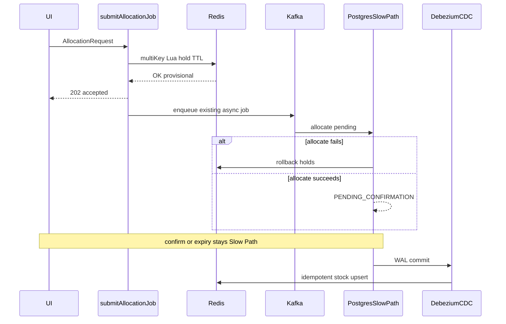

<!-- c8ca779b-eedb-474e-8924-32181ad955e4 -->
---
todos:
  - id: "phase-0-memory"
    content: "Convert skill decisions into scenario, specification, issue, architecture, active-context; slim skill to pointer"
    status: pending
  - id: "phase-1-redis-prewarm"
    content: "Add Redis infra, key ports, bulk pre-warm gate, full re-warm pause semantics"
    status: pending
  - id: "phase-2-submit-fast-path"
    content: "Wire submitAllocationJob: multi-key Lua provisional hold then executeAsync; no Postgres on request path"
    status: pending
  - id: "phase-3-handoff-cleanup"
    content: "Slow Path allocate success/failure settles or rolls back Redis holds; TTL expiry restores stock"
    status: pending
  - id: "phase-4-cdc"
    content: "Debezium → Kafka → idempotent Redis stock sink"
    status: pending
  - id: "phase-5-tests"
    content: "Unit/integration coverage for hold, rollback, pre-warm aggregation, Fast Path accept path"
    status: pending
isProject: false
---
# Redis Fast Path Implementation Plan

Source of agreed decisions: [`.cursor/skills/redis-fast-path/SKILL.md`](.cursor/skills/redis-fast-path/SKILL.md). That file has become a design dump; this plan turns it into repository handoff + phased delivery.

## Phase 0 — Memory handoff (before code)

Follow [AGENTS.md](AGENTS.md):

- Add scenario for provisional Fast Path accept on `POST /api/allocation/jobs` (extend Scenario 2 / new scenario).
- Add `## Feature: Redis Fast Path provisional allocation accept` in [`../../docs/specifications.md`](../../docs/specifications.md) with FR/NFR from the skill.
- Create [`.github/memory/issues/feature-redis-fast-path.md`](.github/memory/issues/feature-redis-fast-path.md) as the implementation handoff (decisions, key model, cleanup matrix, deferred items).
- Update [`../../docs/architecture.md`](../../docs/architecture.md) dual-path persistence boundaries.
- Update [`.github/memory/active-context.md`](.github/memory/active-context.md).
- Slim [`.cursor/skills/redis-fast-path/SKILL.md`](.cursor/skills/redis-fast-path/SKILL.md) to a short pointer at the issue (trigger terms + “read the issue”).

## Phase 1 — Redis platform + pre-warm

- Add Redis to `stockio-service` (Spring Data Redis / Lettuce), local compose, and config.
- Port for Fast Path stock/holds (`stock:sku:{sku}:{warehouseCode}`, `reservation:{requestId}:{orderId}:{orderLineId}`, `expiry:res:...`).
- Startup **bulk pre-warm**: `SUM(quantity_available)` from Postgres `stock` grouped by `(sku, warehouse_code)` into Redis; do not open Fast Path traffic until warm.
- Divergence repair: full re-warm with Fast Path accepts paused/failing during rebuild.

## Phase 2 — Fast Path on `submitAllocationJob`

Touch points:

- [`AllocationController.submitAllocationJob`](stockio-service/src/main/kotlin/nl/stockio/allocation/domain/api/AllocationController.kt)
- [`AllocationJobExecutor.executeAsync`](stockio-service/src/main/kotlin/nl/stockio/allocation/domain/job/AllocationJobExecutor.kt)

Behavior when Fast Path enabled:

1. Validate request limits as today (in-memory; no durable write).
2. Run **one multi-key Lua** across all demand lines (warehouse default **`MAIN`**): check stock, decrement, write reservation hash + TTL expiry key; all-or-nothing.
3. On Lua success: enqueue existing Kafka async Slow Path (`executeAsync`); return `202` + job ids.
4. **No Postgres** on the request path. Current `async=false` / `executeSync` on the HTTP thread is incompatible — Fast Path mode always provisional + async enqueue (sync inline allocation disabled or rejected while Fast Path is on).

Out of scope for this cut: `/api/products/allocate`, MCP, listeners.

## Phase 3 — Slow Path handoff + hold cleanup

Keep existing ACID allocate / confirm / reservation expiry / ledger sync.

- After durable ALLOCATE success: provisional Redis holds are superseded (delete or mark settled); CDC later converges stock.
- On ALLOCATE failure: **explicit Redis hold rollback** (restore stock + delete reservation/expiry keys).
- Cleanup ownership stays as decided:

| Artifact | Owner |
| --- | --- |
| Redis provisional hold | TTL / keyspace expiry listener |
| Postgres pending order | existing reservation expiry job |
| Confirm / cancel | request-path Slow Path APIs |
| CDC | reflect only; never owns cleanup |

Confirm still does **not** commit the stock ledger (Scenario 6 unchanged).

## Phase 4 — WAL → Redis CDC

- Debezium on Postgres logical decoding → Kafka topics partitioned by SKU → consumer/sink applying idempotent updates to `stock:sku:{sku}:{warehouseCode}`.
- Reuse existing Kafka ops plane (KRaft). At-least-once + idempotent apply required.

## Phase 5 — Tests and verification

- Unit tests for Lua hold/rollback and key encoding (`requestId` / `orderId` / `orderLineId`).
- Integration: Fast Path accept does not touch Postgres; Slow Path failure restores Redis; pre-warm aggregates lots correctly.
- Latency smoke for provisional accept target (&lt;5 ms local best-effort; document environment caveats).
- No client oversell UX in this feature (API failure/rollback only).

## Explicitly deferred

- Admission / SKU-lock / ledger-sync redesign
- Client oversell UX (separate skill later)
- Warehouse on `DemandOrderLine` (default `MAIN` only)
- Other Fast Path entry points

## Default sequencing after approval

Docs (Phase 0) → Redis + pre-warm (1) → `submitAllocationJob` Lua + async enqueue (2) → Slow Path rollback/settle (3) → Debezium CDC (4) → tests hardening (5).
