# Stockio Software Architecture

## Stack
- **Backend:** Spring Boot (Kotlin)
- **Frontend:** React, NextJs
- **Database:** PostgreSQL (Spring Data JPA, Flyway, pgvector)
- **Testing:** JUnit Jupiter, Testcontainers, Mockk, Kotest, Playwright
- **Build:** Gradle

## Overview

Stockio is a Kotlin/Spring application for allocating demand against live inventory and expected inbound supply.
It persists allocation results and reservations in PostgreSQL, maintains daily aggregate and lot-level stock projections,
synchronizes today's projection to live stock, and generates Excel reports.
The same core services are exposed through Spring AI MCP tools and a local HTTP API.

- PostgreSQL is the system of record.
- Flyway manages the schema;
- JPA repositories handle operational data and projection locking, while `StockSnapshotRepository` uses `JdbcTemplate`
to read and replace snapshots in the same transaction. Snapshots are not JPA-managed entities, so repeated rebuilds do not require clearing the persistence context.
- Daily snapshots are derived projections from live stock and persisted reservations, not an independent source of inventory truth.

### Design Patterns

- **Hexagonal Architecture (Api, Ports, Infra):** Clear separation of concerns between the HTTP layer, business logic, and persistence.
- **Dependency Injection:** Spring's @Service, @Repository, and constructor injection for loose coupling and testability.
- **DTOs (Data Transfer Objects):** Used for request and response payloads to decouple API and domain models.
- **Singleton:** Spring beans are singletons by default, ensuring one instance per application context.
- **Ports and adapters:** Allocation, reservation cleanup, and stock processors depend on repository ports implemented by Spring Data JPA and JDBC adapters. The separation is partial: some services still inject concrete infrastructure classes, JobRunr APIs, and HTTP clients directly.
- **Configuration/Properties:** Externalized configuration using YAML and @ConfigurationProperties for environment flexibility.

## Modules and technology

The Gradle build includes three modules:

| Module | Purpose |
| --- | --- |
| `:stockio-service` (`stockio-service/`) | Spring Boot application, MCP tools, REST API, allocation workflows, persistence, CSV import, and Excel generation. |
| `:stockio-api` (`stockio-api/`) | Shared Kotlin DTO library and OpenAPI specifications/generation tasks consumed by the service; also contains the independently run Next.js UI. It has no Spring application entry point. |
| `:stockio-test-harness` (`stockio-test-harness/`) | Test-only tooling: mock-backed Playwright tests in `e2e/`, future performance guidance in `performance/`, and an independently run JDBC/RabbitMQ sample publisher with tests in `publisher/`. Depends on API DTOs, not the service. |

The build uses Java 21, Kotlin 2.2.20, Spring Boot 3.5.10, and Spring AI 1.1.2. The service uses Spring MVC, Spring Data JPA, PostgreSQL with pgvector, Flyway, RabbitMQ, Kafka publishing for asynchronous allocation submissions, opt-in Spring Kafka allocation consumption, JobRunr for consumer recovery and other scheduled work, Apache POI, HikariCP, and Spring Boot Actuator. Natural-language product allocation also uses the Tavily search API and Ollama embeddings. Allocation work is parallelized across SKUs with Kotlin coroutines.

## System context

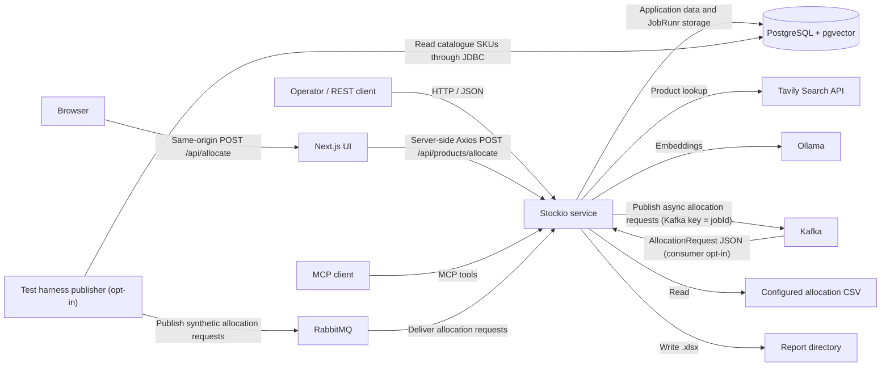

The service runs as a servlet application and exposes MCP tools through Spring AI. The HTTP server binds to `127.0.0.1:9090` by default. No application-level authentication is configured; protect the API and Actuator endpoints if `SERVER_ADDRESS` is changed to expose them beyond the local host.

### Frontend HTTP integration

The Next.js allocation UI under `stockio-api/src/main/kotlin/nl/stockio/ui`
posts to its same-origin `/api/allocate` route. The route uses the server-side
Axios client in `lib/product-allocation-client.ts` to call
`POST /api/products/allocate` at `STOCKIO_API_URL` (default
`http://127.0.0.1:9090`). The service controller directly invokes
`ProductAllocationService.allocate(request)` and returns plain JSON.

Next.js and the service start independently, using npm scripts and
IDE/`:stockio-service:bootRun` respectively. There is no Spring frontend backend,
child JVM, fat-JAR startup dependency, bundled UI/service JAR, or browser CORS
requirement. `stockio-api` builds a normal Kotlin DTO JAR, retains OpenAPI
generation tasks, and is a compile/runtime library dependency of the service;
`stockio-service` and the separate test-harness publisher apply the Spring Boot
application plugin; the API library does not.
The Spring Boot BOM's Kotlin version is explicitly aligned with the Kotlin
plugin so its compiler/build-tools dependencies are not downgraded in the
non-Boot library module.

The route preserves upstream HTTP status/body, disables redirects and caching,
and bounds upstream requests to 180 seconds. Network failures and timeouts
return `502` and `504`; neither proves the service stopped processing.
The UI validates plain REST results, displays domain non-allocation outcomes
without claiming success, and reuses request identity on unchanged manual
retries. No automatic POST retries occur.
`ProductAllocationTools` and `allocate_product_by_name` are removed; unrelated
service MCP tools remain registered.

See the [feature specification](./specifications.md#feature-replace-the-frontend-mcp-bridge-with-an-axios-service-client),
[Scenario 12](./scenarios.md#scenario-12-allocate-a-product-from-the-frontend-through-direct-service-http),
and [issue handoff](./issues/feature-frontend-axios-service-client.md).

### Test harness boundary

`stockio-test-harness` owns browser tests and the synthetic publisher rather
than shipping them as UI or service runtime code. Its npm package owns
Playwright configuration/dependencies and starts the existing UI against a
dedicated localhost mock. Its non-web Spring Boot publisher reads only SKUs
from the service-owned `products` table through a read-only harness datasource,
uses shared `stockio-api` DTOs and compatible JSON, and requires explicit
enablement. It does not import service repositories, entities, or application
services, migrate databases, or declare consumer topology. `performance/`
contains guidance only; no performance runner is implemented.

See [Scenario 13](./scenarios.md#scenario-13-run-tests-and-synthetic-traffic-from-a-separate-harness),
the [feature specification](./specifications.md#feature-isolate-browser-tests-and-synthetic-publishing-in-a-test-harness),
and [harness commands/configuration](../../stockio-test-harness/README.md).

## C4 - level 3 component diagram

This C4 level-3 view opens the `stockio-service` container into its application
components and separates the hexagonal boundaries:

- **Inbound adapters** translate HTTP, MCP, messaging, and scheduled triggers.
- **Application services** orchestrate use cases and transaction boundaries.
- **Domain services and policies** contain allocation and projection rules.
- **Outbound ports** define persistence and external-service contracts.
- **Outbound adapters** implement those ports using JPA, JDBC, HTTP, RabbitMQ,
  Kafka, JobRunr, and the filesystem.

The diagram groups logical responsibilities; it is not a claim that every
integration has an explicit port interface. In particular, JobRunr, search
clients, and filesystem operations still have direct application dependencies.
Repository ports also expose infrastructure entity types. JobRunr is embedded
infrastructure; PostgreSQL stores both operational data and JobRunr data.

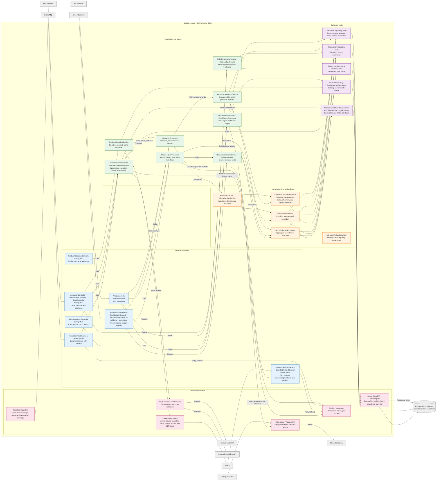

## Fast path and slow path

PostgreSQL remains the durable stock ledger. When `stockio.local.enabled` is
true, `POST /api/allocation/jobs` (async only) places a provisional hold in
Redis before Kafka enqueue. The request path does not write stock or allocation
rows. Slow-path workers still allocate in PostgreSQL. Committed stock changes
flow back through Debezium (`stockio.cdc.public.stock`) and replace Redis
availability with the summed `quantity_available` for each SKU and warehouse.
See [Redis Fast Path](./issues/feature-redis-fast-path.md).

The following runtime collaboration view keeps the more detailed submission and job
relationships. It is complementary to the hexagonal dependency view above:

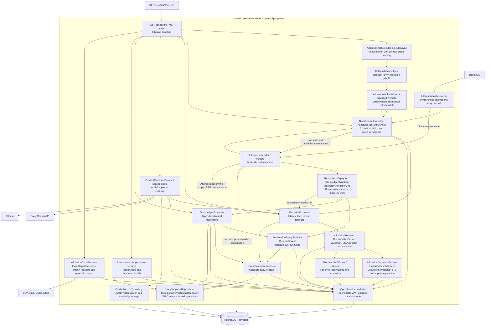

The optional demo publisher is a separate `stockio-test-harness` process, not
part of the service; its behavior is described in the
[RabbitMQ flow](#rabbitmq-intake-and-retry-flow).
These components run within one Spring Boot application, not as separately
deployed services.

### Component responsibilities (hexagonal mapping)

#### Allocation

| Component | Responsibility |
| --- | --- |
| `AllocationTools` | MCP adapter for new-demand allocation and projection, backorder fulfillment, stock-ledger synchronization, and Excel report generation. |
| `AllocationController` | Validates today's business date, submits allocation/projection work directly to JobRunr by default, and exposes job status plus reservation/freshness read aliases. Also supports `async=false` with the limitation described below. |
| `AllocationAdminController` | Creates allocation requests from CSV, generates reports, and removes jobs with excessive retries. |
| `AllocationService` | Validates, groups work by SKU, coordinates SKU workers, and completes allocation runs. |
| `AllocationRunService` | Owns allocation-run identity, request-hash validation, completion, and persisted historical results. |
| `AllocationProcessor` | Runs allocation or backorder fulfillment, then refreshes projections after the SKU transactions commit. Never synchronizes the ledger. |
| `AllocationDocumentService` | Registers immutable order/shipment headers and lines before SKU work and assigns one reservation deadline per order. |
| `AllocationSkuWorker` | Performs one SKU's transactional allocation or backorder fulfillment, reserves stock/supply, and persists resumable operation results. |
| `AllocationPolicyCalculator` | Applies order priority, FIFO source selection, delivery-date eligibility, and backorder rules. |
| `AllocationJobExecutor` | Directly enqueues HTTP requests, executes allocation/projection, and persists or reuses `{jobId, allocationRun}` completion JSON. |
| `AllocationJobRunrService` | Reads JobRunr status and saved completion, and performs administrative job-record cleanup. |
| `BackorderAllocationJob` / `BackorderAllocationService` | Process receipt-triggered or manual fulfillment commands without creating new demand. |
| `AllocationExcelService` | Parses the configured CSV and creates a validated allocation request. |
| `ExcelReportProcessor` | Writes allocation details, sources, pivot tables, and formula summaries to an `.xlsx` workbook. |
| Allocation repository ports and JPA adapters | Persist allocation runs, records, sources, claims, and backorders. |

#### Product

| Component | Responsibility |
| --- | --- |
| `ProductAllocationController` / `ProductAllocationService` | REST-only product resolution through local catalog/vector matching with Tavily fallback, then delegation to `AllocationProcessor`. |
| Tavily / Ollama clients | Perform external product search and local embedding requests with configured timeouts. |
| `ProductRepository` / `ProductVectorRepository` | Persist catalog data and embeddings, and perform catalog and pgvector similarity searches. |

#### Reservation

| Component | Responsibility |
| --- | --- |
| `ReservationController` | Exposes dedicated reservation-lifecycle reads. |
| `ReservationExpiryJob` / expiry services | Release overdue pending orders in transactional batches and rebuild projections. |
| `OrderReservationService` | Reads current reservation lifecycle without changing stock. |
| Reservation repository ports and JPA adapters | Persist shipments, supply, and reservations. |

#### Stock

| Component | Responsibility |
| --- | --- |
| `StockController` | Exposes ledger-freshness reads. |
| `StockProjectionProcessor` | Rebuilds aggregate and lot-level daily projections from the live stock baseline and persisted reservations. |
| `StockLedgerProcessor` / `StockLedgerSkuWorker` | Coordinate durable current-day manifests and atomically rebuild/apply/checkpoint one SKU at a time. |
| `StockLedgerSyncJob` | Independently schedules ledger synchronization twice daily by default. |
| `StockLedgerService` | Reads ledger freshness without changing stock. |
| `StockReceiptFollowupDispatcher` | Dispatches transactionally persisted receipt follow-up immediately after full sync and through a retryable recurring job. |
| `StockSnapshotRepository` | Reads and replaces derived snapshots through JDBC in the caller's transaction. |
| Stock repository ports and JPA/JDBC adapters | Persist live stock, scoped snapshots, ledger manifests/checkpoints, receipt follow-up, and synchronization status. |

The repository interfaces in `allocation/domain/port`, `reservation/domain/port`,
`stock/domain/port`, and `product/domain/port` are the outbound ports shown in the diagram. Their
implementations in `allocation/infra`, `reservation/infra`, `product/infra`, and
`stock/infra` are outbound adapters; JPA repositories and `JdbcTemplate` provide
the persistence mechanisms for those adapters. Some current port signatures still expose
infra entity types; replacing those with domain persistence models would make the
hexagonal boundary stricter without changing the use-case components.

## Interfaces

### MCP tools

| Tool | Input | Behavior |
| --- | --- | --- |
| `allocation_and_stock_projection` | `AllocationRequest` with `runType: NEW_DEMAND` | Allocates demand, persists reservations/backorders, and rebuilds daily projections. It does not synchronize live stock. |
| `allocate_open_backorders` | `AllocationRequest` with `runType: BACKORDER_FULFILLMENT` | Attempts to fulfill persisted backorders using eligible stock and inbound supply, rebuilds projections, and returns an `AllocationRunResult`. Does not synchronize live stock. |
| `process_stock_ledger` | `ProcessDailyStockRequest` | Expires overdue reservations, rebuilds today's projection, and applies it to live stock. Only confirmed orders are delivered; allocation is not recalculated. |
| `get_order_reservation_status` | Order ID | Returns the current lifecycle, deadline, and whether expired reservations still await cleanup. |
| `generate_excel_report` | `ExcelReportRequest` (`runId`, simple `.xlsx` `fileName`) | Generates a report for a saved allocation run and returns the output path. |

### REST endpoints

| Method and path | Behavior |
| --- | --- |
| `POST /api/products/allocate` | Synchronously performs the agentic product lookup and allocation for a `ProductAllocationRequest`; returns the product-resolution status and allocation result. |
| `POST /api/allocation/jobs` | Validates today's business-date `asOfDate`; by default (`async=true`) publishes raw `AllocationRequest` JSON to Kafka keyed by a unique `jobId`, then returns `202 Accepted`, `{jobId, requestId}`, and `Location: /api/allocation/jobs/{jobId}` after broker acknowledgement. Does not synchronize stock. |
| `GET /api/allocation/jobs/{jobId}` | Returns JobRunr state or durable Kafka submission/execution state and, when succeeded, `result: {jobId, allocationRun}` without a completion version or stock-sync result. An unknown job returns `404`. |
| `GET /api/stock/ledger/status` | Returns the last committed ledger success, snapshot date/counts, next expected execution, stale deadline, and freshness status. |
| `GET /api/reservations/orders/{orderId}/status` | Returns current reservation lifecycle and deadline, or `404` for an unknown order. |
| `GET /api/allocation/stock-ledger/status` | Additional ledger-freshness read mapping on `AllocationController`. |
| `GET /api/allocation/order-reservation/{orderId}/status` | Additional reservation-lifecycle read mapping on `AllocationController`. |
| `GET /api/admin/allocations/generate-request-by-csv` | Parses the configured CSV and returns a generated `AllocationRequest`; it does not execute it. |
| `POST /api/admin/allocations/generate-excel` | Generates an Excel report from a saved run. |
| `DELETE /api/admin/allocations/delete-jobs-with-excessive-retries` | Removes qualifying JobRunr jobs with excessive retry transitions. |
| `GET /actuator/health` | Spring Boot health endpoint. |
| `GET /actuator/metrics/{metricName}` | Reads an exposed Micrometer metric. |

Execution and failure behavior for these interfaces are described in
[Supported flows](#supported-flows).

`POST /api/allocation/jobs?async=false` executes inline but still returns `202`.
Its current response uses the allocation `runId` as `jobId`, although completion
is stored under a separate generated execution ID and no JobRunr job is created.
The returned status URL is therefore not a working JobRunr polling contract for
this branch. This is an implementation limitation, not an alternate durable
submission flow. The old `/api/logistics/...` and `/api/allocation-jobs` mappings
are not declared.

### Allocation request shape

An `AllocationRequest` contains:

- `requestId`: UUID used for idempotency.
- `asOfDate`: date used for the allocation and projection.
- `runType`: `NEW_DEMAND` or `BACKORDER_FULFILLMENT`.
- `demandOrders`: order headers with order ID, customer, priority, placed date, and a nonempty `lines` list. Each line has a globally unique `orderLineId`, SKU, requested quantity, and required delivery date.
- `inboundShipments`: shipment headers with shipment ID and a nonempty `lines` list. Each line has a globally unique `shipmentLineId`, SKU, expected quantity, expected arrival date, and warehouse code.

The server validates required fields, positive quantities and priorities, date order, and unique IDs within a request. A new-demand request cannot reuse order IDs already processed as new demand; unresolved quantities belong to the backorder-fulfillment workflow.

An order or shipment may contain repeated SKUs, including separate lines with identical dates. Reservation/backorder identity is the line ID, not the header ID or SKU. Allocation results remain flat but include both `orderId` and `orderLineId`; inbound sources include shipment header and line IDs. `openBackorderCount` counts distinct open orders, not lines.

## Supported flows

The scenarios in [`scenarios.md`](./scenarios.md) define the supported
observable user and operational behavior. This table aligns each scenario with
the architecture detail below; the diagrams show runtime collaboration, with
PostgreSQL arrows abbreviating repository calls. Transaction and lock boundaries
are called out where they affect correctness. Allocation holds supply, projection
forecasts movements, and ledger synchronization applies due physical movements:
these are separate operations.

| Scenario | Scenario definition | Architecture detail |
| --- | --- | --- |
| 1. Allocate a Product by Name | [Scenario 1](./scenarios.md#scenario-1-allocate-a-product-by-name) | [Product resolution and allocation](#product-resolution-and-allocation-flow), [allocation](#allocation-flow), and [stock projection](#stock-projection-flow). |
| 2. Allocate Structured New Demand | [Scenario 2](./scenarios.md#scenario-2-allocate-structured-new-demand) | [REST allocation submission and completion](#rest-allocation-submission-and-completion-flow), [allocation](#allocation-flow), and [stock projection](#stock-projection-flow). |
| 3. Monitor an Allocation Job | [Scenario 3](./scenarios.md#scenario-3-monitor-an-allocation-job) | [REST allocation submission and completion](#rest-allocation-submission-and-completion-flow). |
| 4. Fulfill Open Backorders | [Scenario 4](./scenarios.md#scenario-4-fulfill-open-backorders) | [Backorder fulfillment](#backorder-fulfillment-flow) and the [receipt-triggered handoff](#ledger-synchronization-flow). |
| 5. Inspect an Order Reservation | [Scenario 5](./scenarios.md#scenario-5-inspect-an-order-reservation) | [Status and freshness reads](#status-and-freshness-read-flow); [reservation expiry](#reservation-expiry-flow) is supporting lifecycle maintenance. |
| 6. Synchronize the Physical Stock Ledger | [Scenario 6](./scenarios.md#scenario-6-synchronize-the-physical-stock-ledger) | [Ledger synchronization](#ledger-synchronization-flow), [stock projection](#stock-projection-flow), and [reservation expiry](#reservation-expiry-flow). |
| 7. Monitor Stock-Ledger Freshness | [Scenario 7](./scenarios.md#scenario-7-monitor-stock-ledger-freshness) | [Status and freshness reads](#status-and-freshness-read-flow). |
| 8. Load an Allocation Request from CSV | [Scenario 8](./scenarios.md#scenario-8-load-an-allocation-request-from-csv) | [CSV import](#csv-import-flow). |
| 9. Generate an Excel Allocation Report | [Scenario 9](./scenarios.md#scenario-9-generate-an-excel-allocation-report) | [Excel report](#excel-report-flow). |
| 10. Remove Jobs with Excessive Retries | [Scenario 10](./scenarios.md#scenario-10-remove-jobs-with-excessive-retries) | [Job-record cleanup](#job-record-cleanup-flow). |

#### Supporting implementation flows

These technical flows explain mechanisms that support the scenarios but are not
separate scenario definitions:

| Flow | Role | Related scenarios |
| --- | --- | --- |
| [RabbitMQ intake and retry](#rabbitmq-intake-and-retry-flow) | Queue delivery, synchronous allocation attempt, JobRunr fallback, or dead-letter rejection. | 2 |
| [Kafka allocation intake](#kafka-allocation-intake-and-retry-flow) | Opt-in Kafka delivery through a bounded channel and fixed workers, with synchronous offset completion and recovery. | 18 |
| [Reservation expiry](#reservation-expiry-flow) | Recurring release of overdue holds and forecast refresh. | 5 and 6 |
| [Stock projection](#stock-projection-flow) | Rebuilds aggregate and lot-level forecasts without applying physical movements. | 1, 2, 4, and 6 |

Order confirmation and explicit warehouse receipt/dispatch confirmation are not
implemented flows. Receipt-triggered backorder fulfillment is implemented, but
its post-commit enqueue is not durably coupled to the receipt transaction.

### Allocation flow

`AllocationProcessor` is the common entry point for allocation jobs, MCP
tools, and product allocation. It runs `NEW_DEMAND` allocation, waits for the SKU
workers to finish, and then refreshes projections. It never invokes the ledger.

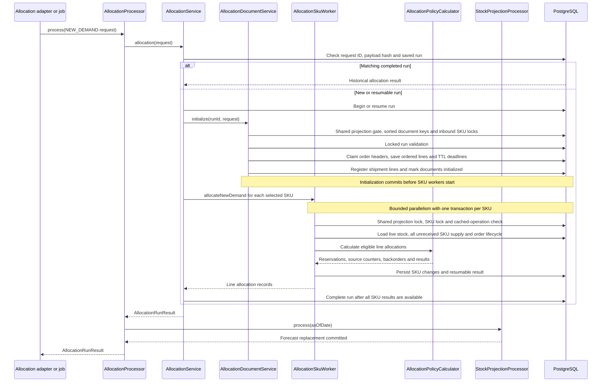

Document registration assigns one order-header deadline shared by all its lines,
including time spent waiting for SKU processing. Already initialized documents
are not registered again, so retries do not renew TTL or reapply supply amendments.
An expired header cannot acquire new reservations; late workers persist
`SKIPPED_ORDER_EXPIRED` with null allocation status and no active demand.

Independent registrations can overlap. Conflicting header/line identities
serialize through namespaced `allocation_document_lock` rows, including before
the business identities exist. Inbound amendments additionally hold the same
SKU locks as allocation and pessimistically lock existing supply before
validating reserved/received quantities. Existing identity constraints remain
in force; retries do not reparent lines or change shipment membership.

The allocation rules are:

1. Orders are processed by ascending numeric priority, then placed date, then original request order.
2. For each SKU, persisted stock lots are considered FIFO by received date, lot ID, and warehouse code.
3. Available live stock is `quantity_on_hand - quantity_reserved`.
4. Remaining demand may use inbound lines ordered by expected arrival date, shipment ID, and shipment line ID, if arrival is no later than the demand line's required delivery date.
5. Available unreceived supply is `expected_quantity - quantity_reserved`. Backorder fulfillment additionally considers only supply that has arrived by `asOfDate`.
6. Unfilled quantity is saved as an open backorder. Only confirmed backorders contribute to projected shortage; shortages do not reduce physical stock.
7. New orders create unconfirmed temporary reservations. Only confirmed reservations leave projected physical stock on their effective delivery date.

Allocations retain source-level detail identifying the stock lot or inbound shipment. A new shipment is classified as inbound supply in the run that allocates it; its unreserved surplus becomes live stock when received and can be allocated as inventory by a later request.

Supply loading includes persisted unreceived shipment lines from earlier runs,
not only the shipments in the current request. Requests can therefore allocate
against previously registered supply.

No outer transaction spans the SKU workers. If one SKU fails, other committed
SKU results remain resumable; the order is not allocated all-or-nothing. If the
forecast fails after allocation commits, processing fails visibly and retry
reuses the allocation run before retrying projection. Projection invariant
failures are distinguished from invalid request input for RabbitMQ retry handling.

### Backorder fulfillment flow

The MCP `allocate_open_backorders` tool maps a `BACKORDER_FULFILLMENT` request to
`BackorderAllocationRequest` with trigger `MANUAL`. After a ledger receipt
commits, `BackorderAllocationJob` passes a command with trigger
`STOCK_LEDGER_RECEIPT` and affected `skuScope` through the same processor and
`BackorderAllocationService`. Neither path creates replacement order headers or
new TTL deadlines.

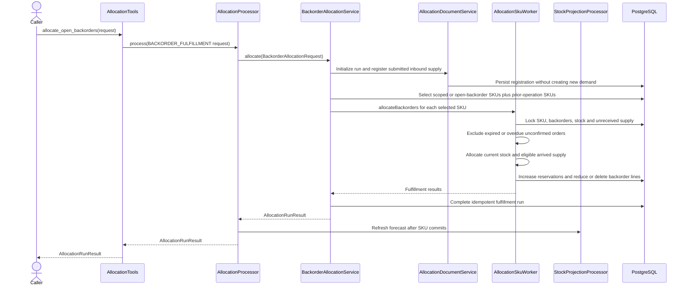

Backorders are processed by priority/FIFO, with document-line sequence preserving
separate repeated-SKU lines. Inbound supply must have arrived by `asOfDate` and
no later than the original required delivery date. Fulfillment keeps the
original order deadline, may be partial, and does not synchronize physical stock.
Repeated requests reuse saved run/SKU results rather than reserve twice.
The current fingerprint hashes an internal `AllocationRequest`, excluding the
command's `skuScope` and `trigger`; this is not full command-field validation.

### Product resolution and allocation flow

`POST /api/products/allocate` calls `ProductAllocationService` synchronously.
The frontend or another REST client supplies a structured
`ProductAllocationRequest`; the service does not invent order identity,
quantities, or dates.

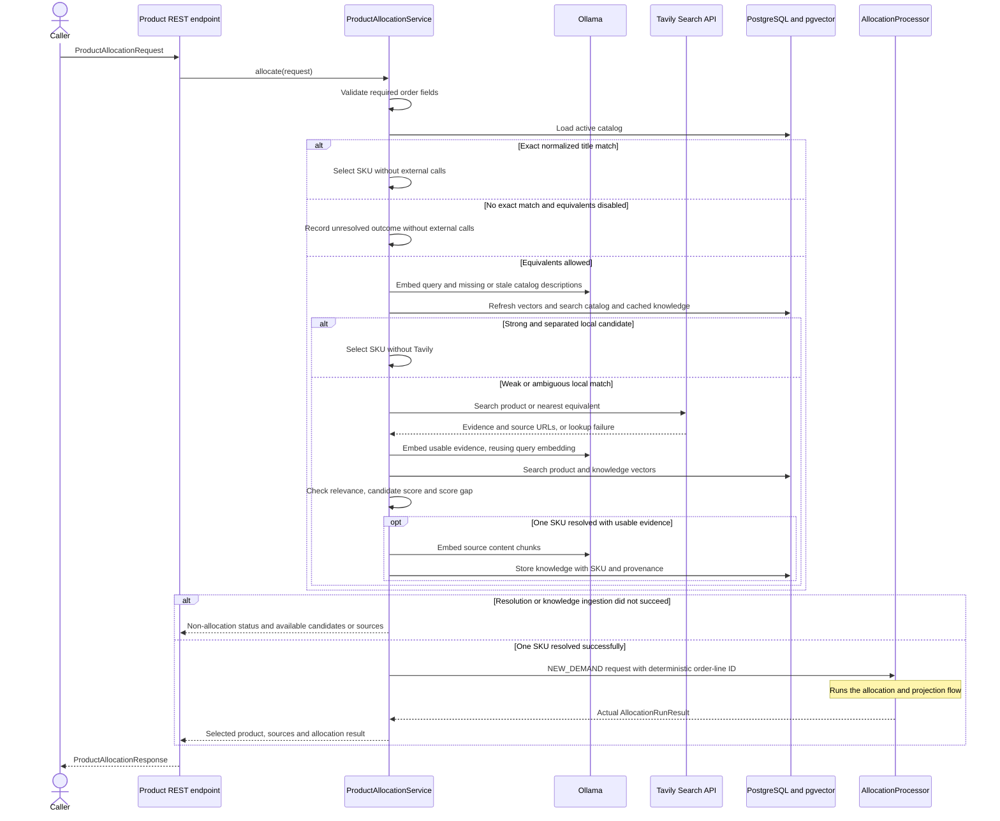

The request includes `productQuery`, `quantity`, `allowEquivalent`, `requestId`,
`orderId`, `customer`, `priority`, `placedDate`, `requiredDeliveryDate`, and
`asOfDate`. For example, "Hold 50 units of Maki Komkommer, or the nearest
equivalent" uses that phrase with `quantity: 50` and `allowEquivalent: true`.

Resolution is local-first. Exact normalized active-title matches skip Ollama and
Tavily. Otherwise, a local candidate scoring at least `0.90`, with a lead of at
least `0.08`, skips Tavily. Weak/ambiguous local results fall back to Tavily;
evidence must meet cosine relevance `0.25`, the candidate must score at least
`0.72`, and its lead must be at least `0.04`. These configurable defaults need
evaluation against representative queries.

Unresolved/ambiguous products and Tavily/Ollama or knowledge-ingestion failures
return explicit non-allocation outcomes. Local-only matches have no external
sources. Once resolved, normal partial-allocation and backorder rules apply:
the response never claims more quantity than the allocation actually reserved.
Invalid input returns HTTP `400`; allocation/projection failures remain processing
errors, not product-resolution success. No ledger synchronization occurs.

### Reservation expiry flow

Expiry is an independent recurring operation, not a consequence of receiving
another allocation request. Its batch boundary is an entire order header and
all that order's lines.

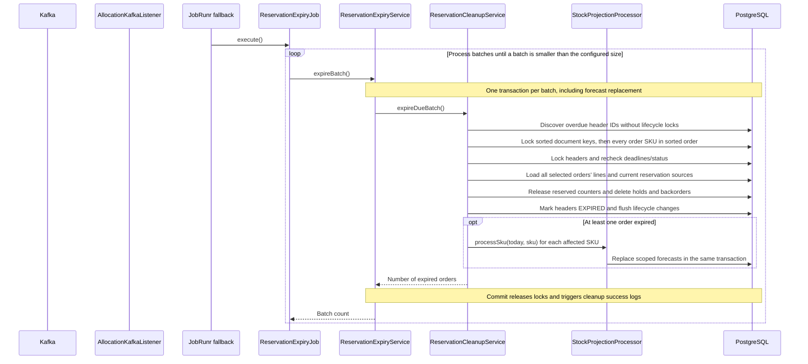

New order headers are `PENDING_CONFIRMATION`. Their shared UTC deadline defaults
to 30 minutes after document initialization, independent of delivery dates. The
sweep defaults to every minute, with batches of 100 orders. Configure positive
values through `ALLOCATION_RESERVATION_TTL`,
`ALLOCATION_RESERVATION_EXPIRY_INTERVAL`, and
`ALLOCATION_RESERVATION_EXPIRY_BATCH_SIZE`.

An order is logically expired at its deadline, although background cleanup can
lag. Overdue headers cannot receive more allocations while waiting, and retries
cannot renew deadlines or recreate released holds. Expired order IDs cannot be
reused. See the [status flow](#status-and-freshness-read-flow) for the distinction
between logical expiry and completed cleanup.

Cleanup releases counters on the reservation's current source. If receipt
converted an inbound hold to a stock hold, cleanup releases the stock lot rather
than received inbound supply. Neither physical stock quantities nor expected
inbound quantities change.

There is currently no confirmation command, so new holds eventually expire.
Pre-feature claims preserved by V14 are `CONFIRMED` without TTL. See
[the expiry feature design](issues/feature_expire_allocation_reservations.md)
for lifecycle invariants and acceptance scenarios.

Missing reservation sources or insufficient reserved counters fail cleanup and
roll back the batch; cleanup does not silently discard inconsistencies.

### REST allocation submission and completion flow

The asynchronous REST interface acknowledges submission before allocation
finishes. Its job ID identifies background execution; the request's `requestId`
separately identifies the idempotent allocation run.

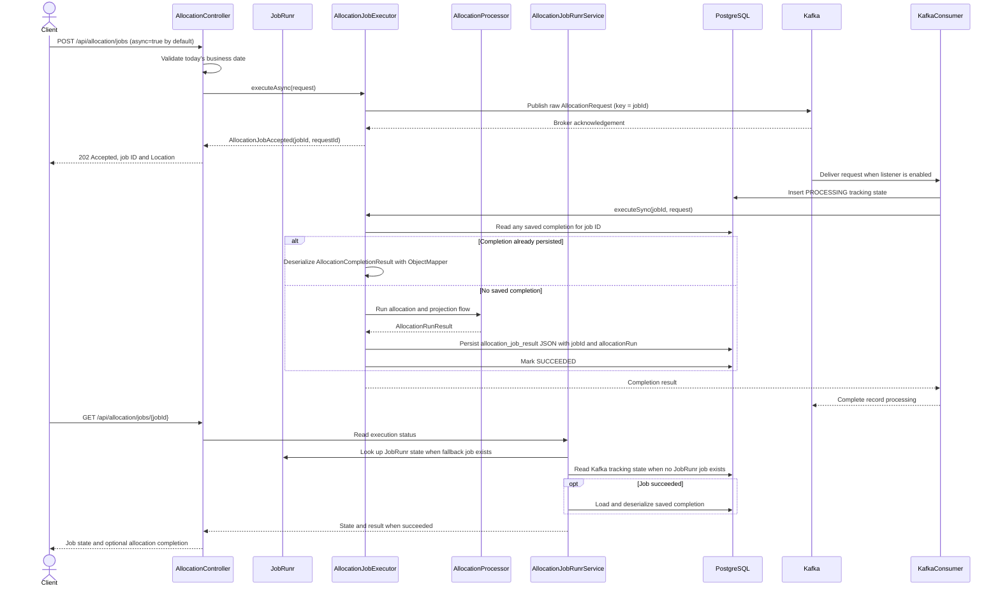

JobRunr retries failures up to three times. A saved completion is returned
without allocating/projecting again. If projection failed before completion was
saved, retry resumes the allocation run and refreshes the forecast without
reserving twice, as described in the [allocation flow](#allocation-flow).

A `SUCCEEDED` job without a saved completion is an explicit consistency error,
not an empty successful response. Completed JSON and run results describe what
was allocated at execution time; they do not prove those holds are still active.

HTTP submission has no Spring event or after-commit listener and no surrounding
application transaction. Kafka publish errors propagate instead of returning
`202`. The accept path does not write job tracking. If the broker accepts a
record but the HTTP response is lost, the caller has an unknown outcome;
resubmitting the same logical request may create another execution job, while
allocation-run idempotency prevents extra reservations. Status for a Kafka job
appears after the listener inserts `PROCESSING`. This direct handoff is distinct
from the ledger's post-commit scheduling gap.

### RabbitMQ intake and retry flow

Rabbit intake does not initially queue a JobRunr job. The listener attempts the
same `AllocationJobExecutor.executeSync` synchronously, using `requestId` as the job ID.

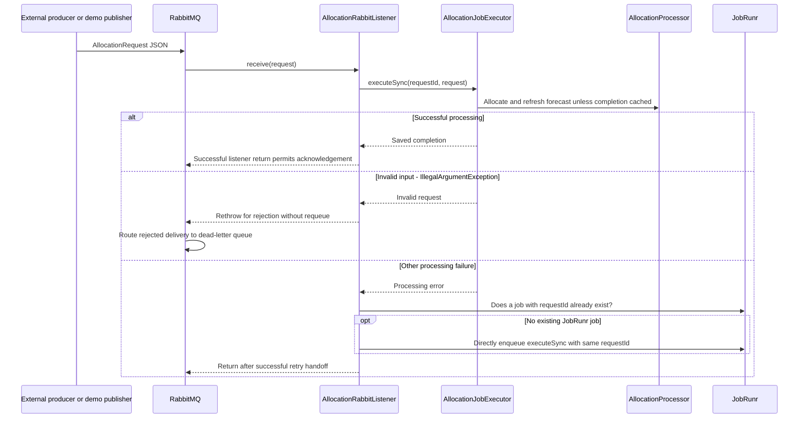

Invalid requests are not retried by JobRunr. Other failures hand off only when a
job with that ID does not already exist; the existence check skips already
recorded jobs but is not itself an atomic business deduplication guarantee.

### Kafka allocation intake and retry flow

The opt-in Kafka listener accepts the existing `AllocationRequest` JSON
contract. The synchronous listener waits for a bounded Kotlin channel worker
that invokes the same execution path as RabbitMQ. Channel enqueue is volatile
and does not permit offset progress; the listener returns only after allocation
or a successful JobRunr recovery handoff. This preserves partition order while
consumer concurrency allows work from separate partitions to overlap. The
shared allocation semaphore remains the execution bulkhead.

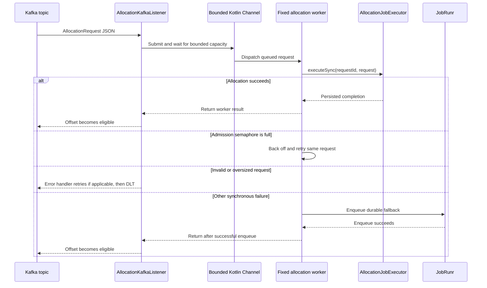

Kafka remains disabled by default and coexists with RabbitMQ. Both brokers can
deliver the same logical request; the stable request ID supports replay, but
the completion lookup does not guarantee single-flight execution for
simultaneous cross-broker duplicates. Local channel buffering does not add
durable admission or processing capacity.
The request queue has a dead-letter exchange/queue, with rejected messages not
requeued by default. A failure while arranging fallback still propagates rather
than masquerading as completed allocation.

The current fallback lambda still contains logging in addition to the executor
call. Unlike the corrected HTTP enqueue lambda, this has not been verified
against JobRunr's actual lambda parser by the mocked listener tests and can fail
during enqueue. A single executor invocation is the supported scheduling shape;
successful unit tests alone do not prove durable fallback acceptance.

The optional harness `AllocationRequestPublisher` emits sample requests at a
fixed interval only when explicitly enabled. Its own `application.yml` defaults
`ALLOCATION_RABBITMQ_PUBLISHER_ENABLED` to `false` and the interval to one second.
`make run-publisher` explicitly enables it. Service startup no longer generates
synthetic traffic. Catalogue SKUs are read through a harness-only JDBC
connection; the service still owns schema migrations and consumer topology.

Its sample shipments arrive one to three days ahead, and generated orders are
due three days ahead with matched quantities. This makes inbound supply eligible
for immediate reservation; it does not postpone the order's 30-minute TTL.

### Stock projection flow

`StockProjectionProcessor` derives snapshots from persisted operational state.
Allocation calls it after SKU transactions commit; expiry and ledger processing
call it within their existing transaction.

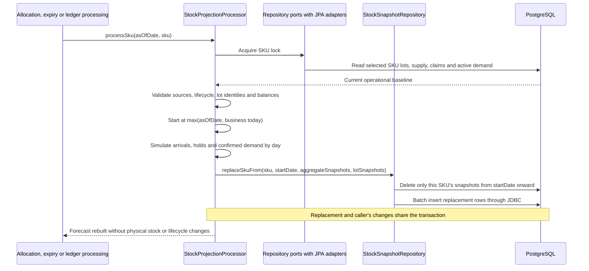

#### Snapshot meaning

The `stock` table is the current physical baseline, by SKU, warehouse, and lot. The daily projection is stored in two tables:

- `stock_daily_snapshots`: aggregate balances by date, SKU, and warehouse.
- `stock_daily_lot_snapshots`: corresponding balances and reservations by date, SKU, warehouse, and lot.

For each day:

```text
closing_stock = opening_stock + inbound_qty - allocated_qty
demand_qty = allocated_qty + shortage_qty
```

The day's closing balance becomes the next day's opening balance. A confirmed backorder contributes to `shortage_qty` on its required delivery date but does not reduce physical stock. Only confirmed stock and inbound reservations reduce physical stock on their effective delivery date; pending reservations remain holds.

Each SKU's horizon ends at its latest unreceived arrival, confirmed reservation delivery,
or confirmed backorder date, and includes at least the start date. Overdue events
are applied at the start, not reconstructed in the past. Pending delivery dates
do not extend the horizon, and future TTL release is not simulated. Earlier
snapshots are retained.

An unreceived shipment contributes its full expected quantity on arrival,
including reserved units. Pending inbound holds become projected lot reservations
on receipt but are not physical deliveries. Only confirmed backorders generate
shortage, assigned to warehouse `MAIN`.

Snapshot replacement deliberately uses JDBC, not managed snapshot entities:
rebuilding the same keys avoids JPA identity/bulk-delete conflicts without
flushing or clearing the processor's persistence context. Reads also use JDBC,
so ledger processing sees replacements made in the same transaction. The shared
datasource transaction rolls back both snapshot changes and JPA business changes
on failure; an empty replacement clears the current/future range.

#### Live quantity interpretation

For a live stock lot:

```text
quantity_available = quantity_on_hand - quantity_reserved
```

`quantity_on_hand` remains the physical quantity even while some units are reserved for future delivery. Before receipt, inbound supply is separate:

```text
inbound_quantity_available = expected_quantity - quantity_reserved
```

### Ledger synchronization flow

Ledger synchronization runs independently of allocation. Both scheduled and
manual entry points use the same coordinator and atomic per-SKU synchronization.
There is no whole-catalogue transaction or point-in-time read guarantee.

```mermaid
sequenceDiagram
    participant Trigger as JobRunr or manual MCP caller
    participant Job as StockLedgerSyncJob
    participant Ledger as StockLedgerProcessor
    participant Cleanup as ReservationCleanupService
    participant Projection as StockProjectionProcessor
    participant Snapshots as StockSnapshotRepository
    participant Status as StockLedgerSyncStatusRepository
    participant Runtime as JobRunr
    participant Backorders as BackorderAllocationJob
    participant DB as PostgreSQL

    alt Scheduled invocation
        Trigger->>Job: Execute recurring sync-stock-ledger job
        Job->>Ledger: processToday()
    else Manual invocation
        Trigger->>Ledger: process(request with optional snapshotDate)
    end
    Ledger->>DB: Begin/resume durable manifest for today's business date
    loop Incomplete SKUs in sorted order
        Ledger->>DB: Lock SKU, fence coordinator owner, lock work checkpoint
        opt Overdue whole-order lifecycle found
            Note over Ledger,DB: Roll back SKU attempt and release its locks
            Ledger->>Cleanup: expireOrders(orderIds)
            Cleanup->>DB: Lock all order SKUs, expire and refresh atomically
            Note over Ledger,DB: Retry SKU after cleanup commits
        end
        Ledger->>Projection: processSku(today, sku)
        Projection->>Snapshots: Replace selected SKU forecast in transaction
        Ledger->>Snapshots: Read fresh scoped daily/lot snapshots
        Ledger->>Ledger: Validate balances and current business date
        Ledger->>DB: Apply receipts, confirmed deliveries and hold conversions
        Ledger->>DB: Persist receipt follow-up and successful SKU checkpoint
        Note over Ledger,DB: Commit one SKU; failed work rolls back and remains resumable
    end
    Ledger->>Status: Record successful sync timestamp, date and counts
    Status->>DB: Complete parent only after all manifest work is committed
    opt Newly received shipment lines
        Ledger->>Runtime: Dispatch durable follow-up with stable command/job IDs
        Runtime->>Backorders: execute(BackorderAllocationRequest)
        Backorders->>Backorders: Allocate existing backorders and refresh projection
    end
    Ledger->>Ledger: Log completed counts and elapsed time
    alt Scheduled invocation
        Ledger-->>Job: Sync result
        Job-->>Trigger: Execution completed
    else Manual invocation
        Ledger-->>Trigger: Sync result
    end
```

`process_stock_ledger` accepts only today's `snapshotDate`; omission resolves it
from the business clock. The coordinator freezes that date and a durable SKU
manifest, then processes one SKU at a time. Each worker locks its SKU before
decision reads, rebuilds its forecast, validates balances, applies physical
movements and checkpoints atomically. Empty output is valid. Pending holds are
retained even after delivery dates; overdue pending orders instead require
independent atomic whole-order cleanup before retrying the worker.

The sync transaction does not recalculate allocations or accept explicit
warehouse movements. After committing newly received supply, it enqueues
affected-SKU backorder fulfillment as separate work. Repeating sync is safe
because delivered reservations and received shipments are no longer projected
as new movements.

`stock_receipt_followup` records stable request IDs derived from the date and
sorted received shipment-line IDs inside each receipt transaction. Dispatch
runs outside that transaction, immediately after complete synchronization and
through the minute-based `dispatch-stock-receipt-followups` recurring job.
Enqueue outages retain pending rows; duplicate dispatch reuses stable job and
allocation-request IDs. Receipt commits do not depend on scheduler availability.

`StockLedgerSyncJob` registers the stable JobRunr recurring ID `sync-stock-ledger`. The default five-field cron `0 0,12 * * *` runs at midnight and noon UTC. The configured zone also supplies the service's shared business `Clock`, including REST date validation, CSV imports, expiry, and projection dates. The separate harness publisher creates its own clock using the same zone setting. Each invocation resolves today's date; unfinished previous-day manifests become `SUPERSEDED` and a fresh current-day manifest reconciles their committed effects without replaying old forecasts.

Allocation and explicit backorder fulfillment refresh forecasts but never trigger physical synchronization. Each ledger SKU worker rebuilds its own projection under the same SKU lock and transaction immediately before applying it: an earlier forecast may contain expired or changed holds. Until sync runs, arrived supply remains inbound and due confirmed deliveries remain reserved in live stock. Expected arrival and due delivery are still date-driven assumptions, not warehouse event confirmations.

The default schedule normally allows up to roughly twelve hours of physical
ledger lag; it does not slow down allocation or the one-minute expiry sweep.
Each successful sync writes its timestamp, business date, SKU count, and lot
snapshot count in the same transaction. The lot count includes forecast lots;
it is not a count of newly received physical lots. Freshness interpretation is
described in the [status flow](#status-and-freshness-read-flow).

All pods must share JobRunr/application storage and identical schedule
configuration. Disabling scheduling removes the recurring definition, not
already queued/running executions. See
[the ledger scheduling feature](issues/feature_stock_ledger_sync_job.md)
for rollout and operational trade-offs.

#### Allocation, receipt, and delivery example

On day D, live lot `LOT-A` has 5 units and shipment `SHIP-B` brings 4 units
arriving on D. Two confirmed orders are due on D+1: `ORDER-1` requests 3 and
`ORDER-2` requests 4, with equal priority and placed date. This illustrates
confirmed commitments, not the default temporary holds; confirmation itself
remains a future feature.

| Order | Requested | From inventory | From inbound | Backordered |
| --- | ---: | ---: | ---: | ---: |
| `ORDER-1` | 3 | 3 | 0 | 0 |
| `ORDER-2` | 4 | 2 | 2 | 0 |

Before receipt, `LOT-A` has 5 on hand / 5 reserved / 0 available; `SHIP-B`
has 4 expected / 2 reserved / 2 available. The D sync creates `SHIP-B` as a
live lot: total stock becomes 9 on hand, 7 reserved, and 2 available. The
D+1 sync delivers the 7 confirmed units, leaving 2 units available for later
allocation as inventory. With pending orders, receipt still happens but delivery
does not: holds remain until their TTL cleanup instead.

### Status and freshness read flow

Reservation lifecycle and ledger freshness answer different questions. These
reads do not expire orders, rebuild forecasts, or synchronize stock.

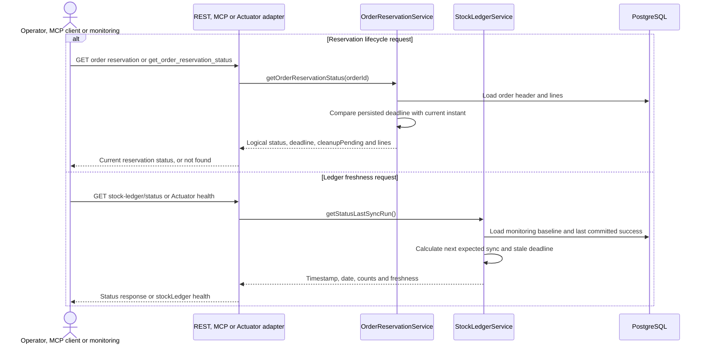

For an overdue pending order, status reports logical `EXPIRED` with
`cleanupPending: true` until the cleanup transaction commits. It does not perform
that cleanup, so inventory counters may still contain those holds briefly.
An unknown order returns REST `404`. Saved allocation results/reports are not a
substitute for this live read.

Ledger monitoring uses `lastSuccessAt`, or `monitoringStartedAt` before the first
success, as its baseline. The next expected cron occurrence plus
`freshnessTolerance` (default one hour) determines `staleAfter`. When enabled,
the Actuator `stockLedger` indicator is `UP` while fresh and `DOWN` after that
deadline. With scheduling disabled it is `UNKNOWN`, no freshness alarm is raised,
and manual synchronization remains available.

The singleton `stock_ledger_sync_status` is monitoring state, not a lock or a
once-per-day execution guard. Its success fields update only when the ledger
transaction commits. External monitoring must poll health/status and alert;
persisting this row alone does not deliver an alert.

### CSV import flow

The admin endpoint converts the configured CSV file into an allocation request.
Import does not register documents, reserve supply, or execute allocation.

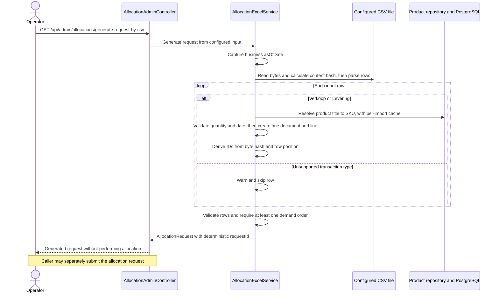

The expected columns, in order, are:

```text
Artikel,Transactie_type,QTY,Datum
```

`Verkoop` rows become single-line demand orders; `Levering` rows become single-line
shipments. Rows are not grouped by SKU or customer. Unknown transaction types
are skipped with a warning. Unknown products, malformed quantities/rows, invalid
dates, or a file without sales rows fail the import. Dates accept `yyyy-MM-dd`
or day-first `d-M-yyyy`.

Document and line IDs come from the CSV byte hash and row position; the request
ID also includes the captured `asOfDate`. Identical bytes on the same date replay
the same request regardless of path. On another date, document IDs still belong
to their original run and cannot allocate the transactions again. Changed bytes
represent a new import.

The default path is `docs/allocations.csv`; set `ALLOCATION_CSV_PATH` if the
input is elsewhere.

### Excel report flow

Reports describe a completed historical allocation run, not today's remaining
holds or the latest ledger state.

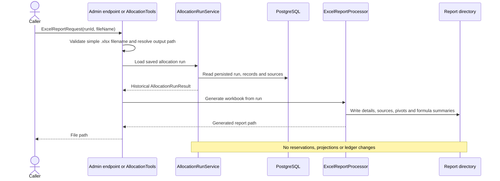

The workbook contains:

- `Allocation Details`: one row per order line, including quantities, status, and
  inventory/inbound sources.
- `Source Allocations`: one row per allocation source.
- `Pivot Summary`: pivots by SKU/status and customer/SKU backorders.
- `Formula Summary`: `SUMIFS` totals grouped by SKU/status.

The output directory defaults to `${user.home}/itzitzo-mcp/reports` and is
configurable with `REPORT_DIR`. The requested name must be a simple `.xlsx`
filename without a directory path.

### Job-record cleanup flow

The admin operation removes qualifying execution records from JobRunr storage;
it is not reservation expiry or an allocation rollback.

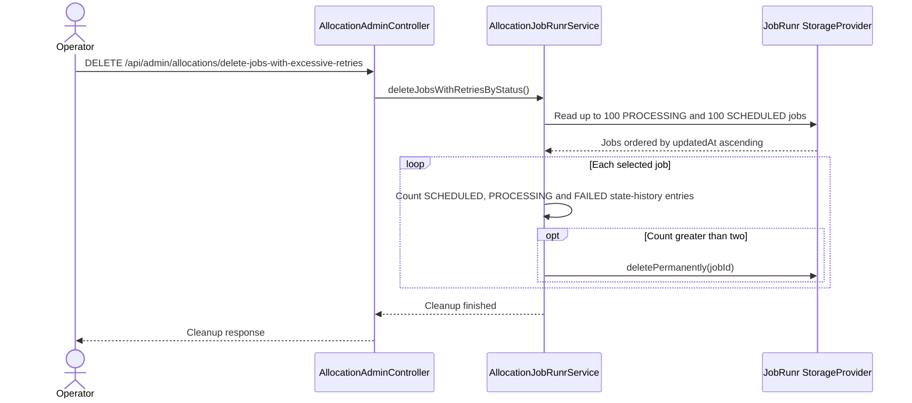

The threshold is based on counted state transitions, not a separate retry-count
field. Removing a job record does not release reservations, delete allocation
history, or guarantee cancellation of code already executing. Use this
administrative endpoint deliberately; normal reservation release follows the
expiry flow.

## Cross-cutting concurrency, idempotency, and rollout

Allocation runs are keyed by `requestId` and store a request hash. A retry with
the same ID/payload resumes or returns the existing run; conflicting reuse is
rejected. Per-SKU operation results and document ownership prevent duplicate
reservations.

All participating writers use database-backed SKU coordination across warehouses.
The former `stock_projection_lock` row and adapter remain for migration history
and legacy lock tests, but no production workflow acquires that gate.

Registration acquires sorted namespaced document keys, sorted inbound SKU locks,
the run row, and then business rows. SKU workers and scoped projection acquire
their SKU before decision reads. Expiry acquires sorted order document keys,
all immutable order SKUs in sorted order, lifecycle rows, then business rows.
Never expand a held SKU set out of order or acquire document locks after SKUs.
Acquiring SKU locks before run/lifecycle rows avoids blocking a worker's foreign
key checks while waiting for its SKU. Run completion acquires no SKU locks.

Document lock rows are lazily inserted with `ON CONFLICT DO NOTHING`, then
locked transactionally; they remain stored like SKU lock rows. Namespaces keep
order, order-line, shipment, and shipment-line identities distinct. Different
document/SKU scopes can register concurrently; shared identities or inbound
SKUs still serialize. Database row locks coordinate multiple service instances.
Projection reads/replaces only the selected SKU, even when output is empty.
Allocation remains committed before its separate retryable synchronous forecast
refresh. Expiry and affected forecasts share one transaction. SKU horizons are
local; cross-SKU reads can combine independently committed versions.

SKU concurrency is limited by `stockio.allocation.max-concurrent-skus` (default
`4`), configured through `ALLOCATION_MAX_CONCURRENT_SKUS`. The limit applies to
each service's dispatcher, not independently per request or globally across the
separate new-demand and backorder services or application instances. Each SKU
uses its own transaction; forecast replacement begins after the allocation
transactions finish.

**Opt-in allocation admission**

`stockio.allocation.admission.enabled` defaults to false. When enabled,
`AllocationAdmission` uses a shared per-instance `Semaphore.tryAcquire()` before
allocation writes. A permit spans allocation, synchronous affected-SKU projection
and optional execution-result persistence through `AllocationProcessor`'s
completion callback. The alternate backorder processor delegates to the same
guard. There is no outer transaction, permit-wait queue or additional thread pool.

All execution/count/byte limits are explicit and positive when enabled.
Shape validation also precedes asynchronous enqueue. Service HTTP bodies and
RabbitMQ messages have pre-JSON byte checks; the separate Next.js process needs
the same opt-in flag and byte setting. Internal/MCP DTOs have bounded canonical
serialization after transport deserialization, not a transport-level byte cap.
Capacity HTTP errors are 503, count limits 400 and byte limits 413. MCP retains
the coded retryable error. Existing success contracts and request identity remain.

Enabled RabbitMQ intake uses one consumer, prefetch 1 and AUTO acknowledgments.
Capacity backoff leaves the original message unacknowledged while the consumer
waits 5-10 seconds without a database connection/permit; interruption/shutdown
requests requeue. Capacity does not trigger generic JobRunr fallback.
JobRunr's annotation-elected state filter durably schedules the same allocation/
backorder job after 5-10 seconds plus polling, excluding capacity failures from
its three ordinary business retries. No new queue/schema is introduced.

Micrometer exposes configured/enabled/active admission, admitted/saturated
attempts, shape rejections and execution/phase timers with bounded labels.
Product resolution, cached result reads, ledger, expiry and status operations
do not acquire allocation permits. This is not a distributed limiter,
database-work budget, bounded durable backlog, maintenance reservation or
forecast-cost bound. Reconcile oversized queued work before enabling; preserve
dates/holds and monitor queue age, history growth, broker delivery timeout,
Hikari waits and maintenance freshness. See the
[feature](./issues/feature-fail-fast-allocation-admission.md) and
[configuration guide](../../stockio-service/README.md#opt-in-allocation-admission).

A separate [draft database-work budget](./issues/feature-shared-database-work-budget.md)
proposes pre-transaction admission with protected ledger/expiry shares, joined
projection ownership and partial-progress recovery. It is not implemented and
does not change the current connection or maintenance guarantees.

**Ledger coordination is not a stock-projection gate**

`stock_ledger_coordinator` admits one sequential ledger coordinator across
instances using a five-minute renewable owner lease. Competing callers wait
outside transactions without reserving a connection. Workers acquire their
SKU first, then lock/check the coordinator owner and work checkpoint; no
coordinator/run row is held while waiting for a SKU. The owner check fences
stale coordinators after takeover, and its transaction-scoped row lock prevents
takeover during a physical SKU commit. Allocation, projection and expiry never
acquire this ledger-only metadata row.

The manifest includes stock, supply, reservations, shortages and old forecast
scopes. New scopes wait for the next run. Successful work and physical effects
commit together; current-day retries skip completed checkpoints. Parent success
and freshness advance only after all intended work completes. The existing
ledger status response adds `progress` with counts, status, lease and last error.
Expired-date work cannot be applied; the next current-day manifest reconciles
committed receipts/deliveries. Physical replay safety still depends on receipt
flags, stable lots and consumed reservation rows.

**Example: concurrent A(order 1, SKU 1), B(order 2, SKU 2), C(order 3, SKU 1)**

Assume distinct request, order, and line identities and order-only requests
without inbound amendments. If A wins the SKU 1 lock:

| Phase | A: order 1, SKU 1 | B: order 2, SKU 2 | C: order 3, SKU 1 |
| --- | --- | --- | --- |
| Document registration | Can register independently. | Can register independently. | Can register independently, despite sharing SKU 1 with A. |
| SKU allocation | Holds SKU 1; allocates supply. | Holds SKU 2; proceeds independently. | Waits for SKU 1. |
| After A commits its SKU transaction | Releases that transaction's locks. | Can commit its SKU transaction independently. | Acquires SKU 1, reads availability including A's committed reservations, then allocates and commits. |

A and C cannot concurrently modify the same SKU through the allocation workers.
Whichever acquires the SKU lock first proceeds; arrival order does not guarantee
which request wins. If supply is insufficient after A's reservation, C can
receive a partial allocation or backorder instead of reserving the same units.

Registration locks SKUs only for inbound registration/amendments, so different
order-only documents can register concurrently even when their demand uses the
same SKU. Registration, per-SKU allocation, run completion, and projection are
separate transaction phases, not one transaction covering the entire request.

Subsequent projection or ledger work for SKU 1 takes the same SKU lock, while
SKU 2 can progress independently. Whole-order expiry may legitimately lock
several SKUs together. Hot-SKU lock waits can still occupy pooled connections;
this is not admission control or a throughput guarantee.

Deploy this protocol through a coordinated stop/migrate/deploy/restart of all
writers, including consumers and JobRunr workers. Mixed-version operation with
old globally exclusive writers is unsupported. See the
[implemented feature](./issues/feature-per-sku-stock-processing.md).

Stable recurring IDs register one shared schedule definition across pods;
database locks and lifecycle checks make overlapping executions/retries safe.
Job names and recurring IDs are not exactly-once guarantees.

The nested line contract is a coordinated breaking change. V15 preserves legacy
run hashes as contract version 1; new runs use version 2. Legacy allocation
runs/results remain readable, but old requests cannot be submitted/resumed
through the nested contract. Drain old allocation jobs and reconcile unfinished
legacy runs before upgrading writers together.

Deploy lifecycle-aware allocation, projection, ledger, and expiry together; old
ledger code must not run concurrently with temporary holds.

The current allocation routes use `/api/allocation/jobs`, and dedicated reads
use `/api/reservations/orders/{orderId}/status` and `/api/stock/ledger/status`.
Old `allocate-project-and-sync`, `allocation-jobs`, and `/api/logistics/...`
routes are not compatibility aliases. The allocation-only job-result rollout assumes a recreated
application database, including JobRunr storage, plus coordinated caller updates.
Completion JSON now contains `jobId` and `allocationRun`, not a top-level
`version` or `stockSync`; the run's stored `contractVersion` is a separate schema
concern. Completion JSON uses the shared `ObjectMapper` directly; no adapter reads
historical combined allocation/sync job results.

## Persistence model

| Table | Responsibility |
| --- | --- |
| `products` | Product catalog and SKU reference data. |
| `product_embeddings` | Cached 768-dimensional Ollama embeddings for active catalog products, refreshed when product text or model changes. |
| `product_knowledge_chunks` | Tavily source text associated with a resolved SKU, with provenance, content hash, retrieval time, and a 768-dimensional embedding. |
| `stock` | Current physical quantity and future reservations by lot. |
| `stock_reservation` | Order reservations against live stock lots. |
| `inbound_shipment` | Shipment header identity and immutable line membership. |
| `inbound_supply` | Shipment lines with expected/received state, reserved quantities, and stable receiving-lot IDs. |
| `inbound_reservation` | Order reservations against unreceived shipments. |
| `allocation_run` | Idempotent run metadata, type, as-of date, completion state, and request hash. |
| `allocation_record` | Per-order-line allocation and backorder results. |
| `allocation_source` | Lot/shipment source detail for each allocation record. |
| `open_backorder` | Current unfulfilled quantity by order line. |
| `allocation_sku_lock` | Common SKU serialization for allocation, amendments, projection, ledger and whole-order expiry. |
| `allocation_document_lock` | Namespaced header/line identity locks, including absent business identities, retained across registrations. |
| `allocation_sku_operation` | Per-run, per-SKU result used to resume work safely. |
| `demand_order` | Order header, original-run ownership, and shared confirmation/expiry lifecycle. |
| `demand_order_line` | Immutable line identity, SKU, requested quantity, delivery date, and document position. |
| `stock_daily_snapshots` | Aggregate daily stock trajectory. |
| `stock_daily_lot_snapshots` | Lot-level daily balances and reservations used by the ledger sync. |
| `stock_projection_lock` | Retained legacy gate; no production workflow acquires it. |
| `stock_ledger_sync_status` | Monitoring baseline and last committed manual/scheduled ledger success. |
| `stock_ledger_run` / `stock_ledger_work` | Frozen run dates/manifests, partial outcomes and atomic per-SKU checkpoints. |
| `stock_ledger_coordinator` | Renewable fenced owner lease for ledger-only execution; never held while acquiring SKUs. |
| `stock_receipt_followup` | Durable, idempotently dispatched receipt-triggered backorder work. |
| `allocation_job_result` | Serialized `{jobId, allocationRun}` completion for executor calls, including synchronous RabbitMQ execution. |
| `flyway_schema_history` | Flyway migration metadata. |

Flyway migrations V1-V18 create and evolve these tables, seed products, add daily projections and concurrency support, remove the retired stock-ledger tables, enable pgvector product-resolution storage, add order-reservation expiry, migrate single-line documents to header/line relationships, and persist ledger-sync freshness. V15 preserves lifecycle timestamps, legacy line mappings, and received lots, and rejects inconsistent legacy reservation data. V17 adds document identity locks; V18 adds ledger run/work/coordinator state, receipt follow-up, and a SKU index on order lines. Both are additive. Hibernate validates the migrated JPA schema at startup; it does not create or alter tables. The local Compose and PostgreSQL Testcontainers images include pgvector.

## Configuration and operations

| Variable / property | Default | Purpose |
| --- | --- | --- |
| `DB_URL` | `jdbc:postgresql://localhost:5437/logistics` | PostgreSQL JDBC URL for the pgvector-enabled local Compose database. |
| `DB_USERNAME` / `DB_PASSWORD` | `logistics` / `logistics` | Database credentials. |
| `DB_POOL_MAX_SIZE` | `10` | Hikari maximum pool size. |
| `DB_POOL_MIN_IDLE` | `2` | Hikari minimum idle connections. |
| `DB_POOL_CONNECTION_TIMEOUT_MS` | `30000` | Time to wait for a pool connection. |
| `DB_POOL_IDLE_TIMEOUT_MS` | `600000` | Maximum idle connection time. |
| `DB_POOL_MAX_LIFETIME_MS` | `1800000` | Maximum connection lifetime. |
| `ALLOCATION_LEDGER_SYNC_ENABLED` | `true` | Register independent ledger synchronization; false deletes its recurring definition. |
| `ALLOCATION_LEDGER_SYNC_CRON` | `0 0,12 * * *` | Five-field cron for physical ledger processing. |
| `ALLOCATION_LEDGER_SYNC_ZONE` | `UTC` | Scheduler zone and shared business-clock zone. |
| `ALLOCATION_LEDGER_SYNC_FRESHNESS_TOLERANCE` | `1h` | Grace after the next expected sync before ledger health becomes stale. |
| `SERVER_ADDRESS` / `SERVER_PORT` | `127.0.0.1` / `9090` | HTTP bind address and port. |
| `ALLOCATION_MAX_CONCURRENT_SKUS` | `4` | Maximum concurrent SKU workers. |
| `ALLOCATION_RESERVATION_TTL` | `30m` | Temporary order-header hold duration, including SKU-processing time. |
| `ALLOCATION_RESERVATION_EXPIRY_INTERVAL` | `1m` | Recurring expiry sweep interval, independent of ledger sync. |
| `ALLOCATION_RESERVATION_EXPIRY_BATCH_SIZE` | `100` | Maximum overdue order headers cleaned up per expiry batch. |
| `ALLOCATION_CSV_PATH` | `docs/allocations.csv` | CSV input path. |
| `REPORT_DIR` | `${user.home}/itzitzo-mcp/reports` | Excel output directory. |
| `TAVILY_API_KEY` | empty (required for fallback searches) | Tavily API credential. |
| `TAVILY_BASE_URL` | `https://api.tavily.com` | Tavily API base URL. |
| `OLLAMA_BASE_URL` | `http://localhost:11434` | Ollama service URL. |
| `OLLAMA_EMBEDDING_MODEL` | `nomic-embed-text` | Embedding model; it must return 768 dimensions. |
| `PRODUCT_RESOLUTION_TIMEOUT` | `15s` | Connect/read timeout for Tavily and Ollama calls. |
| `PRODUCT_RESOLUTION_MAX_RESULTS` | `5` | Tavily search result count. |
| `PRODUCT_RESOLUTION_MAX_CANDIDATES` | `5` | Maximum product candidates used/returned. |
| `PRODUCT_RESOLUTION_MINIMUM_SIMILARITY` | `0.72` | Minimum score for non-exact product matches. |
| `PRODUCT_RESOLUTION_MINIMUM_SIMILARITY_GAP` | `0.04` | Required lead over the second candidate to accept an equivalent. |
| `PRODUCT_RESOLUTION_MINIMUM_LOCAL_SIMILARITY` | `0.90` | Minimum local vector score to bypass Tavily. |
| `PRODUCT_RESOLUTION_MINIMUM_LOCAL_SIMILARITY_GAP` | `0.08` | Required local lead over the second candidate to bypass Tavily. |
| `PRODUCT_RESOLUTION_MINIMUM_TAVILY_EVIDENCE_SIMILARITY` | `0.25` | Minimum cosine similarity between the requested phrase and Tavily evidence. |
| `RABBITMQ_HOST` / `RABBITMQ_PORT` | `localhost` / `5672` | RabbitMQ server address. |
| `RABBITMQ_USERNAME` / `RABBITMQ_PASSWORD` | `stockio` / `stockio` | RabbitMQ credentials. |
| `ALLOCATION_RABBITMQ_EXCHANGE` | `stockio.allocation.exchange` | Allocation request exchange. |
| `ALLOCATION_RABBITMQ_ROUTING_KEY` | `allocation.request` | Allocation request routing key. |
| `ALLOCATION_RABBITMQ_REQUEST_QUEUE` | `stockio.allocation.requests` | Allocation request queue. |
| `ALLOCATION_RABBITMQ_DEAD_LETTER_QUEUE` | `stockio.allocation.dead` | Queue for rejected requests. |
| `ALLOCATION_RABBITMQ_PUBLISHER_ENABLED` | `false` | Harness-only opt-in synthetic publishing; not a service property. |
| `ALLOCATION_RABBITMQ_PUBLISHER_INTERVAL` | `1000` | Harness-only publisher interval/initial delay in milliseconds. |
| `HARNESS_DB_URL` | `jdbc:postgresql://localhost:5437/logistics` | Harness-only read-only catalogue JDBC URL; the service owns migrations. |
| `HARNESS_DB_USERNAME` / `HARNESS_DB_PASSWORD` | `logistics` / `logistics` | Harness-only local defaults; prefer SELECT-only catalogue credentials. |
| `JOBRUNR_DASHBOARD_PORT` | `8181` | JobRunr dashboard port. |
| `STOCKIO_API_URL` | `http://127.0.0.1:9090` | Next.js server-side Axios base URL for the independently running service. |

The frontend does not launch a service subprocess or manage its dashboard.
The standalone service owns its configured HTTP and JobRunr dashboard ports.

Local Docker Compose includes a one-shot `ollama-pull-model` service. It waits
for Ollama's healthcheck, pulls `nomic-embed-text` over the internal Ollama URL,
and exits. Models persist in the `ollama-data` volume. Server health alone does
not establish model readiness; wait for successful model initialization.

Spring Boot Actuator exposes `health` and `metrics` on the application HTTP port. Useful Hikari metrics include:

```text
/actuator/metrics/hikaricp.connections
/actuator/metrics/hikaricp.connections.active
/actuator/metrics/hikaricp.connections.idle
/actuator/metrics/hikaricp.connections.pending
/actuator/metrics/hikaricp.connections.max
```

The metrics endpoint is operational information; keep it on a trusted interface or protect it with the deployment's access controls. Size the connection pool against PostgreSQL's connection limit across all application instances, not only one process.

## Tests

Run the service test suite with:

```sh
./gradlew :stockio-service:test
```

The integration tests use Testcontainers PostgreSQL to verify persistence, migrations, allocation, projections, and synchronization behavior.
