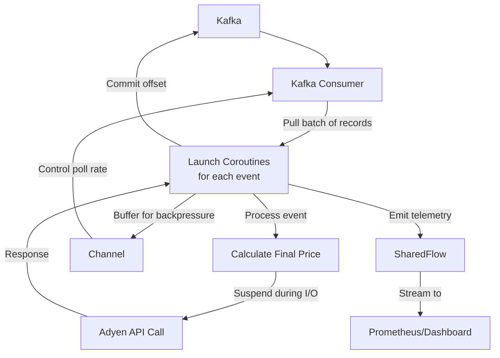

# Fastned Billing Engine Architecture: Kafka and Kotlin Coroutines

## Overview
Combining Kafka and Kotlin Coroutines is a powerful architectural choice for a high-throughput, low-latency system like Fastned's billing engine. Since charging sessions are essentially long-running asynchronous events, this pairing allows the system to remain highly responsive while processing heavy financial logic.

## Mermaid Diagram

## Technical Analyses

### 1. Asynchronous Event Ingestion
In a typical Java/Spring setup, consuming from Kafka can be thread-heavy. With Kotlin Coroutines, Fastned can implement a Non-blocking Consumer.

**How it works:** A single Kafka consumer loop pulls batches of records. Instead of processing each record on a dedicated thread, it launches a coroutine for each charging event.

**The Advantage:** This allows the system to handle thousands of concurrent sessions (e.g., verifying a plug-in event, checking a balance, or initiating a pre-auth with Adyen) using only a handful of CPU threads.

**Integration:** They likely use libraries like `kotlinx-coroutines-kafka` or wrap the standard Kafka Client in a suspend function using `suspendCancellableCoroutine`.

**Technical Depth:** Coroutines provide lightweight concurrency by multiplexing many tasks onto a fixed number of threads. In this case, the event loop remains non-blocking, reducing context switches and memory overhead compared to traditional thread-per-message models. This is crucial for high-throughput scenarios where charging events can spike during peak hours.

### 2. Bridging Kafka and the Adyen API
The most common use case for Coroutines here is handling the "I/O Wait" when talking to Adyen.

**The Pattern:**
1. A Kafka message arrives: `ChargeSessionEnded`.
2. The coroutine calculates the final price.
3. It calls Adyen's API. Instead of the thread sitting idle for 200ms–500ms waiting for Adyen's response, the coroutine suspends.
4. The underlying thread is freed to process other Kafka messages.
5. Once Adyen responds, the coroutine resumes and commits the Kafka offset.

**Technical Depth:** This leverages Kotlin's suspend functions to make asynchronous code look synchronous, improving readability and maintainability. Under the hood, it uses continuations to manage state across suspensions, avoiding the callback hell of traditional async programming. For financial systems, this ensures low latency in payment processing, critical for user experience and compliance with transaction timeouts.

### 3. Graceful Backpressure with Channels
If Adyen's API becomes slow or hits a rate limit, Fastned needs to avoid crashing their billing service or losing Kafka messages.

**Kotlin Channels:** They likely use a `Channel` as a local buffer. If the processing coroutines are busy, the Kafka consumer can pause or slow down its "poll" cycle based on the capacity of the channel.

**Flows for Telemetry:** For real-time monitoring of billing success rates, they might use `SharedFlow` to stream payment status events to a dashboard or a Prometheus metrics exporter without coupling the logic to the billing flow.

**Technical Depth:** Channels in Kotlin provide a thread-safe way to communicate between coroutines, implementing producer-consumer patterns efficiently. Backpressure is handled by suspending producers when the channel is full, preventing memory exhaustion. `SharedFlow` allows multicasting of events, enabling reactive programming for monitoring without blocking the main processing pipeline. This architecture ensures resilience against downstream failures, maintaining system stability under load.
