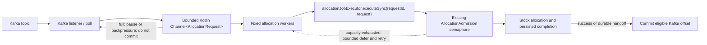

# Feature: Add a Kafka allocation consumer alongside RabbitMQ

## Status and scope

- **Status:** Done
- **Priority:** Not set
- **Bounded Context:** Allocation Messaging & Ingress
- **Specification:** [`../specifications.md`](../specifications.md#feature-add-a-kafka-allocation-consumer-alongside-rabbitmq)
- **Scenario:** [`Scenario 18: Consume an Allocation Request from Kafka`](../scenarios.md#scenario-18-consume-an-allocation-request-from-kafka)

Add a Kafka consumer for Stockio allocation requests alongside the existing
RabbitMQ consumer. The Kafka adapter should invoke the same allocation
application path as `AllocationRabbitListener`, including
`allocationJobExecutor.executeSync(jobId, request)`. Stockio allocates stock;
this is not payment processing or external billing.

The scope is the Kafka consumer and its required configuration, not a Kafka
producer, Kafka Streams topology, or a replacement for RabbitMQ. Keep RabbitMQ
available and behaviorally unchanged.
A bounded Kotlin `Channel` with a fixed set of allocation workers is the proposed
local buffer for smoothing short bursts; the existing `AllocationAdmission`
semaphore remains the authoritative execution bulkhead.

## Approved implementation decisions

- Consume the existing `AllocationRequest` JSON contract; use
  `request.requestId` as the `jobId` for `allocationJobExecutor.executeSync`.
- Keep Kafka disabled by default. Configure topic, group, worker count, channel
  capacity, retry delay, and dead-letter topic through service properties.
- Mirror the current RabbitMQ failure policy: retain and back off capacity
  rejections, dead-letter invalid/oversized requests, and enqueue a durable
  JobRunr fallback for other synchronous failures. Kafka offset progress follows
  successful completion or successful fallback enqueue.
- Use a bounded channel and fixed worker set. A channel send waits for capacity;
  it does not acknowledge the Kafka record. The synchronous listener waits for
  its worker before returning, preserving per-partition order; configured
  consumer concurrency and fixed workers bound processing and buffered work.
- Merge the user-provided `infra/docker-compose.yml` Kafka stack into
  `infra/docker/docker-compose.yml`; retain the supplied baseline file as-is.

## Scenario

### Gherkin description

**Given** Kafka allocation consumption is enabled and a valid allocation request
is available on its configured topic \
**When** Stockio consumes the record \
**Then** it invokes the shared allocation execution path using the request's
stable identity \
**And** it commits the Kafka offset only after allocation completes or a
durable recovery handoff succeeds \
**And** the existing RabbitMQ allocation consumer remains available

### High-level technical analysis

- `AllocationRabbitListener` is the current **RabbitMQ** adapter, not a Kafka
  consumer; it receives an `AllocationRequest` and uses
  `request.requestId` as the `jobId` passed to
  `allocationJobExecutor.executeSync(jobId, request)`.
- `AllocationJobExecutor.executeSync` returns a persisted completion when one
  exists for that `jobId`; otherwise it invokes the allocation processor and
  persists completion. This supports replay after completion, but the initial
  lookup alone does not establish single-flight behavior for simultaneous
  duplicate deliveries.
- Allocation already uses Kotlin coroutines internally to dispatch per-SKU
  workers, then joins them through `runBlocking`; that is separate from Kafka
  record consumption and does not provide an intake buffer.
- Kafka consumption must preserve Stockio's synchronous, database-backed
  allocation semantics. A bounded `Channel<AllocationRequest>` can absorb
  short bursts before a fixed worker set invokes the existing synchronous
  execution path. It is an in-memory buffer, not durable admission or added
  processing capacity; do not launch an unbounded coroutine per record.
- `AllocationAdmission.execute` already owns a non-waiting semaphore bulkhead:
  it uses `tryAcquire()` and throws `AllocationCapacityExceededException`
  when full. Kafka workers must complement that shared limit, not add a
  competing capacity policy or silently drop a rejected record.
- Kafka offset handling, retry/backoff, invalid-message handling, and any
  JobRunr recovery handoff need explicit Kafka-specific policy. Do not copy
  RabbitMQ acknowledgment behavior mechanically.
- Consumer concurrency must respect allocation admission and existing
  per-SKU/database coordination. Partition count or consumer count is not a
  capacity guarantee.

## Proposed ingestion and admission flow

The channel can smooth brief intake bursts, but it is volatile and must remain
bounded. Enqueueing into it is not successful processing and must not commit an
offset. Workers must retain/retry capacity-rejected records without a hot retry
loop, and offset progress must not pass unfinished earlier records in the same
partition. The synchronous listener waits for the bounded-channel worker before
returning; validate offset advancement and recovery with a broker-backed test
before rollout.

### Acceptance Criteria

- Kafka consumption can be enabled/configured without removing or silently
  changing the existing RabbitMQ consumer.
- A Kafka record is mapped to the agreed allocation request contract and
  delegates to the shared allocation execution path with a stable job identity.
- A record is not acknowledged by committing its offset before success or a
  confirmed durable recovery handoff.
- Concurrent same-request execution through the shared executor is tested; the
  stable request identity is retained across Kafka/RabbitMQ delivery, and no
  single-flight guarantee is claimed for simultaneous cross-broker delivery.
- Capacity exhaustion applies bounded backpressure without unbounded in-memory
  work; permanent invalid records and recoverable failures follow distinct,
  explicit policies.
- The bounded channel and fixed worker set smooth short bursts without
  replacing or bypassing `AllocationAdmission`; channel saturation and
  semaphore rejection preserve records and do not advance offsets.
- Tests cover message conversion, execution delegation, offset/retry behavior,
  duplicate delivery, channel saturation, capacity pressure, and coexistence
  with RabbitMQ.

## Functional Requirements (FR)

| ID | Title | Description |
| --- | --- | --- |
| FR-01 | Kafka allocation adapter | Add a Kafka listener for the agreed allocation message contract and delegate to the existing allocation application path; keep broker-specific code outside allocation business logic. |
| FR-02 | Stable execution identity | Derive the execution/job identity deterministically from the logical request so redelivery does not create a new logical allocation; define and test simultaneous duplicate behavior rather than relying only on the completion cache. |
| FR-03 | Safe offset progress | Commit offsets only after successful allocation completion or after a durable fallback has accepted responsibility for the same request. |
| FR-04 | Explicit failure policy | Distinguish capacity pressure, transient processing failures, malformed/permanent requests, and successful completion; use bounded-delay capacity backoff and finite retries/DLT for other failures. |
| FR-05 | Bounded consumption | Use a bounded local Kotlin channel and fixed worker concurrency to smooth short bursts; keep the existing `AllocationAdmission` semaphore authoritative, preserve records on channel or semaphore saturation, and do not launch unbounded per-record coroutines or buffers. |
| FR-06 | RabbitMQ coexistence | Keep the RabbitMQ listener and its contract operational; document behavior when both brokers deliver the same logical request. |
| FR-07 | Operational visibility | Log and measure bounded-cardinality consumption outcomes, retries, capacity deferrals, and processing duration without using request or SKU identifiers as metric labels. |

## Non-Functional Requirements (NFR)

| ID | Title | Description |
| --- | --- | --- |
| NFR-01 | At-least-once safety | Assume records can be redelivered; do not claim exactly-once stock allocation from Kafka offset transactions alone. |
| NFR-02 | Bounded resource use | Bound the local channel and active workers; preserve the existing allocation admission and stock-coordination guarantees, and never treat in-memory channel enqueueing as durable acceptance. |
| NFR-03 | Opt-in rollout | Kafka listener activation and connection settings must be explicit so introducing Kafka does not unexpectedly alter existing RabbitMQ operation. |
| NFR-04 | Honest performance claims | Do not claim non-blocking processing, throughput improvement, or latency bounds without representative measurements. |

## Technical analysis and affected components

### Current implementation

- `stockio-service/src/main/kotlin/nl/stockio/allocation/domain/job/listener/AllocationRabbitListener.kt`
  declares `@RabbitListener`, RabbitMQ queue/exchange/dead-letter configuration,
  capacity backoff, and a JobRunr fallback for synchronous processing failures.
- `stockio-service/src/main/kotlin/nl/stockio/allocation/domain/job/AllocationJobExecutor.kt`
  owns `executeSync`; the RabbitMQ listener passes `request.requestId` as its
  `jobId`.
- The service currently has Spring AMQP/RabbitMQ configuration and no Kafka
  listener or Kafka consumer configuration.
- `AllocationAdmission` uses a non-waiting `Semaphore.tryAcquire()` for
  allocation work and reports saturation with
  `AllocationCapacityExceededException`; the RabbitMQ listener currently
  backs off and retries that request.
- `executeSync` is a synchronous call into Spring/JPA-backed work; per-SKU
  workers already use Kotlin coroutines internally. Its database and per-SKU
  coordination, plus the allocation admission limit, constrain safe Kafka
  consumer concurrency. A new Kafka channel must not multiply that existing
  concurrency without measurement.

### Proposed boundary

- Add a Kafka-specific adapter and configuration in `stockio-service`.
- Reuse the same allocation execution service; do not duplicate allocation
  business rules in the listener.
- Use a bounded Kotlin `Channel<AllocationRequest>` as a local burst buffer
  feeding a fixed worker set. Size/configure workers with the existing
  `AllocationAdmission` limit in mind; keep that semaphore as the shared
  execution guard across Kafka, RabbitMQ, and other callers.
- If the channel is full or the bulkhead rejects work, apply bounded backpressure
  or retry without dropping the record, committing its offset, or spinning in
  a hot loop. The synchronous listener waits for its bounded-channel worker;
  only successful allocation or durable fallback lets it return and advance
  the offset.
- Limit each poll to one record per partition so worker completion cannot
  reorder work within a partition; size worker concurrency to the provisioned
  topic partitions and documented service limits.
- Keep Kafka offset control and retry/dead-letter handling in the Kafka
  integration boundary. Extract shared consumer orchestration only if that is
  needed to make the chosen recovery behavior consistent and testable.
- Use a separate bounded worker/channel layer only for broker intake; do not
  confuse it with the existing per-SKU coroutine workers or claim that it
  makes blocking Spring/JPA calls non-blocking.
- Do not add Adyen integration, payment models, Kafka Streams processing, or a
  producer starter as part of this feature.

## Operational configuration and rollout

- Production bootstrap servers, credentials, topic/group names, partition
  count, worker count, channel capacity, and retry delay remain deployment
  configuration. Local topic/group defaults are for development only.
- Size worker concurrency and partitions from observed allocation/database
  capacity; do not claim throughput or latency bounds from local buffering.
- The database's unique request identity and allocation-run resume behavior
  protect logical allocation replay. Keep the JobRunr completion job ID equal
  to `requestId`; test same-request overlap across Kafka and RabbitMQ.
- Deploy the Kafka consumer disabled, ensure the upstream producer and source
  topic are configured, and provision the DLT before enabling it deliberately.
  RabbitMQ remains available; no migration or producer library is part of this
  feature.

## Implementation plan

1. Add opt-in Spring Kafka dependencies, typed service configuration, source
   and DLT topic declarations, and a raw-string consumer compatible with the
   existing `AllocationRequest` JSON contract.
2. Implement synchronous listener completion backed by a bounded Kotlin
   channel and fixed workers; preserve per-partition order and commit offsets
   only after execution or durable JobRunr handoff.
3. Mirror RabbitMQ's capacity backoff and JobRunr fallback behavior, dead-letter
   malformed/oversized requests, and preserve records on channel/bulkhead
   saturation.
4. Merge the supplied local Kafka stack into the existing Docker Compose file
   and document disabled-by-default configuration and startup.
5. Add focused listener, queue, retry/DLT, duplicate-delivery, context
   lifecycle, and broker-backed tests; measure before setting production
   concurrency or claiming throughput improvements.

## Resources

- [Scenario 18: Consume an Allocation Request from Kafka](../scenarios.md#scenario-18-consume-an-allocation-request-from-kafka)
- [Feature specification](../specifications.md#feature-add-a-kafka-allocation-consumer-alongside-rabbitmq)
- [Architecture](../architecture.md)
- Current RabbitMQ adapter: `stockio-service/src/main/kotlin/nl/stockio/allocation/domain/job/listener/AllocationRabbitListener.kt`
- Shared execution path: `stockio-service/src/main/kotlin/nl/stockio/allocation/domain/job/AllocationJobExecutor.kt`
