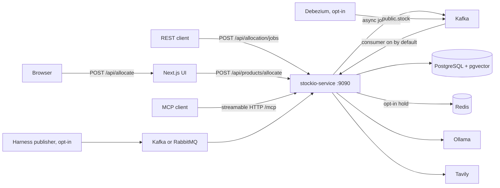
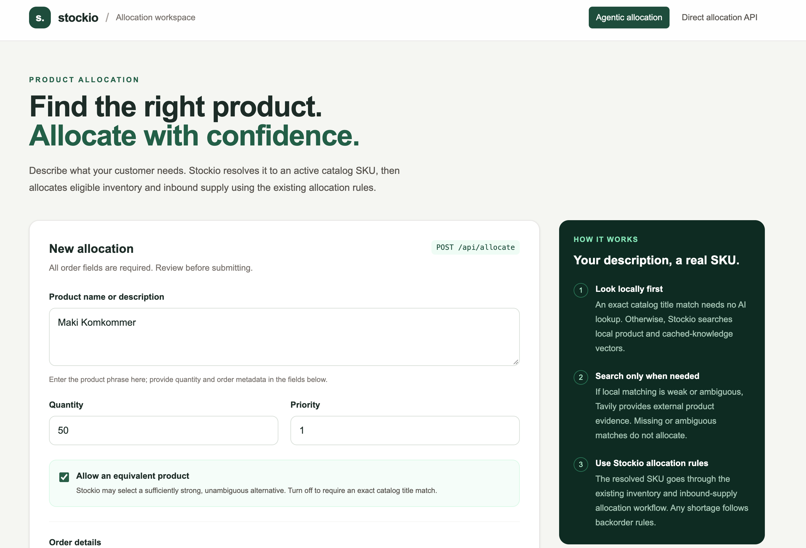

# Stockio

Stockio allocates customer demand against on-hand lots and expected inbound supply, and it keeps the resulting reservations, backorders, and daily stock forecast in PostgreSQL. The service is a Kotlin 2.2.20 / Spring Boot 3.5.10 Gradle multi-module application. Domain code calls ports; JPA, JDBC, Kafka, RabbitMQ, and JobRunr are the adapters. HTTP intake is asynchronous through Kafka by default.

## Repository architecture

| Module | Directory | What belongs here |
| --- | --- | --- |
| `:stockio-service` | `stockio-service/` | The running Spring Boot process: allocation, reservation, stock, and product domain code, REST controllers, MCP tools, persistence, Flyway, and listeners. |
| `:stockio-api` | `stockio-api/` | Shared request and response DTOs, and the OpenAPI documents that generate the controller interfaces. The Next.js UI lives under this module and is started on its own. This module is not a second Spring application. |
| `:stockio-test-harness` | `stockio-test-harness/` | Playwright browser tests, the Gatling runner, and the opt-in sample publisher. It depends on `:stockio-api` and does not own the schema or the allocation rules. |

Put a new business rule in `:stockio-service` behind an existing port. Put a new request or response field in `:stockio-api` and in the matching OpenAPI file. Put a browser, load, or synthetic-publisher check in `:stockio-test-harness`.

OpenAPI generation lives in the root `build.gradle`. `:stockio-service` compiles the generated interfaces.

| Document | Generated interface |
| --- | --- |
| `stockio-api/src/main/resources/openapi/allocation-controller.yaml` | `AllocationApi` |
| `stockio-api/src/main/resources/openapi/reservation-controller.yaml` | `ReservationApi` |
| `stockio-api/src/main/resources/openapi/product-allocation-controller.yaml` | Product allocation API |

```shell
./gradlew :stockio-api:openApiGenerateAllocation :stockio-api:openApiGenerateReservation :stockio-api:openApiGenerateProductAllocation
```

## Documentation index

| Question | Document |
| --- | --- |
| What the service is, which routes it exposes, and how it is configured | [Architecture](docs/architecture.md) |
| Supported flows, including the ones that are not implemented | [Scenarios](docs/scenarios.md) |
| Feature requirements tied to those scenarios | [Specifications](docs/specifications.md) |
| Step-by-step flow of each scenario | [Supported flows](docs/arch_supported_flows.md) |
| Tables, foreign keys, and what a lot is | [Data model](docs/arch_data_model.md) |
| SKU locks, admission, and what is not built | [Backpressure and admission control](docs/arch_backpressure_admission_control.md) |

## Architecture and data flow

PostgreSQL is the ledger. A lot is one received batch of a SKU in one warehouse. Redis, when enabled, holds a per-SKU sum of available quantity and is not the source of truth. Daily snapshots are a forecast rebuilt from live stock and reservations.



An asynchronous allocation call validates the payload, publishes it to Kafka, and returns `202` after the broker acknowledges. The listener runs the same allocation as a synchronous call. Each SKU commits in its own transaction under `allocation_sku_lock`. The run then refreshes that SKU's forecast. Ledger sync is a separate JobRunr schedule: it applies today's receipts and confirmed deliveries, and it records a `stock_receipt_followup` row for backorder allocation. RabbitMQ remains a second consumer. JobRunr is the fallback when Kafka or RabbitMQ processing fails for a reason other than capacity or lock contention.

Reservation reads are on `ReservationController`:

- `GET /api/reservations/orders/{orderId}/status`
- `GET /api/reservations/orders/{key}/redis`

## Getting started

Prerequisites: JDK 21, Docker Compose, and Node.js 22.18 or later when you run the UI. Gradle supplies Kotlin 2.2.20.

From the repository root, start local infrastructure and the service:

```shell
make up
make run-service
```

`make up` starts Compose, including PostgreSQL on port 5437, RabbitMQ, Kafka, Redis, and Ollama. `make run-service` runs `stockio-service/run-service.sh`, which exports the local admission, lock-contention, Kafka, and Redis settings and then starts `./gradlew :stockio-service:bootRun`. The HTTP server binds to `127.0.0.1:9090`. Flyway applies the schema. 

The Kafka allocation consumer is on unless `ALLOCATION_KAFKA_ENABLED=false`. Asynchronous submit still needs a broker at `localhost:9092`.

Build everything:

```shell
./gradlew build
```

UI, in a second terminal, with the service already running:

```shell
make run-ui
```

That uses nvm and the UI `.nvmrc`. Open `http://127.0.0.1:3000`. The browser posts to the Next.js route `/api/allocate`, which calls `POST /api/products/allocate` on `STOCKIO_API_URL` (default `http://127.0.0.1:9090`).

OpenAPI UI: `http://127.0.0.1:9090/openapi.html`.



## Testing and quality gates

Service and harness tests are JUnit Jupiter. Kotest supplies assertions. Mockk is used for mocks. Integration tests start PostgreSQL with Testcontainers. There is no separate contract-test suite; the OpenAPI files are the HTTP contract, and the controller tests call the generated routes.

| Check | Command |
| --- | --- |
| All modules | `make test` or `./gradlew test` |
| Service unit and integration tests | `./gradlew :stockio-service:test` |
| OpenAPI documents | `./gradlew :stockio-api:openApiValidate :stockio-api:openApiValidateReservation` |
| Browser tests against a mock service | `make test-e2e` |
| Gatling load run, non-production only | `./stockio-test-harness/performance/run-performance.sh` |

`make test-e2e` builds the UI and a mock backend. It does not need the real service, PostgreSQL, or Kafka.

The performance harness is Gatling. It posts `POST /api/allocation/jobs` and then reads `GET /api/allocation/jobs/{jobId}`. Start the service first (`make up` and `make run-service`), then from the repository root:

```shell
./stockio-test-harness/performance/run-performance.sh
```

With no arguments that script targets `localhost:9090`, `async=true`, a 10-second warm-up, a 10-second ramp, and a 60-second soak at 10 requests per second. Pass Gradle `-D` properties to use another profile. `make run-performance` runs the same Gradle task with the harness defaults instead of that short profile. HTML reports are written under `stockio-test-harness/build/reports/gatling`. A local run is not a production capacity claim. Properties and safety notes are in [the performance harness README](stockio-test-harness/performance/README.md).

The opt-in sample publisher is `make run-publisher` for RabbitMQ and `make run-publisher-kafka` for Kafka. Both stay off unless that make target sets the enable flag.

## Operational runbook and configuration

Configuration is environment variables read by `stockio-service/src/main/resources/application.yml`. The table below is those application defaults. `make run-service` overrides admission, lock contention, the Kafka consumer width, and the Redis fast path in `stockio-service/run-service.sh`: admission and lock contention are on, and `STOCKIO_REDIS_PATH_ENABLED=true`. No extra Spring profile is required to boot.

| Variable | Default | Purpose |
| --- | --- | --- |
| `DB_URL` | `jdbc:postgresql://localhost:5437/logistics` | PostgreSQL JDBC URL. |
| `DB_USERNAME` / `DB_PASSWORD` | `logistics` / `logistics` | Database credentials. |
| `SERVER_ADDRESS` / `SERVER_PORT` | `127.0.0.1` / `9090` | HTTP bind. |
| `ALLOCATION_KAFKA_ENABLED` | `true` | Allocation consumer. Publish still happens when this is false. |
| `ALLOCATION_KAFKA_TOPIC` | `stockio.allocation.requests` | Async allocation topic. |
| `KAFKA_BOOTSTRAP_SERVERS` | `localhost:9092` | Kafka bootstrap servers. |
| `ALLOCATION_MAX_CONCURRENT_SKUS` | `4` | SKU workers per process. |
| `ALLOCATION_ADMISSION_ENABLED` | `false` | Per-instance in-flight limit. Every limit must be a positive number when enabled. |
| `ALLOCATION_LOCK_CONTENTION_ENABLED` | `false` | Transaction-local lock and statement timeouts. |
| `STOCKIO_REDIS_PATH_ENABLED` | `false` | Provisional Redis hold before Kafka publish. `async=false` is then rejected. |
| `ALLOCATION_LEDGER_SYNC_CRON` | `0 0,12 * * *` | Ledger sync, UTC. |
| `RABBITMQ_HOST` / `RABBITMQ_PORT` | `localhost` / `5672` | RabbitMQ. |
| `TAVILY_API_KEY` | see `application.yml` | Credential for the product-search fallback. |
| `OLLAMA_BASE_URL` | `http://localhost:11434` | Embeddings. Model `nomic-embed-text`, 768 dimensions. |
| `REPORT_DIR` | `${user.home}/itzitzo-mcp/reports` | Excel report output. |
| `JOBRUNR_DASHBOARD_PORT` | `8181` | JobRunr dashboard. |

Admission limits, lock order, and the behaviors that are not implemented are in [Backpressure and admission control](docs/arch_backpressure_admission_control.md). The full property table is in [Architecture](docs/architecture.md#configuration-and-operations).

Observability on the service port:

| Endpoint | What it shows |
| --- | --- |
| `GET /actuator/health` | Liveness. Details are hidden. |
| `GET /actuator/metrics/{name}` | Micrometer, including Hikari pool gauges such as `hikaricp.connections.active`. |
| `http://127.0.0.1:8181` | JobRunr dashboard. |

Console logs are structured JSON. This repository does not ship a Prometheus scrape config or a Grafana dashboard. Keep Actuator on localhost, or protect it, before changing `SERVER_ADDRESS`.
