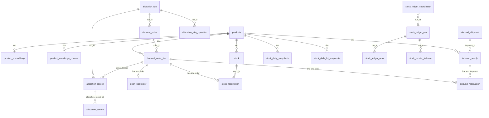

# Data model

PostgreSQL is the system of record. Flyway migrations V1–V20 create and evolve the schema. Hibernate validates that schema at startup and does not create or alter tables. The local Compose and Testcontainers PostgreSQL images include pgvector.

## Relation model

`products` is the SKU catalog. Demand, inbound supply, on-hand lots, and both daily snapshot tables reference it.

An `allocation_run` is one accepted request. It registers orders and, when allocation finishes, records the outcome of each line.

`demand_order` is the order document, one row per order. It holds the customer, priority, and reservation lifecycle: pending confirmation, confirmed, or expired. It is written at registration and stays that row while later runs allocate against it. `demand_order_line` is what the order asked for: SKU, quantity, and delivery date. Stock reservations, inbound reservations, open backorders, and allocation records point at that line.

`allocation_record` is the outcome of one run for one line: quantity taken from stock, quantity taken from inbound supply, quantity left on backorder, and the status. A later run for the same line, such as backorder fulfillment, writes another record.

`inbound_shipment` is the shipment header. `inbound_supply` is one line of that shipment and carries the receiving lot. `stock` is one on-hand lot. A reservation row is the quantity of one line held against one lot or one unreceived shipment line.

A lot is one received batch of a single SKU in one warehouse. Fifty units of the same product can be two lots: twenty that arrived on Tuesday and thirty that arrived on Friday. Each lot has its own id, received date, and quantities. In this schema that batch is one `stock` row, identified by SKU, warehouse, and `lot_id`. The `lot_id` is assigned on the shipment line and becomes the stock lot when the ledger receives that line. Allocation consumes older lots before newer ones.

`allocation_source` records which lot or shipment line supplied an allocation record. Those source identifiers are stored as columns. They are not foreign keys.

Ledger runs, work checkpoints, the coordinator lease, and receipt follow-up reference `stock_ledger_run` only. They do not reference stock or allocation rows.

These tables have no foreign keys: `allocation_sku_lock`, `allocation_document_lock`, `stock_projection_lock`, `stock_ledger_sync_status`, `allocation_job_result`, `allocation_job_tracking`, and `flyway_schema_history`. Job rows are keyed by the execution `jobId`, which is not the allocation run id.

## Tables

| Table | Responsibility |
| --- | --- |
| `products` | Product catalog and SKU reference data. |
| `product_embeddings` | Cached 768-dimensional Ollama embeddings for active catalog products, refreshed when product text or model changes. |
| `product_knowledge_chunks` | Tavily source text associated with a resolved SKU, with provenance, content hash, retrieval time, and a 768-dimensional embedding. |
| `stock` | On-hand quantity and reserved quantity by lot. `quantity_available` is generated as on hand minus reserved. |
| `stock_reservation` | Order-line reservations against live stock lots. |
| `inbound_shipment` | Shipment header identity. |
| `inbound_supply` | Shipment lines with expected and received state, reserved quantity, and a stable receiving-lot id. |
| `inbound_reservation` | Order-line reservations against unreceived shipment lines. |
| `allocation_run` | Idempotent run metadata, type, as-of date, completion state, contract version, and request hash. |
| `allocation_record` | Per-order-line allocation and backorder result for a run. |
| `allocation_source` | Lot or shipment-line source detail for each allocation record. |
| `open_backorder` | Current unfulfilled quantity by order line. |
| `allocation_sku_lock` | SKU row locks shared by allocation, amendments, projection, ledger, and whole-order expiry. |
| `allocation_document_lock` | Namespaced header and line identity locks, including identities that do not yet have a business row. |
| `allocation_sku_operation` | Per-run, per-SKU result used to resume work safely. |
| `demand_order` | Order header, original-run ownership, and shared confirmation and expiry lifecycle. |
| `demand_order_line` | Immutable line identity, SKU, requested quantity, delivery date, and document position. |
| `stock_daily_snapshots` | Aggregate daily stock trajectory by SKU and warehouse. |
| `stock_daily_lot_snapshots` | Lot-level daily balances and reservations used by ledger sync. |
| `stock_projection_lock` | Retained legacy gate. No production workflow acquires it. |
| `stock_ledger_sync_status` | Monitoring baseline and the last committed manual or scheduled ledger success. |
| `stock_ledger_run` / `stock_ledger_work` | Frozen run dates and manifests, partial outcomes, and per-SKU checkpoints. |
| `stock_ledger_coordinator` | Renewable owner lease for ledger execution. It is not held while a worker waits for a SKU lock. |
| `stock_receipt_followup` | Durable receipt-triggered backorder work, dispatched once. |
| `allocation_job_result` | Serialized `{jobId, allocationRun}` completion for an executor call, including synchronous RabbitMQ and Kafka execution. |
| `allocation_job_tracking` | Kafka execution state for a `jobId`: `PROCESSING`, `SUCCEEDED`, or `FAILED`. Inserted when the listener takes the record. |
| `flyway_schema_history` | Flyway migration metadata. |

## Migrations

V1–V20 create these tables, seed products, add daily projections and per-SKU concurrency, remove the retired stock-ledger transaction tables, add pgvector storage, add order-reservation expiry, and migrate single-line documents to header and line relationships. V15 preserves lifecycle timestamps, legacy line mappings, and received lots, and rejects inconsistent legacy reservation data. V17 adds document identity locks. V18 adds ledger run, work, and coordinator state, receipt follow-up, and a SKU index on order lines. V19 creates `allocation_job_tracking`. V20 keeps only `PROCESSING`, `SUCCEEDED`, and `FAILED` on that table.
