# Supported flows

Runtime collaboration for the scenarios listed in
[architecture.md](./architecture.md#supported-flows). PostgreSQL arrows in the
diagrams abbreviate repository calls.

### Allocation flow

`AllocationProcessor` is the common entry point for allocation jobs, MCP
tools, and product allocation. It runs `NEW_DEMAND` allocation, waits for the SKU
workers to finish, and then refreshes projections. It never invokes the ledger.

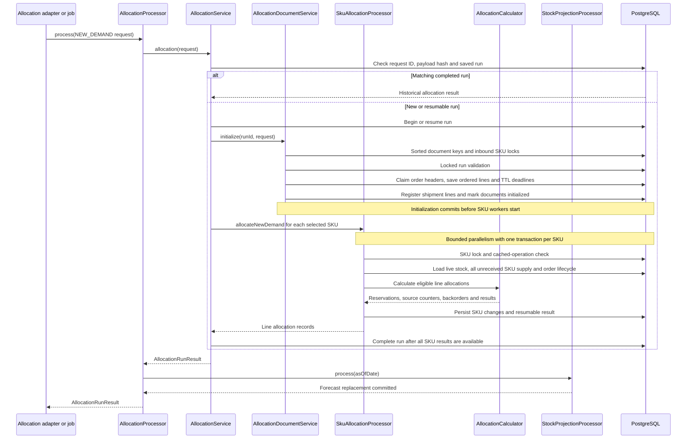

Document registration assigns one order-header deadline shared by all its lines,
including time spent waiting for SKU processing. Already initialized documents
are not registered again, so retries do not renew TTL or reapply supply amendments.
An expired header cannot acquire new reservations; late workers persist
`SKIPPED_ORDER_EXPIRED` with null allocation status and no active demand.

Independent registrations can overlap. Conflicting header/line identities
serialize through namespaced `allocation_document_lock` rows, including before
the business identities exist. Inbound amendments additionally hold the same
SKU locks as allocation and pessimistically lock existing supply before
validating reserved/received quantities. Existing identity constraints remain
in force; retries do not reparent lines or change shipment membership.

The allocation rules are:

1. Orders are processed by ascending numeric priority, then placed date, then original request order.
2. For each SKU, persisted stock lots are considered FIFO by received date, lot ID, and warehouse code.
3. Available live stock is `quantity_on_hand - quantity_reserved`.
4. Remaining demand may use inbound lines ordered by expected arrival date, shipment ID, and shipment line ID, if arrival is no later than the demand line's required delivery date.
5. Available unreceived supply is `expected_quantity - quantity_reserved`. Backorder fulfillment additionally considers only supply that has arrived by `asOfDate`.
6. Unfilled quantity is saved as an open backorder. Only confirmed backorders contribute to projected shortage; shortages do not reduce physical stock.
7. New orders create unconfirmed temporary reservations. Only confirmed reservations leave projected physical stock on their effective delivery date.

Allocations retain source-level detail identifying the stock lot or inbound shipment. A new shipment is classified as inbound supply in the run that allocates it; its unreserved surplus becomes live stock when received and can be allocated as inventory by a later request.

Supply loading includes persisted unreceived shipment lines from earlier runs,
not only the shipments in the current request. Requests can therefore allocate
against previously registered supply.

No outer transaction spans the SKU workers. If one SKU fails, other committed
SKU results remain resumable; the order is not allocated all-or-nothing. If the
forecast fails after allocation commits, processing fails visibly and retry
reuses the allocation run before retrying projection. Projection invariant
failures are distinguished from invalid request input for RabbitMQ retry handling.

### Backorder fulfillment flow

The MCP `allocate_open_backorders` tool maps a `BACKORDER_FULFILLMENT` request to
`BackorderAllocationRequest` with trigger `MANUAL`. After a ledger receipt
commits, `BackorderAllocationJob` passes a command with trigger
`STOCK_LEDGER_RECEIPT` and affected `skuScope` through the same processor and
`BackorderAllocationService`. Neither path creates replacement order headers or
new TTL deadlines.

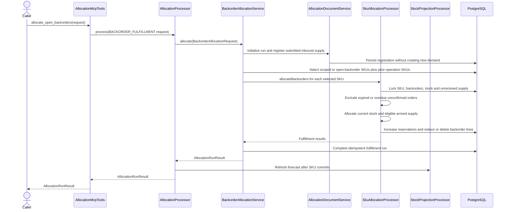

Backorders are processed by priority/FIFO, with document-line sequence preserving
separate repeated-SKU lines. Inbound supply must have arrived by `asOfDate` and
no later than the original required delivery date. Fulfillment keeps the
original order deadline, may be partial, and does not synchronize physical stock.
Repeated requests reuse saved run/SKU results rather than reserve twice.
The current fingerprint hashes an internal `AllocationRequest`, excluding the
command's `skuScope` and `trigger`; this is not full command-field validation.

### Product resolution and allocation flow

`POST /api/products/allocate` calls `ProductAllocationService` synchronously.
The frontend or another REST client supplies a structured
`ProductAllocationRequest`; the service does not invent order identity,
quantities, or dates.

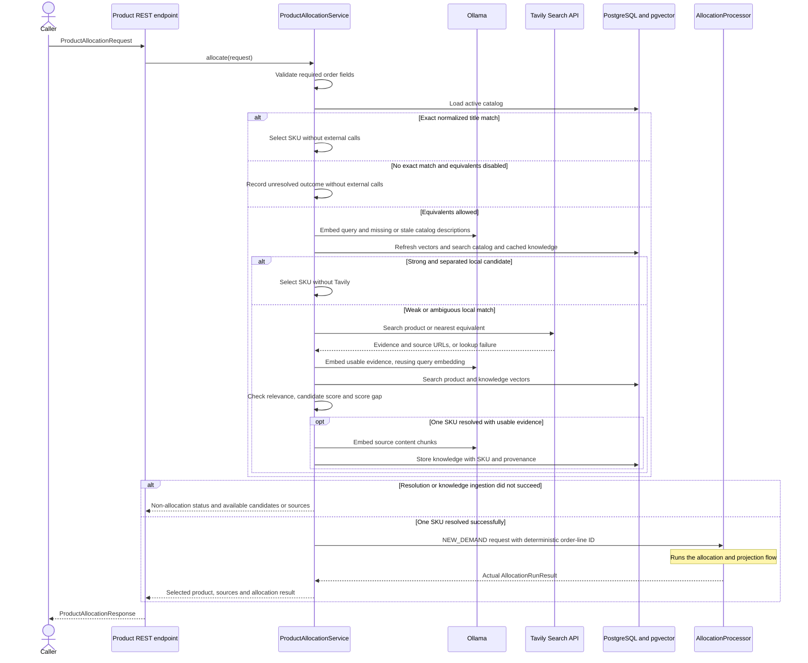

The request includes `productQuery`, `quantity`, `allowEquivalent`, `requestId`,
`orderId`, `customer`, `priority`, `placedDate`, `requiredDeliveryDate`, and
`asOfDate`. For example, "Hold 50 units of Maki Komkommer, or the nearest
equivalent" uses that phrase with `quantity: 50` and `allowEquivalent: true`.

Resolution is local-first. Exact normalized active-title matches skip Ollama and
Tavily. Otherwise, a local candidate scoring at least `0.90`, with a lead of at
least `0.08`, skips Tavily. Weak/ambiguous local results fall back to Tavily;
evidence must meet cosine relevance `0.25`, the candidate must score at least
`0.72`, and its lead must be at least `0.04`. These configurable defaults need
evaluation against representative queries.

Unresolved/ambiguous products and Tavily/Ollama or knowledge-ingestion failures
return explicit non-allocation outcomes. Local-only matches have no external
sources. Once resolved, normal partial-allocation and backorder rules apply:
the response never claims more quantity than the allocation actually reserved.
Invalid input returns HTTP `400`; allocation/projection failures remain processing
errors, not product-resolution success. No ledger synchronization occurs.

### Reservation expiry flow

Expiry is an independent recurring operation, not a consequence of receiving
another allocation request. Its batch boundary is an entire order header and
all that order's lines.

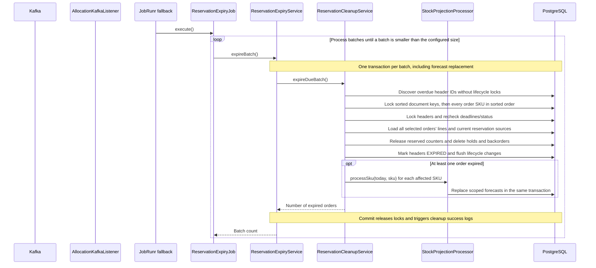

New order headers are `PENDING_CONFIRMATION`. Their shared UTC deadline defaults
to 30 minutes after document initialization, independent of delivery dates. The
sweep defaults to every minute, with batches of 100 orders. Configure positive
values through `ALLOCATION_RESERVATION_TTL`,
`ALLOCATION_RESERVATION_EXPIRY_INTERVAL`, and
`ALLOCATION_RESERVATION_EXPIRY_BATCH_SIZE`.

An order is logically expired at its deadline, although background cleanup can
lag. Overdue headers cannot receive more allocations while waiting, and retries
cannot renew deadlines or recreate released holds. Expired order IDs cannot be
reused. See the [status flow](#status-and-freshness-read-flow) for the distinction
between logical expiry and completed cleanup.

Cleanup releases counters on the reservation's current source. If receipt
converted an inbound hold to a stock hold, cleanup releases the stock lot rather
than received inbound supply. Neither physical stock quantities nor expected
inbound quantities change.

There is currently no confirmation command, so new holds eventually expire.
Pre-feature claims preserved by V14 are `CONFIRMED` without TTL. See
[the expiry feature design](../.github/memory/issues/feature_expire_allocation_reservations.md)
for lifecycle invariants and acceptance scenarios.

Missing reservation sources or insufficient reserved counters fail cleanup and
roll back the batch; cleanup does not silently discard inconsistencies.

### REST allocation submission and completion flow

The asynchronous REST interface acknowledges submission before allocation
finishes. Its job ID identifies background execution; the request's `requestId`
separately identifies the idempotent allocation run.

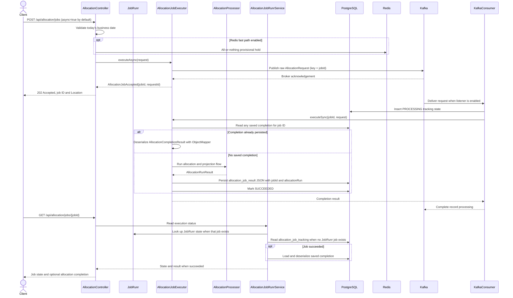

JobRunr retries failures up to three times. A saved completion is returned
without allocating/projecting again. If projection failed before completion was
saved, retry resumes the allocation run and refreshes the forecast without
reserving twice, as described in the [allocation flow](#allocation-flow).

A `SUCCEEDED` job without a saved completion is an explicit consistency error,
not an empty successful response. Completed JSON and run results describe what
was allocated at execution time; they do not prove those holds are still active.

HTTP submission has no Spring event or after-commit listener and no surrounding
application transaction. With the fast path on, a failed Kafka publish rolls
the provisional hold back and does not return `202`. The accept path does not
write `allocation_job_tracking`. If the broker accepts a record but the HTTP
response is lost, the caller has an unknown outcome; resubmitting the same
logical request may create another execution job, while allocation-run
idempotency prevents extra reservations. Status for a Kafka job appears after
the listener inserts `PROCESSING`. A successful slow-path run then settles the
Redis hold; a failed run restores it. This direct handoff is distinct
from the ledger's post-commit scheduling gap.

### RabbitMQ intake and retry flow

Rabbit intake does not initially queue a JobRunr job. The listener attempts the
same `AllocationJobExecutor.executeSync` synchronously, using `requestId` as the job ID.

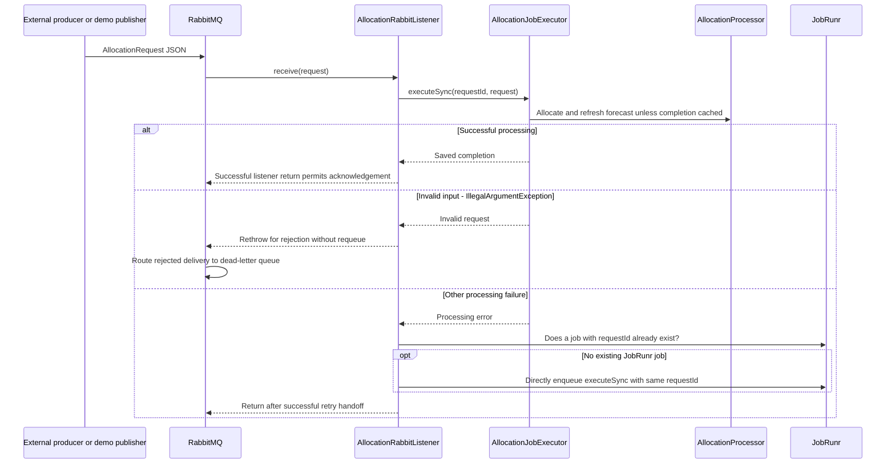

Invalid requests and oversized bodies are not retried by JobRunr. Capacity and
lock-contention failures pause and retry the same delivery; they do not enqueue
a fallback job. Other failures hand off only when a job with that ID does not
already exist; the existence check skips already recorded jobs but is not itself
an atomic business deduplication guarantee.

### Kafka allocation intake and retry flow

The Kafka listener accepts the existing `AllocationRequest` JSON
contract. The synchronous listener waits for a bounded Kotlin channel worker
that invokes the same execution path as RabbitMQ. Channel enqueue is volatile
and does not permit offset progress; the listener returns only after allocation
or a successful JobRunr recovery handoff. This preserves partition order while
consumer concurrency allows work from separate partitions to overlap. The
shared allocation semaphore remains the execution bulkhead.

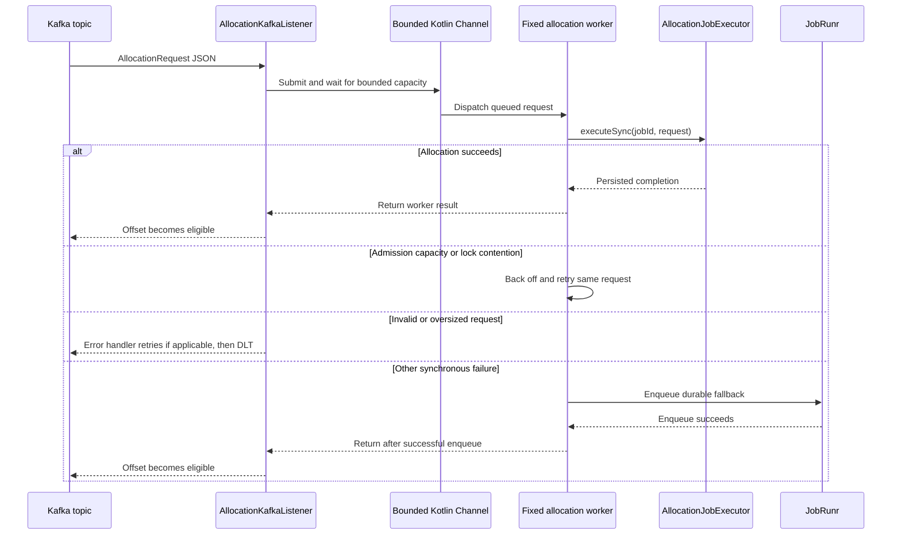

Kafka consumption is enabled by default and coexists with RabbitMQ. Set `ALLOCATION_KAFKA_ENABLED=false` to stop the listener. Both brokers can
deliver the same logical request; the stable request ID supports replay, but
the completion lookup does not guarantee single-flight execution for
simultaneous cross-broker duplicates. Local channel buffering does not add
durable admission or processing capacity.
The request queue has a dead-letter exchange/queue, with rejected messages not
requeued by default. A failure while arranging fallback still propagates rather
than masquerading as completed allocation.

The current fallback lambda still contains logging in addition to the executor
call. Unlike the corrected HTTP enqueue lambda, this has not been verified
against JobRunr's actual lambda parser by the mocked listener tests and can fail
during enqueue. A single executor invocation is the supported scheduling shape;
successful unit tests alone do not prove durable fallback acceptance.

The optional harness `AllocationRequestPublisher` emits sample requests at a
fixed interval only when explicitly enabled. Its own `application.yml` defaults
`ALLOCATION_RABBITMQ_PUBLISHER_ENABLED` to `false` and the interval to one second.
`make run-publisher` explicitly enables it. Service startup no longer generates
synthetic traffic. Catalogue SKUs are read through a harness-only JDBC
connection; the service still owns schema migrations and consumer topology.

Its sample shipments arrive one to three days ahead, and generated orders are
due three days ahead with matched quantities. This makes inbound supply eligible
for immediate reservation; it does not postpone the order's 30-minute TTL.

### Stock projection flow

`StockProjectionProcessor` derives snapshots from persisted operational state.
Allocation calls it after SKU transactions commit; expiry and ledger processing
call it within their existing transaction.

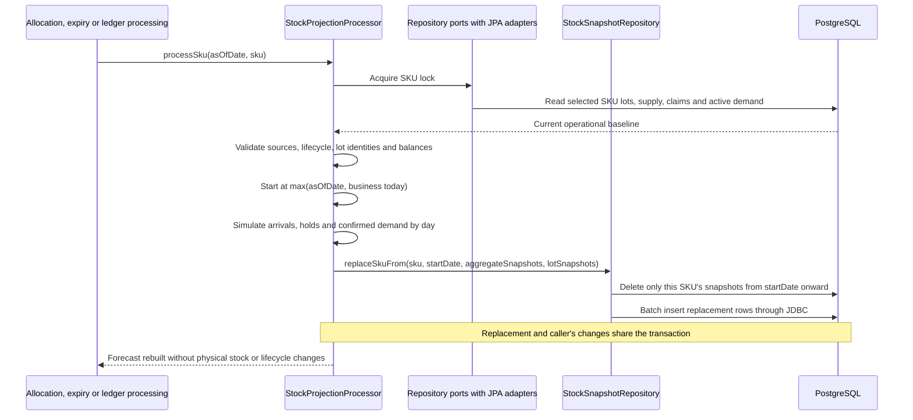

#### Snapshot meaning

The `stock` table is the current physical baseline, by SKU, warehouse, and lot. The daily projection is stored in two tables:

- `stock_daily_snapshots`: aggregate balances by date, SKU, and warehouse.
- `stock_daily_lot_snapshots`: corresponding balances and reservations by date, SKU, warehouse, and lot.

For each day:

```text
closing_stock = opening_stock + inbound_qty - allocated_qty
demand_qty = allocated_qty + shortage_qty
```

The day's closing balance becomes the next day's opening balance. A confirmed backorder contributes to `shortage_qty` on its required delivery date but does not reduce physical stock. Only confirmed stock and inbound reservations reduce physical stock on their effective delivery date; pending reservations remain holds.

Each SKU's horizon ends at its latest unreceived arrival, confirmed reservation delivery,
or confirmed backorder date, and includes at least the start date. Overdue events
are applied at the start, not reconstructed in the past. Pending delivery dates
do not extend the horizon, and future TTL release is not simulated. Earlier
snapshots are retained.

An unreceived shipment contributes its full expected quantity on arrival,
including reserved units. Pending inbound holds become projected lot reservations
on receipt but are not physical deliveries. Only confirmed backorders generate
shortage, assigned to warehouse `MAIN`.

Snapshot replacement deliberately uses JDBC, not managed snapshot entities:
rebuilding the same keys avoids JPA identity/bulk-delete conflicts without
flushing or clearing the processor's persistence context. Reads also use JDBC,
so ledger processing sees replacements made in the same transaction. The shared
datasource transaction rolls back both snapshot changes and JPA business changes
on failure; an empty replacement clears the current/future range.

#### Live quantity interpretation

For a live stock lot:

```text
quantity_available = quantity_on_hand - quantity_reserved
```

`quantity_on_hand` remains the physical quantity even while some units are reserved for future delivery. Before receipt, inbound supply is separate:

```text
inbound_quantity_available = expected_quantity - quantity_reserved
```

### Ledger synchronization flow

Ledger synchronization runs independently of allocation. Both scheduled and
manual entry points use the same coordinator and atomic per-SKU synchronization.
There is no whole-catalogue transaction or point-in-time read guarantee.

```mermaid
sequenceDiagram
    participant Trigger as JobRunr or manual MCP caller
    participant Job as StockLedgerSyncJob
    participant Ledger as StockLedgerProcessor
    participant Cleanup as ReservationCleanupService
    participant Projection as StockProjectionProcessor
    participant Snapshots as StockSnapshotRepository
    participant Status as StockLedgerSyncStatusRepository
    participant Runtime as JobRunr
    participant Backorders as BackorderAllocationJob
    participant DB as PostgreSQL

    alt Scheduled invocation
        Trigger->>Job: Execute recurring sync-stock-ledger job
        Job->>Ledger: processToday()
    else Manual invocation
        Trigger->>Ledger: process(request with optional snapshotDate)
    end
    Ledger->>DB: Begin/resume durable manifest for today's business date
    loop Incomplete SKUs in sorted order
        Ledger->>DB: Lock SKU, fence coordinator owner, lock work checkpoint
        opt Overdue whole-order lifecycle found
            Note over Ledger,DB: Roll back SKU attempt and release its locks
            Ledger->>Cleanup: expireOrders(orderIds)
            Cleanup->>DB: Lock all order SKUs, expire and refresh atomically
            Note over Ledger,DB: Retry SKU after cleanup commits
        end
        Ledger->>Projection: processSku(today, sku)
        Projection->>Snapshots: Replace selected SKU forecast in transaction
        Ledger->>Snapshots: Read fresh scoped daily/lot snapshots
        Ledger->>Ledger: Validate balances and current business date
        Ledger->>DB: Apply receipts, confirmed deliveries and hold conversions
        Ledger->>DB: Persist receipt follow-up and successful SKU checkpoint
        Note over Ledger,DB: Commit one SKU; failed work rolls back and remains resumable
    end
    Ledger->>Status: Record successful sync timestamp, date and counts
    Status->>DB: Complete parent only after all manifest work is committed
    opt Newly received shipment lines
        Ledger->>Runtime: Dispatch durable follow-up with stable command/job IDs
        Runtime->>Backorders: execute(BackorderAllocationRequest)
        Backorders->>Backorders: Allocate existing backorders and refresh projection
    end
    Ledger->>Ledger: Log completed counts and elapsed time
    alt Scheduled invocation
        Ledger-->>Job: Sync result
        Job-->>Trigger: Execution completed
    else Manual invocation
        Ledger-->>Trigger: Sync result
    end
```

`process_stock_ledger` accepts only today's `snapshotDate`; omission resolves it
from the business clock. The coordinator freezes that date and a durable SKU
manifest, then processes one SKU at a time. Each worker locks its SKU before
decision reads, rebuilds its forecast, validates balances, applies physical
movements and checkpoints atomically. Empty output is valid. Pending holds are
retained even after delivery dates; overdue pending orders instead require
independent atomic whole-order cleanup before retrying the worker.

The sync transaction does not recalculate allocations or accept explicit
warehouse movements. After committing newly received supply, it enqueues
affected-SKU backorder fulfillment as separate work. Repeating sync is safe
because delivered reservations and received shipments are no longer projected
as new movements.

`stock_receipt_followup` records stable request IDs derived from the date and
sorted received shipment-line IDs inside each receipt transaction. Dispatch
runs outside that transaction, immediately after complete synchronization and
through the minute-based `dispatch-stock-receipt-followups` recurring job.
Enqueue outages retain pending rows; duplicate dispatch reuses stable job and
allocation-request IDs. Receipt commits do not depend on scheduler availability.

`StockLedgerSyncJob` registers the stable JobRunr recurring ID `sync-stock-ledger`. The default five-field cron `0 0,12 * * *` runs at midnight and noon UTC. The configured zone also supplies the service's shared business `Clock`, including REST date validation, CSV imports, expiry, and projection dates. The separate harness publisher creates its own clock using the same zone setting. Each invocation resolves today's date; unfinished previous-day manifests become `SUPERSEDED` and a fresh current-day manifest reconciles their committed effects without replaying old forecasts.

Allocation and explicit backorder fulfillment refresh forecasts but never trigger physical synchronization. Each ledger SKU worker rebuilds its own projection under the same SKU lock and transaction immediately before applying it: an earlier forecast may contain expired or changed holds. Until sync runs, arrived supply remains inbound and due confirmed deliveries remain reserved in live stock. Expected arrival and due delivery are still date-driven assumptions, not warehouse event confirmations.

The default schedule normally allows up to roughly twelve hours of physical
ledger lag; it does not slow down allocation or the one-minute expiry sweep.
Each successful sync writes its timestamp, business date, SKU count, and lot
snapshot count in the same transaction. The lot count includes forecast lots;
it is not a count of newly received physical lots. Freshness interpretation is
described in the [status flow](#status-and-freshness-read-flow).

All pods must share JobRunr/application storage and identical schedule
configuration. Disabling scheduling removes the recurring definition, not
already queued/running executions. See
[the ledger scheduling feature](../.github/memory/issues/feature_stock_ledger_sync_job.md)
for rollout and operational trade-offs.

#### Allocation, receipt, and delivery example

On day D, live lot `LOT-A` has 5 units and shipment `SHIP-B` brings 4 units
arriving on D. Two confirmed orders are due on D+1: `ORDER-1` requests 3 and
`ORDER-2` requests 4, with equal priority and placed date. This illustrates
confirmed commitments, not the default temporary holds; confirmation itself
remains a future feature.

| Order | Requested | From inventory | From inbound | Backordered |
| --- | ---: | ---: | ---: | ---: |
| `ORDER-1` | 3 | 3 | 0 | 0 |
| `ORDER-2` | 4 | 2 | 2 | 0 |

Before receipt, `LOT-A` has 5 on hand / 5 reserved / 0 available; `SHIP-B`
has 4 expected / 2 reserved / 2 available. The D sync creates `SHIP-B` as a
live lot: total stock becomes 9 on hand, 7 reserved, and 2 available. The
D+1 sync delivers the 7 confirmed units, leaving 2 units available for later
allocation as inventory. With pending orders, receipt still happens but delivery
does not: holds remain until their TTL cleanup instead.

### Status and freshness read flow

Reservation lifecycle and ledger freshness answer different questions. These
reads do not expire orders, rebuild forecasts, or synchronize stock.

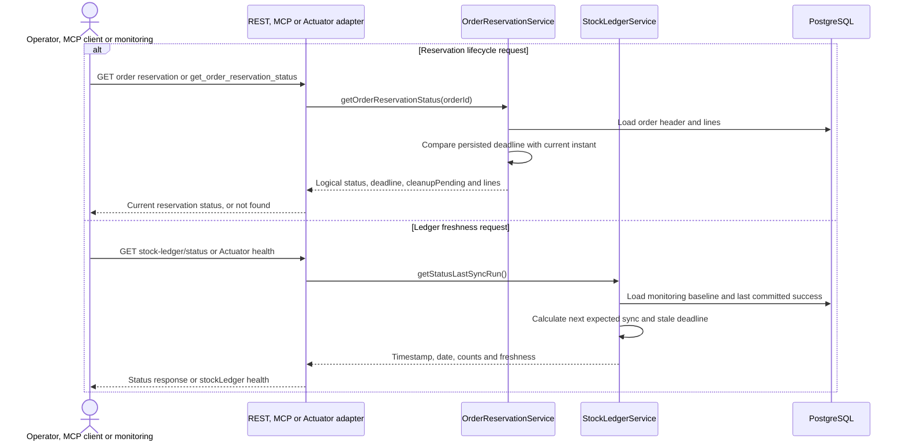

For an overdue pending order, status reports logical `EXPIRED` with
`cleanupPending: true` until the cleanup transaction commits. It does not perform
that cleanup, so inventory counters may still contain those holds briefly.
An unknown order returns REST `404`. Saved allocation results/reports are not a
substitute for this live read.

Ledger monitoring uses `lastSuccessAt`, or `monitoringStartedAt` before the first
success, as its baseline. The next expected cron occurrence plus
`freshnessTolerance` (default one hour) determines `staleAfter`. When enabled,
the Actuator `stockLedger` indicator is `UP` while fresh and `DOWN` after that
deadline. With scheduling disabled it is `UNKNOWN`, no freshness alarm is raised,
and manual synchronization remains available.

The singleton `stock_ledger_sync_status` is monitoring state, not a lock or a
once-per-day execution guard. Its success fields update only when the ledger
transaction commits. External monitoring must poll health/status and alert;
persisting this row alone does not deliver an alert.

### CSV import flow

The admin endpoint converts the configured CSV file into an allocation request.
Import does not register documents, reserve supply, or execute allocation.

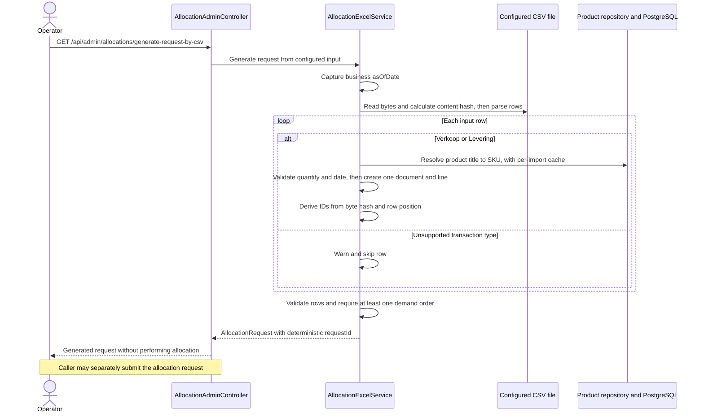

The expected columns, in order, are:

```text
Artikel,Transactie_type,QTY,Datum
```

`Verkoop` rows become single-line demand orders; `Levering` rows become single-line
shipments. Rows are not grouped by SKU or customer. Unknown transaction types
are skipped with a warning. Unknown products, malformed quantities/rows, invalid
dates, or a file without sales rows fail the import. Dates accept `yyyy-MM-dd`
or day-first `d-M-yyyy`.

Document and line IDs come from the CSV byte hash and row position; the request
ID also includes the captured `asOfDate`. Identical bytes on the same date replay
the same request regardless of path. On another date, document IDs still belong
to their original run and cannot allocate the transactions again. Changed bytes
represent a new import.

The default path is `docs/allocations.csv`; set `ALLOCATION_CSV_PATH` if the
input is elsewhere.

### Excel report flow

Reports describe a completed historical allocation run, not today's remaining
holds or the latest ledger state.

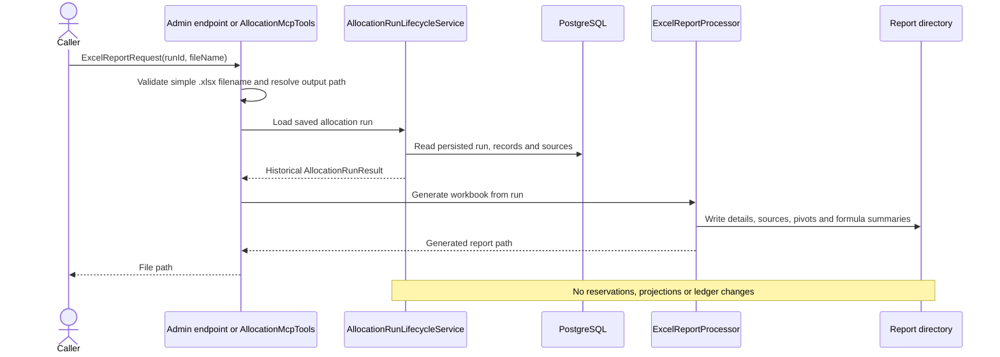

The workbook contains:

- `Allocation Details`: one row per order line, including quantities, status, and
  inventory/inbound sources.
- `Source Allocations`: one row per allocation source.
- `Pivot Summary`: pivots by SKU/status and customer/SKU backorders.
- `Formula Summary`: `SUMIFS` totals grouped by SKU/status.

The output directory defaults to `${user.home}/itzitzo-mcp/reports` and is
configurable with `REPORT_DIR`. The requested name must be a simple `.xlsx`
filename without a directory path.

### Job-record cleanup flow

`DELETE /api/admin/allocations/flush-all-jobs` clears JobRunr storage. It is
not reservation expiry, not an allocation rollback, and not a retry-count filter.

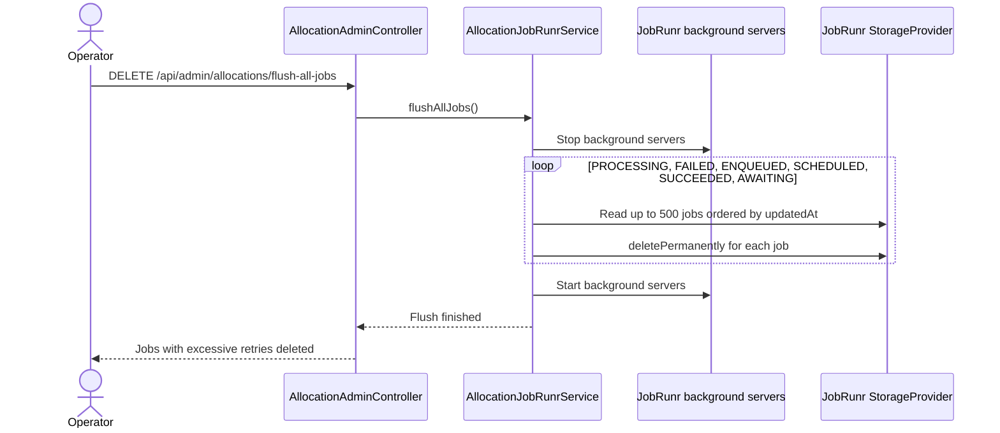

The response text still says excessive retries were deleted. The implementation
deletes every job in those states, in batches, after stopping the servers.
`allocation_job_tracking` and `allocation_job_result` are left in place.
Removing a JobRunr record does not release reservations or cancel code that is
already running. Normal reservation release follows the expiry flow.

### Scenario 11: Publish an allocation request

A reusable allocation producer starter is not part of this build. The running
publisher is `AllocationRequestPublisher` in `stockio-test-harness`. It stays
off unless `stockio.allocation.rabbitmq.publisher.enabled` is true. Service
startup does not publish sample traffic.

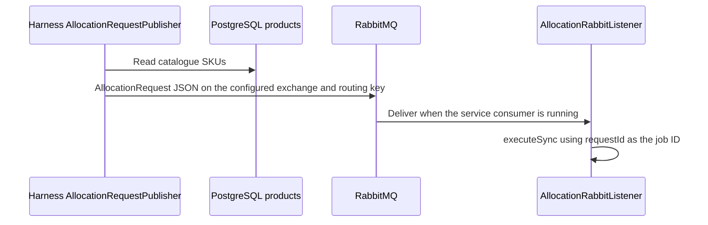

The publisher does not declare queues or the dead-letter topology. Consumption
continues in the [RabbitMQ intake flow](#rabbitmq-intake-and-retry-flow).

### Scenario 12: Allocate a product from the frontend

The agentic page posts to the Next.js route. That route calls the service over
HTTP. The browser does not call `stockio-service` directly, and product
allocation is not an MCP tool.

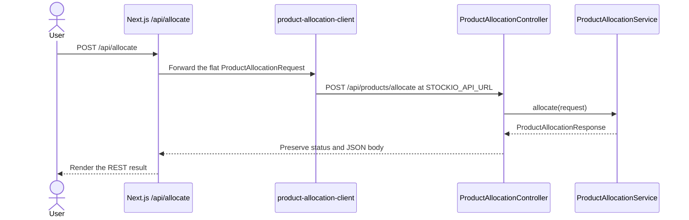

Upstream network failure returns `502`. Timeout returns `504`. Neither status
means the service stopped the allocation. Unchanged manual retries keep
`requestId`. The boundary is also described under
[Frontend HTTP integration](./architecture.md#frontend-http-integration).

### Scenario 13: Run tests and synthetic traffic

`stockio-test-harness` is a separate process from the service.

- `e2e/` runs Playwright against the Next.js UI and a localhost mock. It does not require a live service.
- `publisher/` reads SKUs through its own JDBC connection and publishes RabbitMQ requests only when explicitly enabled. See [Scenario 11](#scenario-11-publish-an-allocation-request).
- `performance/` runs Gatling against `POST /api/allocation/jobs` and `GET /api/allocation/jobs/{jobId}` with `./gradlew :stockio-test-harness:performanceRun`. A local report is not a production capacity claim. See [Scenario 19](#scenario-19-exercise-allocation-job-endpoints-under-load).

### Scenario 14: Register independent allocation documents

`AllocationDocumentService.initialize` registers orders and shipments before
SKU workers start. Disjoint document identities can register at the same time.
The same header or line identity serializes on `allocation_document_lock`.
Inbound amendments also take the affected SKU locks, in sorted order, before
business rows.

Registration does not take the legacy `stock_projection_lock`. That gate is
not used by the current writers. The lock order used after this scenario is
the [per-SKU protocol](#scenario-15-process-stock-operations-concurrently-by-sku).

### Scenario 15: Process stock operations concurrently by SKU

Allocation, scoped projection, ledger work, and whole-order expiry coordinate
on `allocation_sku_lock` instead of a single projection gate. Different SKUs
proceed together. The same SKU is taken by one transaction at a time.

Document locks, when needed, are acquired before SKU locks, then run or
lifecycle rows, then business rows. Expiry of one order locks every SKU on
that order before it releases holds. A ledger run records per-SKU checkpoints
and advances freshness only after the manifest completes. The worked example
is in [Backpressure and admission control](./arch_backpressure_admission_control.md#implemented-concurrency-idempotency-and-rollout).

### Scenario 16: Reject allocation work when capacity is exhausted

`stockio.allocation.admission.enabled` defaults to false. When it is true,
`AllocationAdmission` takes one non-waiting permit per allocation orchestration
on that process. The permit covers allocation, the following projection, and
completion persistence. There is no wait queue.

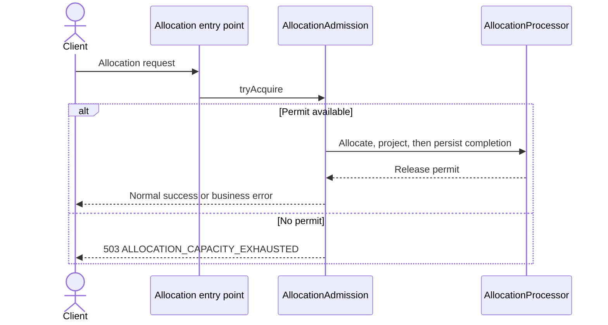

Count limits return `400`. Byte limits return `413`. Both happen before
allocation writes. RabbitMQ capacity pressure retries the same delivery and
does not enqueue a JobRunr fallback. Product lookup, ledger sync, expiry, and
status reads do not take this permit. Limits are per service instance.

### Scenario 17: Preserve maintenance admission under database-work pressure

This flow is not implemented. There is no separate database-work budget that
reserves ledger and expiry capacity while allocation permits are full. The
current guard is the allocation semaphore in
[Scenario 16](#scenario-16-reject-allocation-work-when-capacity-is-exhausted).
The draft is recorded in
[feature-shared-database-work-budget](../.github/memory/issues/feature-shared-database-work-budget.md).

### Scenario 18: Consume an allocation request from Kafka

Kafka consumption is on unless `stockio.allocation.kafka.enabled` is false. The
listener uses the record key as `jobId`, or `requestId` when the key is
absent, and calls `AllocationJobExecutor.executeSync`. The offset advances
after that call succeeds or after a JobRunr fallback is enqueued. The
sequence is the [Kafka allocation intake flow](#kafka-allocation-intake-and-retry-flow).
RabbitMQ consumption stays available beside it.

### Scenario 19: Exercise allocation-job endpoints under load

The Gatling runner in `stockio-test-harness/performance` submits
`POST /api/allocation/jobs` and polls `GET /api/allocation/jobs/{jobId}`.
Run it with `./gradlew :stockio-test-harness:performanceRun` against a
non-production service. The HTML report is written under
`stockio-test-harness/build/reports/gatling`. Authentication is optional.
The run does not establish a production latency or throughput guarantee.

### Scenario 20: Submit structured allocation requests from the direct UI

The direct page is separate from the agentic product page. It builds an
`AllocationRequest` from SKU, quantity, priority, and order fields, shows that
JSON, and posts it same-origin.

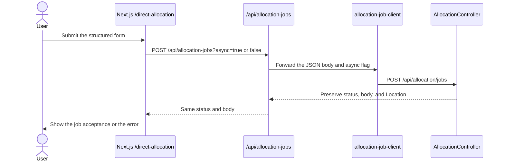

The route returns `502` or `504` when the service cannot be reached or times
out, and it does not retry. `async` must be `true` or `false`. The agentic
`POST /api/allocate` path in [Scenario 12](#scenario-12-allocate-a-product-from-the-frontend)
stays in place.

### Scenario 21: Fail fast under allocation lock contention

`stockio.allocation.lock-contention.enabled` defaults to false. When it is
true, SKU allocation sets a PostgreSQL lock timeout and statement timeout.
Lock wait, statement cancellation, and deadlock become
`503` `ALLOCATION_LOCK_CONTENTION` instead of waiting out the connection pool.

Inline HTTP returns that status for the attempt. RabbitMQ and Kafka pause and
retry the same message. JobRunr can retry the job. The response does not mean
the request was rejected for shape or for the admission semaphore in
[Scenario 16](#scenario-16-reject-allocation-work-when-capacity-is-exhausted).
Lock order stays document identities, then SKUs, then run or lifecycle rows.

### Scenario 22: Accept allocation jobs on the Redis fast path

When `stockio.allocation.redis.enabled` is true, async job submission holds
stock in Redis before Kafka publish. The request path does not write
PostgreSQL stock or allocation rows. `async=false` is rejected. Product
allocation, MCP, and the RabbitMQ listener do not take this hold.

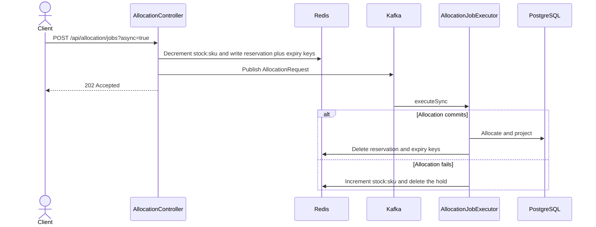

`ReservationController` serves `GET /api/reservations/orders/{key}/redis` and reads a `stock:sku`,
`reservation`, or `expiry:res` key. Other keys are rejected. Key meanings and
CDC repair are in [Fast path and slow path](./architecture.md#fast-path-and-slow-path).
