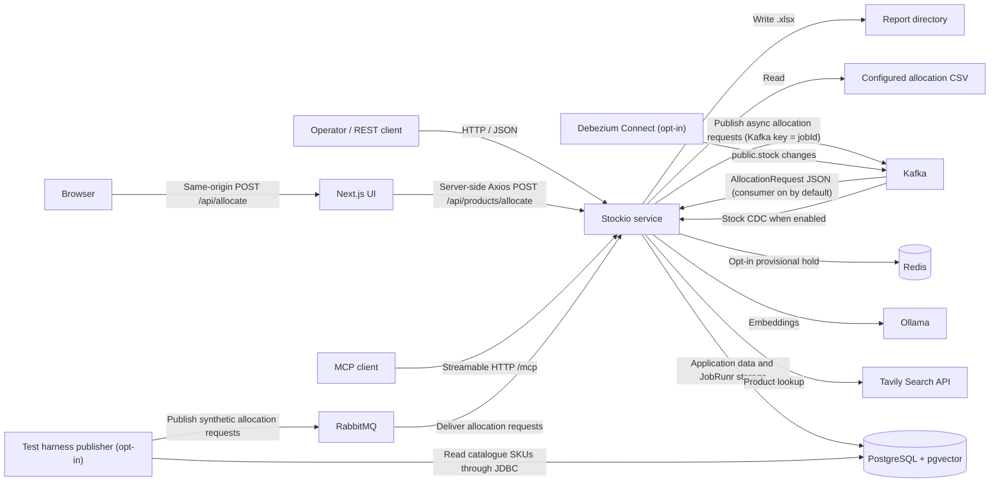

# Stockio Software Architecture

## Stack
- **Backend:** Spring Boot (Kotlin)
- **Frontend:** React, NextJs
- **Database:** PostgreSQL (Spring Data JPA, R2DBC for SKU allocation, Flyway, pgvector)
- **Testing:** JUnit Jupiter, Testcontainers, Mockk, Kotest, Playwright
- **Build:** Gradle

## Overview

Stockio is a Kotlin/Spring application for allocating demand against live inventory and expected inbound supply.
It persists allocation results and reservations in PostgreSQL, maintains daily aggregate and lot-level stock projections,
synchronizes today's projection to live stock, and generates Excel reports.
The same core services are exposed through Spring AI MCP tools and a local HTTP API.

- PostgreSQL is the system of record.
- Flyway manages the schema;
- JPA and JDBC repositories handle registration, projection, reservations outside a SKU allocation, and snapshots. A SKU allocation transaction uses its own R2DBC pool and does not enlist those JDBC connections. Spring Boot does not auto-configure a JDBC `DataSource` once an R2DBC `ConnectionFactory` exists, so the service declares the Hikari pool from `spring.datasource` itself. Flyway, JPA, and JobRunr use that pool. The JPA transaction manager stays primary for `@Transactional`. SKU allocation uses the reactive transaction manager through its own `TransactionalOperator`. `StockSnapshotRepository` uses `JdbcTemplate` to read and replace snapshots in the JDBC transaction. Snapshots are not JPA-managed entities, so repeated rebuilds do not require clearing the persistence context.
- Daily snapshots are derived projections from live stock and persisted reservations, not an independent source of inventory truth.

### Design Patterns

- **Hexagonal Architecture (Api, Ports, Infra):** Clear separation of concerns between the HTTP layer, business logic, and persistence.
- **Dependency Injection:** Spring's @Service, @Repository, and constructor injection for loose coupling and testability.
- **DTOs (Data Transfer Objects):** Used for request and response payloads to decouple API and domain models.
- **Singleton:** Spring beans are singletons by default, ensuring one instance per application context.
- **Ports and adapters:** Allocation, reservation cleanup, and stock processors depend on repository ports implemented by Spring Data JPA, JDBC, and the R2DBC SKU allocation adapter. The separation is partial: some services still inject concrete infrastructure classes, JobRunr APIs, and HTTP clients directly.
- **Configuration/Properties:** Externalized configuration using YAML and @ConfigurationProperties for environment flexibility.

## Modules and technology

The Gradle build includes three modules:

| Module | Purpose |
| --- | --- |
| `:stockio-service` (`stockio-service/`) | Spring Boot application, MCP tools, REST API, allocation workflows, persistence, CSV import, and Excel generation. |
| `:stockio-api` (`stockio-api/`) | Shared Kotlin DTO library and OpenAPI specifications/generation tasks consumed by the service; also contains the independently run Next.js UI. It has no Spring application entry point. |
| `:stockio-test-harness` (`stockio-test-harness/`) | Test-only tooling: mock-backed Playwright tests in `e2e/`, a Gatling runner in `performance/`, and an independently run JDBC/RabbitMQ sample publisher with tests in `publisher/`. Depends on API DTOs, not the service. |

The build uses Java 21, Kotlin 2.2.20, Spring Boot 3.5.10, and Spring AI 1.1.2. The service uses WebFlux on Netty, Spring Data JPA, a PostgreSQL R2DBC pool for SKU allocation, PostgreSQL with pgvector, Flyway, RabbitMQ, Kafka publishing for asynchronous allocation submissions, Spring Kafka allocation consumption enabled by default, opt-in Redis provisional holds, JobRunr for consumer recovery and other scheduled work, Apache POI, HikariCP, and Spring Boot Actuator. Natural-language product allocation also uses the Tavily search API and Ollama embeddings. SKU allocation runs as a bounded reactive fan-out on the R2DBC pool. Inline HTTP calls the suspending `AllocationJobExecutor.execute`. Prepare, projection, and completion are suspending calls on Reactor's bounded elastic dispatcher. SKU work stays a `Flux` that those calls await. Kafka, RabbitMQ, JobRunr, and MCP still block once in `executeSync` or `processSync`. Opt-in Debezium Connect tails `public.stock` into Kafka for the Redis repair consumer.

## System context



The service runs as a WebFlux application on Netty and exposes MCP tools through Spring AI's streamable HTTP transport at `/mcp`. Domain I/O stays blocking and runs on a dedicated scheduler so it stays off the Netty event loop. The HTTP server binds to `127.0.0.1:9090` by default. No application-level authentication is configured; protect the API and Actuator endpoints if `SERVER_ADDRESS` is changed to expose them beyond the local host.

### Frontend HTTP integration

The Next.js allocation UI under `stockio-api/src/main/kotlin/nl/stockio/ui`
posts to its same-origin `/api/allocate` route. The route uses the server-side
Axios client in `lib/product-allocation-client.ts` to call
`POST /api/products/allocate` at `STOCKIO_API_URL` (default
`http://127.0.0.1:9090`). The service controller directly invokes
`ProductAllocationService.allocate(request)` and returns plain JSON.

Next.js and the service start independently, using npm scripts and
IDE/`:stockio-service:bootRun` respectively. There is no Spring frontend backend,
child JVM, fat-JAR startup dependency, bundled UI/service JAR, or browser CORS
requirement. `stockio-api` builds a normal Kotlin DTO JAR, retains OpenAPI
generation tasks, and is a compile/runtime library dependency of the service;
`stockio-service` and the separate test-harness publisher apply the Spring Boot
application plugin; the API library does not.
The Spring Boot BOM's Kotlin version is explicitly aligned with the Kotlin
plugin so its compiler/build-tools dependencies are not downgraded in the
non-Boot library module.

The route preserves upstream HTTP status/body, disables redirects and caching,
and bounds upstream requests to 180 seconds. Network failures and timeouts
return `502` and `504`; neither proves the service stopped processing.
The UI validates plain REST results, displays domain non-allocation outcomes
without claiming success, and reuses request identity on unchanged manual
retries. No automatic POST retries occur.
`ProductAllocationTools` and `allocate_product_by_name` are removed; unrelated
service MCP tools remain registered.

See the [feature specification](./specifications.md#feature-replace-the-frontend-mcp-bridge-with-an-axios-service-client),
[Scenario 12](./scenarios.md#scenario-12-allocate-a-product-from-the-frontend-through-direct-service-http),
and [issue handoff](../.github/memory/issues/feature-frontend-axios-service-client.md).

### Test harness boundary

`stockio-test-harness` owns browser tests and the synthetic publisher rather
than shipping them as UI or service runtime code. Its npm package owns
Playwright configuration/dependencies and starts the existing UI against a
dedicated localhost mock. Its non-web Spring Boot publisher reads only SKUs
from the service-owned `products` table through a read-only harness datasource,
uses shared `stockio-api` DTOs and compatible JSON, and requires explicit
enablement. It does not import service repositories, entities, or application
services, migrate databases, or declare consumer topology. `performance/`
runs Gatling against the allocation-job endpoints with
`./gradlew :stockio-test-harness:performanceRun`.

See [Scenario 13](./scenarios.md#scenario-13-run-tests-and-synthetic-traffic-from-a-separate-harness),
the [feature specification](./specifications.md#feature-isolate-browser-tests-and-synthetic-publishing-in-a-test-harness),
and [harness commands/configuration](../stockio-test-harness/README.md).

## Domain layers

Packages under `nl.stockio` in `stockio-service`:

```
nl/stockio
├── allocation
│   ├── domain
│   │   ├── allocator
│   │   ├── api
│   │   │   ├── exception
│   │   │   ├── filter
│   │   │   └── validator
│   │   ├── converter
│   │   ├── fastpath
│   │   ├── job
│   │   │   └── listener
│   │   ├── model
│   │   ├── performance
│   │   ├── port
│   │   ├── processor
│   │   ├── service
│   │   └── tools
│   └── infra
│       └── model
├── product
│   ├── domain
│   │   ├── api
│   │   ├── model
│   │   ├── port
│   │   └── service
│   └── infra
├── reservation
│   ├── domain
│   │   ├── api
│   │   ├── job
│   │   ├── port
│   │   └── service
│   └── infra
└── stock
    ├── api
    ├── domain
    │   ├── job
    │   ├── port
    │   ├── processor
    │   └── service
    └── infra
```

## Fast path and slow path

PostgreSQL remains the durable stock ledger. When `stockio.allocation.redis.enabled`
is true (`STOCKIO_REDIS_PATH_ENABLED`), `POST /api/allocation/jobs` accepts only
`async=true`. The request path places one all-or-nothing provisional hold in
Redis, then publishes to Kafka. It does not write stock or allocation rows.
`async=false` returns `409` with `REDIS_SYNC_DISABLED`. A short hold returns
`409` `REDIS_INSUFFICIENT_STOCK`; a conflicting hold returns `409`
`REDIS_HOLD_CONFLICT`; a rebuild in progress returns `503` `REDIS_NOT_READY`.

The hold decrements `stock:sku:{sku}:{warehouse}`. `reservation:` and
`expiry:res:` keys remember that decrement. Slow-path success deletes those two
keys and leaves the decrement in place. Slow-path failure increments the stock
key and deletes the hold. Committed `public.stock` changes flow back through
Debezium on `stockio.cdc.public.stock` when `stockio.allocation.redis.cdc.enabled`
is true, and replace Redis availability with `SUM(quantity_available)` for that
SKU and warehouse. Startup rebuild loads the same sum and pauses new holds
while it runs. See [Redis Fast Path](../.github/memory/issues/feature-redis-fast-path.md).

The optional demo publisher is a separate `stockio-test-harness` process, not
part of the service; its behavior is described in the
[RabbitMQ flow](./arch_supported_flows.md#rabbitmq-intake-and-retry-flow).
Allocation, product, reservation, and stock run in the one Spring Boot application.

## Interfaces

### MCP tools

MCP clients connect with the streamable HTTP transport at `http://127.0.0.1:9090/mcp`. The server type is synchronous. Tool methods stay the blocking domain services.

| Tool | Input | Behavior |
| --- | --- | --- |
| `allocation_and_stock_projection` | `AllocationRequest` with `runType: NEW_DEMAND` | Allocates demand, persists reservations/backorders, and rebuilds daily projections. It does not synchronize live stock. |
| `allocate_open_backorders` | `AllocationRequest` with `runType: BACKORDER_FULFILLMENT` | Attempts to fulfill persisted backorders using eligible stock and inbound supply, rebuilds projections, and returns an `AllocationRunResult`. Does not synchronize live stock. |
| `process_stock_ledger` | `ProcessDailyStockRequest` | Expires overdue reservations, rebuilds today's projection, and applies it to live stock. Only confirmed orders are delivered; allocation is not recalculated. |
| `get_order_reservation_status` | Order ID | Returns the current lifecycle, deadline, and whether expired reservations still await cleanup. |
| `generate_excel_report` | `ExcelReportRequest` (`runId`, simple `.xlsx` `fileName`) | Generates a report for a saved allocation run and returns the output path. |

### REST endpoints

`AllocationController`, `ReservationController`, and `ProductAllocationController`
implement the generated interfaces for these OpenAPI documents:

- [`allocation-controller.yaml`](../stockio-api/src/main/resources/openapi/allocation-controller.yaml)
- [`reservation-controller.yaml`](../stockio-api/src/main/resources/openapi/reservation-controller.yaml)
- [`product-allocation-controller.yaml`](../stockio-api/src/main/resources/openapi/product-allocation-controller.yaml)

`AllocationAdminController` and `StockController` are handwritten and are not in those documents. No application-level authentication is configured.

| Method and path | Contract | Behavior |
| --- | --- | --- |
| `POST /api/products/allocate` | Product allocation OpenAPI | Synchronously resolves a `ProductAllocationRequest` and allocates it. Returns `200` with the resolution status and allocation result. Invalid input or count limits return `400`. An oversized body returns `413`. Exhausted allocation capacity returns `503`. |
| `POST /api/allocation/jobs` | Allocation OpenAPI | Requires `asOfDate` to be the current business date. `async` defaults to `true`. With the Redis fast path off, `async=true` publishes the raw `AllocationRequest` to Kafka keyed by a new `jobId` and returns `202`, `{jobId, requestId}`, and `Location: /api/allocation/jobs/{jobId}` after the broker acknowledges. The job is not pollable until the listener inserts `PROCESSING`. The request path does not write stock or allocation rows. `400`, `413`, and `503` match the OpenAPI document for invalid input, count limits, byte limits, and exhausted inline capacity. |
| `GET /api/allocation/jobs/{jobId}` | Allocation OpenAPI | Returns the JobRunr state when that job exists, otherwise `allocation_job_tracking` (`PROCESSING`, `SUCCEEDED`, or `FAILED`). A succeeded job includes `result: {jobId, allocationRun}`. A saved completion is returned as `SUCCEEDED` even when the JobRunr record is already gone. Unknown ids return `404`. A `SUCCEEDED` tracking row without saved completion returns `500`. |
| `GET /api/reservations/orders/{key}/redis` | Reservation OpenAPI | `ReservationController` returns a managed Redis key: `stock:sku:{sku}:{warehouse}`, `reservation:{requestId}:{orderId}:{orderLineId}`, or `expiry:res:{requestId}:{orderId}:{orderLineId}`. String keys return `value`; reservation hashes return `fields`. Other keys return `400`. A missing key returns `404`. Fast path disabled or rebuilding returns `503` `REDIS_NOT_READY`. |
| `GET /api/allocation/stock-ledger/status` | Allocation OpenAPI | Same ledger-freshness payload as the stock controller, mapped on `AllocationController`. |
| `GET /api/reservations/orders/{orderId}/status` | Reservation OpenAPI | Returns the current lifecycle, lines, and deadline. A pending order past its deadline is reported `EXPIRED` with `cleanupPending=true` until cleanup finishes. This read does not change stock. Unknown orders return `404`. |
| `GET /api/stock/ledger/status` | Handwritten `StockController` | Returns the last committed ledger success, snapshot date and counts, next expected execution, stale deadline, freshness, and optional `progress`. |
| `GET /api/admin/allocations/generate-request-by-csv` | Handwritten admin | Parses the configured CSV and returns an `AllocationRequest`. It does not execute it. |
| `POST /api/admin/allocations/generate-excel` | Handwritten admin | Generates an Excel report for a saved run and returns the output path. |
| `DELETE /api/admin/allocations/flush-all-jobs` | Handwritten admin | Stops JobRunr, permanently deletes stored jobs in the flushed states, and starts JobRunr again. It does not filter on retry count. |
| `GET /actuator/health` | Actuator | Spring Boot health endpoint. |
| `GET /actuator/metrics/{metricName}` | Actuator | Reads an exposed Micrometer metric. |

Execution and failure behavior for these interfaces are described in
[Supported flows](#supported-flows).

With the Redis fast path off, `POST /api/allocation/jobs?async=false` still returns `202`.
The body uses the allocation `runId` as `jobId`, completion is stored under a
separate generated execution id, and no JobRunr job is created. That `Location`
is not a working status URL. With the fast path on, `async=false` is rejected
with `409` `REDIS_SYNC_DISABLED` before Kafka publish. Fast-path hold failures
also return `409` (`REDIS_INSUFFICIENT_STOCK`, `REDIS_HOLD_CONFLICT`). Those
`409` responses are implemented on `AllocationController` and are not yet listed
in `allocation-controller.yaml`. Enabled lock-contention control returns `503`
`ALLOCATION_LOCK_CONTENTION`, which that document also does not list. The old
`/api/logistics/...` and `/api/allocation-jobs` mappings are not declared.

### Allocation request shape

An `AllocationRequest` contains:

- `requestId`: UUID used for idempotency.
- `asOfDate`: date used for the allocation and projection.
- `runType`: `NEW_DEMAND` or `BACKORDER_FULFILLMENT`.
- `demandOrders`: order headers with order ID, customer, priority, placed date, and a nonempty `lines` list. Each line has a globally unique `orderLineId`, SKU, requested quantity, and required delivery date.
- `inboundShipments`: shipment headers with shipment ID and a nonempty `lines` list. Each line has a globally unique `shipmentLineId`, SKU, expected quantity, expected arrival date, and warehouse code. `warehouseCode` defaults to `MAIN` when omitted.

The server validates required fields, positive quantities and priorities, date order, and unique IDs within a request. A new-demand request cannot reuse order IDs already processed as new demand; unresolved quantities belong to the backorder-fulfillment workflow.

An order or shipment may contain repeated SKUs, including separate lines with identical dates. Reservation/backorder identity is the line ID, not the header ID or SKU. Allocation results remain flat but include both `orderId` and `orderLineId`; inbound sources include shipment header and line IDs. `openBackorderCount` counts distinct open orders, not lines.

## Supported flows

The scenarios in [`scenarios.md`](./scenarios.md) define the supported
observable user and operational behavior. This table aligns each scenario with its
[flow](./arch_supported_flows.md). Transaction and lock boundaries are called
out in that file where they affect correctness. Allocation holds supply,
projection forecasts movements, and ledger synchronization applies due physical
movements: these are separate operations.

| Scenario | Scenario definition | Architecture detail |
| --- | --- | --- |
| 1. Allocate a Product by Name | [Scenario 1](./scenarios.md#scenario-1-allocate-a-product-by-name) | [Product resolution and allocation](./arch_supported_flows.md#product-resolution-and-allocation-flow), [allocation](./arch_supported_flows.md#allocation-flow), and [stock projection](./arch_supported_flows.md#stock-projection-flow). |
| 2. Allocate Structured New Demand | [Scenario 2](./scenarios.md#scenario-2-allocate-structured-new-demand) | [REST allocation submission and completion](./arch_supported_flows.md#rest-allocation-submission-and-completion-flow), [allocation](./arch_supported_flows.md#allocation-flow), and [stock projection](./arch_supported_flows.md#stock-projection-flow). |
| 3. Monitor an Allocation Job | [Scenario 3](./scenarios.md#scenario-3-monitor-an-allocation-job) | [REST allocation submission and completion](./arch_supported_flows.md#rest-allocation-submission-and-completion-flow). |
| 4. Fulfill Open Backorders | [Scenario 4](./scenarios.md#scenario-4-fulfill-open-backorders) | [Backorder fulfillment](./arch_supported_flows.md#backorder-fulfillment-flow) and the [receipt-triggered handoff](./arch_supported_flows.md#ledger-synchronization-flow). |
| 5. Inspect an Order Reservation | [Scenario 5](./scenarios.md#scenario-5-inspect-an-order-reservation) | [Status and freshness reads](./arch_supported_flows.md#status-and-freshness-read-flow); [reservation expiry](./arch_supported_flows.md#reservation-expiry-flow) is supporting lifecycle maintenance. |
| 6. Synchronize the Physical Stock Ledger | [Scenario 6](./scenarios.md#scenario-6-synchronize-the-physical-stock-ledger) | [Ledger synchronization](./arch_supported_flows.md#ledger-synchronization-flow), [stock projection](./arch_supported_flows.md#stock-projection-flow), and [reservation expiry](./arch_supported_flows.md#reservation-expiry-flow). |
| 7. Monitor Stock-Ledger Freshness | [Scenario 7](./scenarios.md#scenario-7-monitor-stock-ledger-freshness) | [Status and freshness reads](./arch_supported_flows.md#status-and-freshness-read-flow). |
| 8. Load an Allocation Request from CSV | [Scenario 8](./scenarios.md#scenario-8-load-an-allocation-request-from-csv) | [CSV import](./arch_supported_flows.md#csv-import-flow). |
| 9. Generate an Excel Allocation Report | [Scenario 9](./scenarios.md#scenario-9-generate-an-excel-allocation-report) | [Excel report](./arch_supported_flows.md#excel-report-flow). |
| 10. Remove Jobs with Excessive Retries | [Scenario 10](./scenarios.md#scenario-10-remove-jobs-with-excessive-retries) | [Job-record cleanup](./arch_supported_flows.md#job-record-cleanup-flow). |
| 11. Publish an Allocation Request from Another Spring Boot Application | [Scenario 11](./scenarios.md#scenario-11-publish-an-allocation-request-from-another-spring-boot-application) | [Harness publication](./arch_supported_flows.md#scenario-11-publish-an-allocation-request) and [RabbitMQ intake](./arch_supported_flows.md#rabbitmq-intake-and-retry-flow). |
| 12. Allocate a Product from the Frontend through Direct Service HTTP | [Scenario 12](./scenarios.md#scenario-12-allocate-a-product-from-the-frontend-through-direct-service-http) | [Frontend product allocation](./arch_supported_flows.md#scenario-12-allocate-a-product-from-the-frontend) and [product resolution](./arch_supported_flows.md#product-resolution-and-allocation-flow). |
| 13. Run Tests and Synthetic Traffic from a Separate Harness | [Scenario 13](./scenarios.md#scenario-13-run-tests-and-synthetic-traffic-from-a-separate-harness) | [Test harness](./arch_supported_flows.md#scenario-13-run-tests-and-synthetic-traffic). |
| 14. Register Independent Allocation Documents Concurrently | [Scenario 14](./scenarios.md#scenario-14-register-independent-allocation-documents-concurrently) | [Document registration](./arch_supported_flows.md#scenario-14-register-independent-allocation-documents) and [per-SKU coordination](./arch_backpressure_admission_control.md#implemented-concurrency-idempotency-and-rollout). |
| 15. Process Stock Operations Concurrently by SKU | [Scenario 15](./scenarios.md#scenario-15-process-stock-operations-concurrently-by-sku) | [Per-SKU stock processing](./arch_supported_flows.md#scenario-15-process-stock-operations-concurrently-by-sku). |
| 16. Reject Allocation Work When Execution Capacity Is Exhausted | [Scenario 16](./scenarios.md#scenario-16-reject-allocation-work-when-execution-capacity-is-exhausted) | [Allocation admission](./arch_supported_flows.md#scenario-16-reject-allocation-work-when-capacity-is-exhausted). |
| 17. Preserve Maintenance Admission Under Database-Work Pressure | [Scenario 17](./scenarios.md#scenario-17-preserve-maintenance-admission-under-database-work-pressure) | [Not implemented](./arch_supported_flows.md#scenario-17-preserve-maintenance-admission-under-database-work-pressure). |
| 18. Consume an Allocation Request from Kafka | [Scenario 18](./scenarios.md#scenario-18-consume-an-allocation-request-from-kafka) | [Kafka intake](./arch_supported_flows.md#kafka-allocation-intake-and-retry-flow). |
| 19. Exercise allocation-job REST endpoints under controlled load | [Scenario 19](./scenarios.md#scenario-19-exercise-allocation-job-rest-endpoints-under-controlled-load) | [Performance harness](./arch_supported_flows.md#scenario-19-exercise-allocation-job-endpoints-under-load). |
| 20. Submit structured allocation requests from a direct UI workflow | [Scenario 20](./scenarios.md#scenario-20-submit-structured-allocation-requests-from-a-direct-ui-workflow) | [Direct allocation UI](./arch_supported_flows.md#scenario-20-submit-structured-allocation-requests-from-the-direct-ui). |
| 21. Fail fast under allocation lock contention | [Scenario 21](./scenarios.md#scenario-21-fail-fast-under-allocation-lock-contention) | [Lock-contention fail-fast](./arch_supported_flows.md#scenario-21-fail-fast-under-allocation-lock-contention). |
| 22. Accept allocation jobs on the Redis fast path | [Scenario 22](./scenarios.md#scenario-22-accept-allocation-jobs-on-the-redis-fast-path) | [Redis fast path](./arch_supported_flows.md#scenario-22-accept-allocation-jobs-on-the-redis-fast-path) and [fast path and slow path](#fast-path-and-slow-path). |

#### Supporting implementation flows

These technical flows explain mechanisms that support the scenarios but are not
separate scenario definitions:

| Flow | Role | Related scenarios |
| --- | --- | --- |
| [RabbitMQ intake and retry](./arch_supported_flows.md#rabbitmq-intake-and-retry-flow) | Queue delivery, synchronous allocation attempt, JobRunr fallback, or dead-letter rejection. | 2 and 11 |
| [Kafka allocation intake](./arch_supported_flows.md#kafka-allocation-intake-and-retry-flow) | Default Kafka delivery through a bounded channel and fixed workers, with synchronous offset completion and recovery. | 18 |
| [Reservation expiry](./arch_supported_flows.md#reservation-expiry-flow) | Recurring release of overdue holds and forecast refresh. | 5 and 6 |
| [Stock projection](./arch_supported_flows.md#stock-projection-flow) | Rebuilds aggregate and lot-level forecasts without applying physical movements. | 1, 2, 4, and 6 |

Order confirmation and explicit warehouse receipt/dispatch confirmation are not
implemented flows. Receipt-triggered backorder fulfillment is implemented, but
its post-commit enqueue is not durably coupled to the receipt transaction.

## Cross-cutting concurrency, idempotency, and rollout

Allocation is idempotent on `requestId` and a stored request hash. The same payload resumes; a different payload is rejected.

Writers coordinate per SKU in PostgreSQL. Independent SKUs proceed together. One transaction at a time holds a given SKU, and expiry of a multi-SKU order holds every SKU on that order. The old global projection lock is unused.

Two opt-in guards sit in front of that work, both off by default. Allocation admission returns `503` when the instance has no free permit. Lock-contention control returns `503` `ALLOCATION_LOCK_CONTENTION` on lock wait, statement timeout, or deadlock. Neither guard is a cluster-wide database budget. A separate budget that reserves ledger and expiry capacity is not implemented.

Roll writers out together. Mixed versions that still take the global projection gate are unsupported.

Lock order, the worked example, ledger coordination, admission behavior, and route rollout are in [Backpressure and admission control](./arch_backpressure_admission_control.md#implemented-concurrency-idempotency-and-rollout).

## Data model

`products` is the SKU catalog. Demand lines, inbound shipment lines, on-hand lots, and the daily snapshots all reference a SKU there.

An `allocation_run` is one accepted request. It registers orders and, when allocation finishes, records the outcome of each line. Those are different tables.

`demand_order` is the order document, one row per order. It holds the customer, priority, and reservation lifecycle: pending confirmation, confirmed, or expired. It is written at registration and stays that row while later runs allocate against it. `demand_order_line` is what the order asked for: SKU, quantity, and delivery date. Stock reservations, inbound reservations, and open backorders point at that line.

`allocation_record` is the outcome of one run for one line: quantity taken from stock, quantity taken from inbound supply, quantity left on backorder, and the status. A later run for the same line, such as backorder fulfillment, writes another record. `allocation_source` stores the lot or shipment-line id that supplied that record.

`inbound_shipment` is the header. `inbound_supply` is a line of that shipment and its receiving lot. `stock` is an on-hand lot. A reservation holds one order line against one of those lots.

Ledger run, work, the coordinator lease, and receipt follow-up hang off `stock_ledger_run`. Lock rows, job rows, and Flyway history stand on their own.

Flyway V1–V20 owns the schema. Hibernate validates it and does not create or alter tables. Tables, foreign keys, and the diagram are in [Data model](./arch_data_model.md).

## Configuration and operations

| Variable / property | Default | Purpose |
| --- | --- | --- |
| `DB_URL` | `jdbc:postgresql://localhost:5437/logistics` | PostgreSQL JDBC URL for the pgvector-enabled local Compose database. |
| `DB_USERNAME` / `DB_PASSWORD` | `logistics` / `logistics` | Database credentials. |
| `DB_POOL_MAX_SIZE` | `10` | Hikari maximum pool size. |
| `DB_POOL_MIN_IDLE` | `2` | Hikari minimum idle connections. |
| `DB_POOL_CONNECTION_TIMEOUT_MS` | `30000` | Time to wait for a pool connection. |
| `DB_POOL_IDLE_TIMEOUT_MS` | `600000` | Maximum idle connection time. |
| `DB_POOL_MAX_LIFETIME_MS` | `1800000` | Maximum connection lifetime. |
| `R2DBC_URL` | `r2dbc:postgresql://localhost:5437/logistics` | PostgreSQL R2DBC URL for SKU allocation. It uses the same database as `DB_URL`. |
| `R2DBC_POOL_MAX_SIZE` | `10` | Maximum R2DBC pool size. This pool is separate from Hikari. |
| `R2DBC_POOL_INITIAL_SIZE` | `2` | Initial R2DBC pool size. |
| `R2DBC_POOL_MAX_ACQUIRE_TIME` | `30s` | Time to wait for an R2DBC connection. |
| `R2DBC_POOL_MAX_IDLE_TIME` | `10m` | Maximum idle time for an R2DBC connection. |
| `R2DBC_POOL_MAX_LIFE_TIME` | `30m` | Maximum lifetime of an R2DBC connection. |
| `ALLOCATION_LEDGER_SYNC_ENABLED` | `true` | Register independent ledger synchronization; false deletes its recurring definition. |
| `ALLOCATION_LEDGER_SYNC_CRON` | `0 0,12 * * *` | Five-field cron for physical ledger processing. |
| `ALLOCATION_LEDGER_SYNC_ZONE` | `UTC` | Scheduler zone and shared business-clock zone. |
| `ALLOCATION_LEDGER_SYNC_FRESHNESS_TOLERANCE` | `1h` | Grace after the next expected sync before ledger health becomes stale. |
| `SERVER_ADDRESS` / `SERVER_PORT` | `127.0.0.1` / `9090` | HTTP bind address and port. |
| `ALLOCATION_MAX_CONCURRENT_SKUS` | `4` | Maximum SKU allocation transactions in flight for one request. |
| `ALLOCATION_RESERVATION_TTL` | `30m` | Temporary order-header hold duration, including SKU-processing time. |
| `ALLOCATION_RESERVATION_EXPIRY_INTERVAL` | `1m` | Recurring expiry sweep interval, independent of ledger sync. |
| `ALLOCATION_RESERVATION_EXPIRY_BATCH_SIZE` | `100` | Maximum overdue order headers cleaned up per expiry batch. |
| `ALLOCATION_KAFKA_ENABLED` | `true` | Spring Kafka allocation consumer. Set `false` to leave HTTP publish in place without consuming the topic. |
| `ALLOCATION_KAFKA_TOPIC` | `stockio.allocation.requests` | Async allocation request topic. |
| `STOCKIO_REDIS_PATH_ENABLED` | `false` | `stockio.allocation.redis.enabled`. Provisional holds on async job submit. |
| `STOCKIO_REDIS_PATH_HOLD_TTL` | `10m` | TTL on `expiry:res` keys. |
| `STOCKIO_REDIS_PATH_DEFAULT_WAREHOUSE` | `MAIN` | Warehouse used when a demand line has no warehouse. |
| `STOCKIO_REDIS_PATH_CDC_ENABLED` | `false` | Replace Redis availability from Debezium `public.stock` events. |
| `STOCKIO_REDIS_PATH_CDC_TOPIC` | `stockio.cdc.public.stock` | Debezium stock topic. |
| `ALLOCATION_LOCK_CONTENTION_ENABLED` | `false` | Fail-fast PostgreSQL lock and statement timeouts on SKU allocation. |
| `ALLOCATION_CSV_PATH` | `docs/allocations.csv` | CSV input path. |
| `REPORT_DIR` | `${user.home}/itzitzo-mcp/reports` | Excel output directory. |
| `TAVILY_API_KEY` | empty (required for fallback searches) | Tavily API credential. |
| `TAVILY_BASE_URL` | `https://api.tavily.com` | Tavily API base URL. |
| `OLLAMA_BASE_URL` | `http://localhost:11434` | Ollama service URL. |
| `OLLAMA_EMBEDDING_MODEL` | `nomic-embed-text` | Embedding model; it must return 768 dimensions. |
| `PRODUCT_RESOLUTION_TIMEOUT` | `15s` | Connect/read timeout for Tavily and Ollama calls. |
| `PRODUCT_RESOLUTION_MAX_RESULTS` | `5` | Tavily search result count. |
| `PRODUCT_RESOLUTION_MAX_CANDIDATES` | `5` | Maximum product candidates used/returned. |
| `PRODUCT_RESOLUTION_MINIMUM_SIMILARITY` | `0.72` | Minimum score for non-exact product matches. |
| `PRODUCT_RESOLUTION_MINIMUM_SIMILARITY_GAP` | `0.04` | Required lead over the second candidate to accept an equivalent. |
| `PRODUCT_RESOLUTION_MINIMUM_LOCAL_SIMILARITY` | `0.90` | Minimum local vector score to bypass Tavily. |
| `PRODUCT_RESOLUTION_MINIMUM_LOCAL_SIMILARITY_GAP` | `0.08` | Required local lead over the second candidate to bypass Tavily. |
| `PRODUCT_RESOLUTION_MINIMUM_TAVILY_EVIDENCE_SIMILARITY` | `0.25` | Minimum cosine similarity between the requested phrase and Tavily evidence. |
| `RABBITMQ_HOST` / `RABBITMQ_PORT` | `localhost` / `5672` | RabbitMQ server address. |
| `RABBITMQ_USERNAME` / `RABBITMQ_PASSWORD` | `stockio` / `stockio` | RabbitMQ credentials. |
| `ALLOCATION_RABBITMQ_EXCHANGE` | `stockio.allocation.exchange` | Allocation request exchange. |
| `ALLOCATION_RABBITMQ_ROUTING_KEY` | `allocation.request` | Allocation request routing key. |
| `ALLOCATION_RABBITMQ_REQUEST_QUEUE` | `stockio.allocation.requests` | Allocation request queue. |
| `ALLOCATION_RABBITMQ_DEAD_LETTER_QUEUE` | `stockio.allocation.dead` | Queue for rejected requests. |
| `ALLOCATION_RABBITMQ_PUBLISHER_ENABLED` | `false` | Harness-only opt-in synthetic publishing; not a service property. |
| `ALLOCATION_RABBITMQ_PUBLISHER_INTERVAL` | `1000` | Harness-only publisher interval/initial delay in milliseconds. |
| `HARNESS_DB_URL` | `jdbc:postgresql://localhost:5437/logistics` | Harness-only read-only catalogue JDBC URL; the service owns migrations. |
| `HARNESS_DB_USERNAME` / `HARNESS_DB_PASSWORD` | `logistics` / `logistics` | Harness-only local defaults; prefer SELECT-only catalogue credentials. |
| `JOBRUNR_DASHBOARD_PORT` | `8181` | JobRunr dashboard port. |
| `STOCKIO_API_URL` | `http://127.0.0.1:9090` | Next.js server-side Axios base URL for the independently running service. |

The frontend does not launch a service subprocess or manage its dashboard.
The standalone service owns its configured HTTP and JobRunr dashboard ports.

Local Docker Compose includes a one-shot `ollama-pull-model` service. It waits
for Ollama's healthcheck, pulls `nomic-embed-text` over the internal Ollama URL,
and exits. Models persist in the `ollama-data` volume. Server health alone does
not establish model readiness; wait for successful model initialization.

Spring Boot Actuator exposes `health` and `metrics` on the application HTTP port. Useful Hikari metrics include:

```text
/actuator/metrics/hikaricp.connections
/actuator/metrics/hikaricp.connections.active
/actuator/metrics/hikaricp.connections.idle
/actuator/metrics/hikaricp.connections.pending
/actuator/metrics/hikaricp.connections.max
```

The metrics endpoint is operational information; keep it on a trusted interface or protect it with the deployment's access controls. Size the connection pool against PostgreSQL's connection limit across all application instances, not only one process.

## Tests

Run the service test suite with:

```sh
./gradlew :stockio-service:test
```

The integration tests use Testcontainers PostgreSQL to verify persistence, migrations, allocation, projections, and synchronization behavior.
