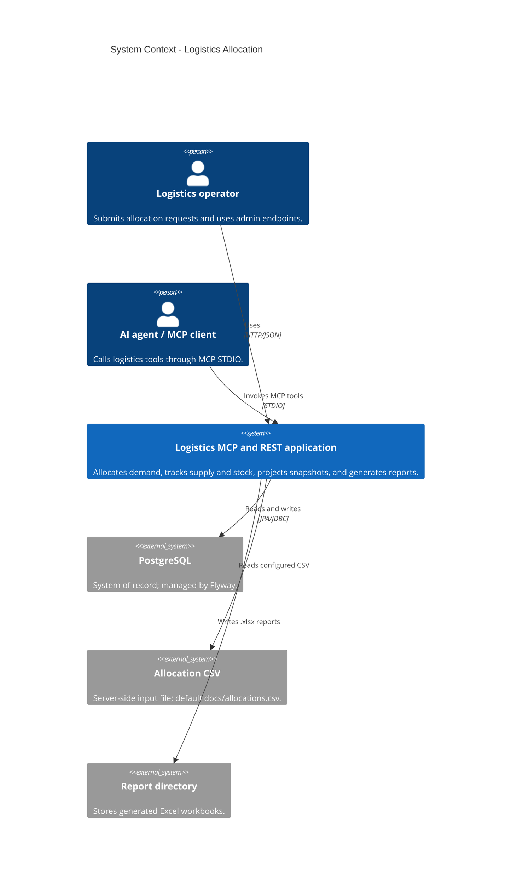
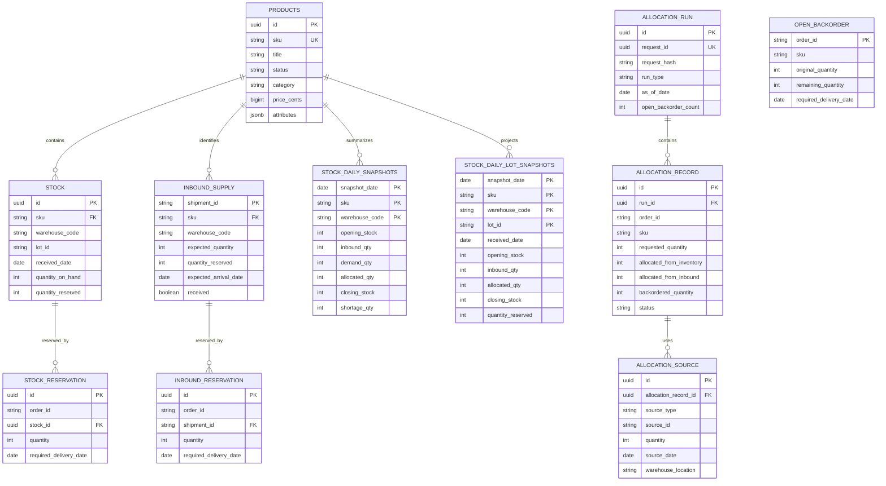
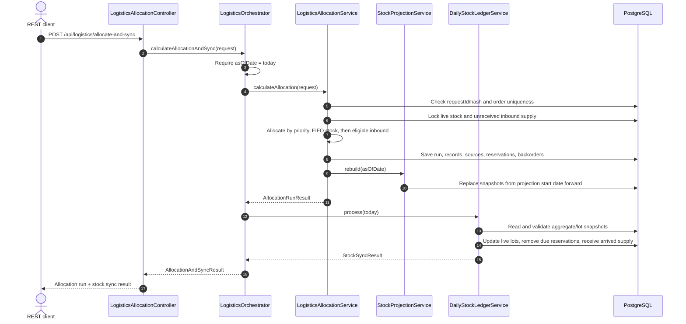
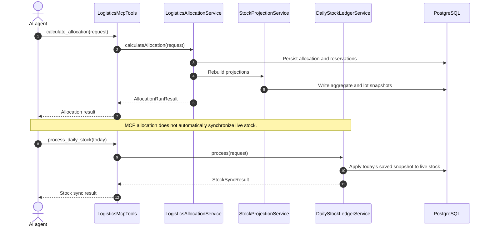
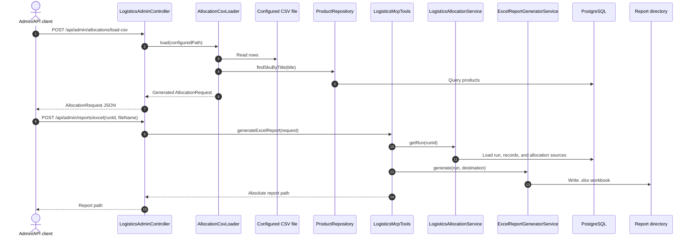

# Logistics MCP and REST API Architecture

## 1. Overview

The project is a Kotlin/Spring application that accepts demand and inbound-supply data, allocates persisted inventory, tracks backorders, projects daily stock balances, and generates Excel reports. It exposes the same logistics capabilities through Spring AI MCP tools and a local HTTP API.

The Gradle build exposes two logical projects, mapped to the current module directories:

- `:stock-service` (`stockio-service/`) is the production application: MCP server, REST API, allocation workflows, persistence, CSV loading, and Excel generation.
- `:stock-client` (`api/`) is a sample Spring AI MCP client configured to launch the server over STDIO.

PostgreSQL is the system of record. Flyway evolves the schema and seeds the product catalog. Daily snapshots are projections from the live stock baseline and persisted allocations; they are not a separate source of live inventory.

## 2. Technology stack

| Area | Technology | Role |
| --- | --- | --- |
| Runtime | Java 21 | JVM runtime and toolchain. |
| Language | Kotlin 2.2.20 | Server, client, services, and domain DTOs. |
| Build | Gradle Groovy multi-project build | Builds `:stock-service` and `:stock-client`. |
| Application framework | Spring Boot 3.5.10 | Dependency injection, configuration, transactions, and application lifecycle. |
| MCP | Spring AI 1.1.2 MCP server/client starters | Exposes tools over STDIO and supplies the sample client. |
| HTTP API | Spring MVC (`spring-boot-starter-web`) | REST controllers, defaulting to `127.0.0.1:8080`. |
| Persistence | PostgreSQL, Spring Data JPA/Hibernate | Durable products, allocations, reservations, backorders, and live stock. |
| SQL access | Spring `JdbcTemplate` | Inserts and reads aggregate/per-lot daily snapshots. |
| Schema management | Flyway | Ordered database migrations and product seed data. Hibernate runs with `ddl-auto: validate`. |
| Input validation | Jakarta Bean Validation | Validates structured allocation and report requests. |
| Excel | Apache POI OOXML 5.4.1 | Creates `.xlsx` reports, native pivot tables, and formula summaries. |
| Testing | Spring Boot Test, JUnit 5, Testcontainers PostgreSQL | Exercises application behavior and migrations against PostgreSQL. |

Configuration is supplied through environment variables: `DB_URL`, `DB_USERNAME`, `DB_PASSWORD`, `SERVER_ADDRESS`, `SERVER_PORT`, `ALLOCATION_CSV_PATH`, and `REPORT_DIR`.

## 3. System context

The application is the boundary containing allocation policy and persistence. Operators can call the HTTP endpoints directly; an AI agent can call MCP tools through the configured STDIO process. The sample `:stock-client` is one possible MCP caller, not a required production component. The CSV and report locations are local to the server process.

The HTTP listener binds to loopback by default. There is no application-level authentication configured in the current project; overriding `SERVER_ADDRESS` to expose the API beyond the local host should be accompanied by an appropriate access-control layer.

## 4. C4 component view

```mermaid
C4Component
    title C4 Component Diagram - stock-service

    Person(operator, "REST/API caller", "Uses allocation and admin endpoints.")
    Person(agent, "AI agent / MCP client", "Invokes MCP tools over STDIO.")
    System_Ext(database, "PostgreSQL", "Products, stock, allocations, and snapshots.")
    System_Ext(csv, "Allocation CSV", "Configured server-side file.")
    System_Ext(reportFiles, "Report directory", "Generated Excel workbooks.")

    System_Boundary(app, "Logistics MCP and REST application") {
        Container_Boundary(server, "stock-service - Spring Boot") {
            Component(rest, "REST Controllers", "Spring MVC", "Expose allocate-and-sync and admin endpoints.")
            Component(mcp, "LogisticsMcpTools", "Spring AI @Tool component", "Expose allocation, fulfillment, daily sync, and report tools.")
            Component(orchestrator, "LogisticsOrchestrator", "Spring service", "Runs allocation followed by today's snapshot sync in one transaction.")
            Component(allocation, "LogisticsAllocationService", "Transactional service", "Validates requests, allocates stock/supply, and persists runs and backorders.")
            Component(projection, "StockProjectionService", "Transactional service", "Rebuilds aggregate and lot-level projections from today forward.")
            Component(sync, "DailyStockLedgerService", "Transactional service", "Copies today's saved lot balances into live stock.")
            Component(loader, "AllocationCsvLoader", "Spring service", "Parses CSV rows and maps product titles to SKUs.")
            Component(products, "ProductRepository", "Spring Data JPA", "Looks up product SKUs by title.")
            Component(repositories, "Logistics repositories", "Spring Data JPA", "Persist allocation, stock, reservation, and backorder entities.")
            Component(report, "ExcelReportGeneratorService", "Spring service / Apache POI", "Creates workbook details, pivots, and formula summaries.")
        }
    }

    Rel(operator, rest, "Calls", "HTTP/JSON")
    Rel(agent, mcp, "Invokes tools", "MCP STDIO")
    Rel(rest, orchestrator, "Calls allocate-and-sync")
    Rel(rest, loader, "Calls CSV load endpoint")
    Rel(rest, mcp, "Calls report generation method")
    Rel(mcp, allocation, "Calls allocation and backorder fulfillment")
    Rel(mcp, sync, "Calls daily stock sync")
    Rel(mcp, report, "Generates report after loading a saved run")
    Rel(orchestrator, allocation, "1. Calculates and persists allocation")
    Rel(orchestrator, sync, "2. Synchronizes today's snapshot")
    Rel(allocation, repositories, "Reads/writes orders, stock, supply, reservations, runs")
    Rel(allocation, projection, "Rebuilds snapshots after allocation")
    Rel(projection, database, "Writes daily snapshots", "JDBC")
    Rel(sync, repositories, "Locks and updates live stock and reservations")
    Rel(sync, database, "Reads aggregate and lot snapshots", "JDBC")
    Rel(loader, csv, "Reads")
    Rel(loader, products, "Resolves title to SKU")
    Rel(products, database, "Queries products", "JPA")
    Rel(repositories, database, "Reads/writes", "JPA")
    Rel(report, reportFiles, "Writes .xlsx")
```

| Component | Responsibility |
| --- | --- |
| REST controllers | `LogisticsAllocationController` exposes `POST /api/logistics/allocate-and-sync`. `LogisticsAdminController` exposes CSV loading and Excel report endpoints. |
| `LogisticsMcpTools` | MCP adapter for `calculate_allocation`, `fulfill_open_backorders`, `process_daily_stock`, and `generate_excel_report`. |
| `LogisticsOrchestrator` | REST workflow facade; requires today's `asOfDate`, calls allocation first and daily sync second. Its outer transaction makes both steps atomic. |
| `LogisticsAllocationService` | Core application service: validates demand, allocates FIFO inventory then eligible inbound supply, creates backorders, persists run/source records, and requests projection rebuilding. |
| `StockProjectionService` | Recomputes aggregate and per-lot snapshots from live stock, reservations, inbound supply, and backorders. Existing snapshots before its start date are retained. |
| `DailyStockLedgerService` | Validates today's aggregate/lot snapshot consistency, synchronizes live lot balances, removes due stock reservations, and converts arrived inbound reservations. |
| `AllocationCsvLoader` | Reads the configured CSV, maps `Verkoop` to demand and `Levering` to inbound shipments, and ignores other transaction types. |
| Repositories | Spring Data JPA access to products, allocations, stock, supply, reservations, and backorders; snapshot SQL is handled with `JdbcTemplate`. |
| `ExcelReportGeneratorService` | Builds allocation detail/source sheets, native pivot tables, and a formula-based summary. |

## 5. Data model

### Entity relationships

`stock_daily_snapshots` and `stock_daily_lot_snapshots` both reference `products`; their composite keys are shown above. There is no database foreign key from backorders to allocation records, nor from a snapshot aggregate row to its lot rows.

### Table responsibilities

| Table | Purpose and important fields |
| --- | --- |
| `products` | Product catalog keyed by SKU; title is used by the CSV loader to resolve SKU. Flyway seeds the current catalog. |
| `stock` | Current on-hand and reserved quantity for each `(sku, warehouse_code, lot_id)`; available quantity is generated as on-hand minus reserved. |
| `stock_reservation` | Quantity allocated from a live stock lot to an order, with the delivery date when it leaves the projection. |
| `inbound_supply` | Expected shipment by shipment ID, including SKU, warehouse, expected quantity, reserved quantity, arrival date, and receipt state. |
| `inbound_reservation` | Quantity allocated to an order from a shipment before it is received. On receipt, future reservations transfer to `stock_reservation`. |
| `allocation_run` | One idempotent execution, keyed by a generated run ID and unique `request_id`; stores request hash, run type, as-of date, and open-backorder count. |
| `allocation_record` | Per-order result within a run: requested, allocated, backordered quantities, status, priority, and dates. |
| `allocation_source` | Per-record source detail identifying the stock lot or inbound shipment and allocated quantity. |
| `open_backorder` | Current outstanding balance for an order. Fulfillment reduces or deletes this record. |
| `stock_daily_snapshots` | Aggregate daily opening, inbound, demand, allocated, closing, and shortage quantities by SKU/warehouse/date. |
| `stock_daily_lot_snapshots` | Daily lot-level balances, receipt dates, and future reservations used to synchronize live stock without losing lot identity. |
| `flyway_schema_history` | Flyway-managed migration metadata, not logistics data. It is preserved by data-clear scripts. |

Migration history: V1-V3 create and extend allocation persistence/idempotency; V4-V5 create and seed products; V6-V8 add stock, reservations, and aggregate/lot projections; V9 removes the unused legacy `stock_ledger_run` and `stock_ledger_transaction` tables.

## 6. Runtime flows

### 6.1 REST allocation followed by today's sync

This REST workflow runs in one transaction. If synchronization fails, allocation writes and projection changes roll back with it. The `asOfDate` guard prevents an allocation from committing when the subsequent sync cannot process the same day.

### 6.2 Direct MCP allocation and stock sync

MCP exposes allocation, backorder fulfillment, daily stock sync, and Excel report generation as separate tools. Unlike the REST orchestration endpoint, an MCP caller decides when to invoke `process_daily_stock`.

### 6.3 CSV load and Excel report

The CSV loader returns a request; it does not itself allocate. It maps only `Verkoop` and `Levering` rows, resolves titles through the product repository, and generates random IDs/customer names per load. The report endpoint reuses the MCP tool method and only accepts a simple `.xlsx` filename to keep output inside the configured report directory.

## 7. Allocation and stock rules

- Orders are processed by lower numeric priority first, then `placedDate`; payload order breaks ties.
- Existing inventory is allocated FIFO by `receivedDate` and lot ID, with persisted reservations excluded from availability.
- New-demand requests can reserve unreceived supply only when its expected arrival is on or before the order's required delivery date. Backorder fulfillment additionally requires arrival by the request's `asOfDate`.
- Live-stock availability is `quantity_on_hand - quantity_reserved`; unreceived-supply availability is `expected_quantity - quantity_reserved`. New shipments are allocated as inbound in that run, not first converted to inventory. On receipt, their unallocated surplus becomes live stock and can be allocated as inventory by later orders. See the [per-order quantity example](stock_interaction.md#per-order-quantity-flow).
- Allocated quantities are reserved at allocation time and projected to leave physical stock on their effective delivery date. A past required date is clamped to at least the request's `asOfDate`.
- Remaining unfilled demand becomes an open backorder. Backorders add projected shortage and do not reduce physical closing stock.
- Daily physical balance follows `closing_stock = opening_stock + inbound_qty - allocated_qty`. Lot-level totals must agree with aggregate closing stock before today's snapshot is synchronized.
- Projections use current live stock as their baseline and rebuild from `max(asOfDate, today)` onward; earlier snapshots are retained rather than reconstructed from current stock.

## 8. Design patterns and architectural decisions

| Pattern / decision | How it appears in the project |
| --- | --- |
| Layered architecture / adapters | MCP tools and REST controllers are inbound adapters. Services implement application workflows. Repositories and `JdbcTemplate` provide persistence access. |
| Repository pattern | Spring Data repositories encapsulate products, allocation runs/records/sources, backorders, live stock, and supply reservations. |
| Service layer | Allocation, projection, synchronization, CSV parsing, and report generation have distinct service responsibilities. |
| Orchestrator / facade | `LogisticsOrchestrator` composes allocation and daily synchronization behind one REST operation. |
| Transaction boundary | `@Transactional` protects allocation persistence and projection updates; the orchestrator's outer transaction spans both allocation and sync. |
| Idempotent command handling | Allocation requests are hashed with SHA-256 and keyed by `requestId`. A retry with the same ID and payload returns the previous run; a conflicting reuse is rejected. |
| Deterministic allocation policy | Priority ordering and FIFO lot/supply ordering encode the selected allocation policy explicitly. |
| Projection/rebuild | `StockProjectionService` recalculates future daily snapshots from current persisted state instead of treating snapshots as independent mutable stock. |
| DTO/entity separation | Request and result data classes are distinct from JPA entities; service code maps between them. |

The project does not use event sourcing: `allocation_source` is allocation provenance, while live stock and reservation tables remain the operational state. The `stock_ledger_run` and `stock_ledger_transaction` tables from the earlier transaction-based design were dropped in V9.

## 9. Operational entry points

| Entry point | Behavior |
| --- | --- |
| MCP STDIO | Used by an MCP client to call the four logistics tools. |
| `POST /api/logistics/allocate-and-sync` | Runs new-demand allocation and today's stock sync atomically; requires `asOfDate` to be today. |
| `POST /api/admin/allocations/load-csv` | Loads the configured CSV and returns a generated request without allocating it. |
| `POST /api/admin/reports/excel` | Generates a workbook for a previously persisted allocation run and returns its path. |
| `fulfill_open_backorders` / `process_daily_stock` MCP tools | Independently fulfill pending orders and synchronize today's saved snapshot. |

The REST listener defaults to loopback (`127.0.0.1:8080`). The application does not currently configure authentication or authorization. Flyway migrations apply at startup; Hibernate validates the resulting schema rather than creating or altering it.
