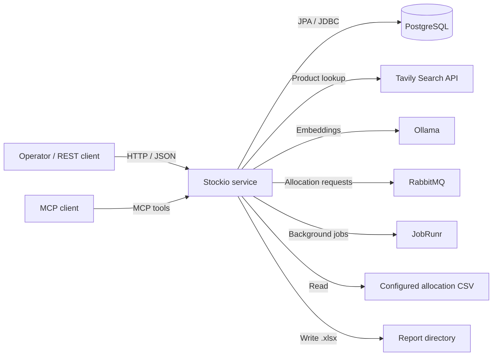
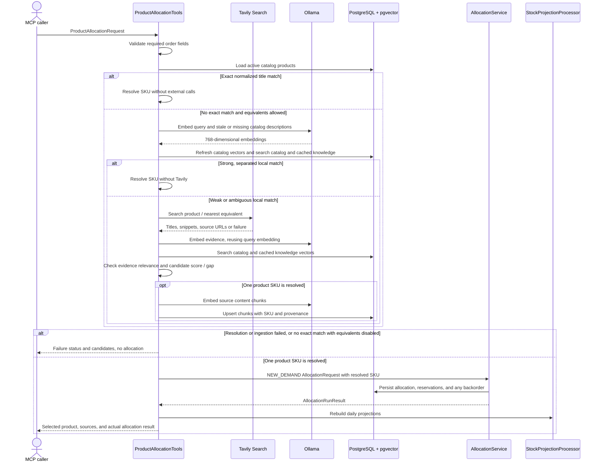

# Stockio Architecture

## Overview

Stockio is a Kotlin/Spring application for allocating demand against live inventory and expected inbound supply. It persists allocation results and reservations in PostgreSQL, maintains daily aggregate and lot-level stock projections, synchronizes today's projection to live stock, and generates Excel reports. The same core services are exposed through Spring AI MCP tools and a local HTTP API.

PostgreSQL is the system of record. Flyway manages the schema; JPA repositories handle most operational data, while `JdbcTemplate` is used for projection locking and snapshot persistence. Daily snapshots are derived projections from live stock and persisted reservations, not an independent source of inventory truth.

## Modules and technology

The Gradle build includes two modules:

| Module | Purpose |
| --- | --- |
| `:stockio-service` (`stockio-service/`) | Spring Boot application, MCP tools, REST API, allocation workflows, persistence, CSV import, and Excel generation. |
| `:stockio-api` (`stockio-api/`) | Sample Spring AI MCP client. It is not required by the service at runtime. |

The build uses Java 21, Kotlin 2.2.20, Spring Boot 3.5.10, and Spring AI 1.1.2. The service uses Spring MVC, Spring Data JPA, PostgreSQL with pgvector, Flyway, RabbitMQ, JobRunr, Apache POI, HikariCP, and Spring Boot Actuator. Natural-language product allocation also uses the Tavily search API and Ollama embeddings. Allocation work is parallelized across SKUs with Kotlin coroutines.

## System context



The service runs as a servlet application and exposes MCP tools through Spring AI. The HTTP server binds to `127.0.0.1:8080` by default. No application-level authentication is configured; protect the API and Actuator endpoints if `SERVER_ADDRESS` is changed to expose them beyond the local host.

## Application components

| Component | Responsibility |
| --- | --- |
| `AllocationTools` | MCP adapter for new-demand allocation and projection, backorder fulfillment, stock-ledger synchronization, and Excel report generation. |
| `ProductAllocationTools` / `ProductAllocationService` | Resolves a product phrase through local catalog/vector matching with Tavily fallback, then delegates allocation to the existing allocation and projection services. |
| Tavily / Ollama clients | Perform external product search and local embedding requests with configured timeouts. |
| `ProductVectorRepository` | Persists catalog embeddings and Tavily knowledge chunks and performs pgvector similarity searches. |
| `AllocationController` | Accepts asynchronous allocate-and-project-and-sync requests and exposes JobRunr job status. |
| `AllocationAdminController` | Creates allocation requests from CSV, generates reports, and removes jobs with excessive retries. |
| `AllocationService` | Validates, groups work by SKU, coordinates SKU workers, and completes allocation runs. |
| `AllocationSkuWorker` | Performs one SKU's transactional allocation or backorder fulfillment, reserves stock/supply, and persists resumable operation results. |
| `AllocationPolicyCalculator` | Applies order priority, FIFO source selection, delivery-date eligibility, and backorder rules. |
| `StockProjectionProcessor` | Rebuilds aggregate and lot-level daily projections from the live stock baseline and persisted reservations. |
| `StockLedgerProcessor` | Validates and synchronizes today's saved lot-level projection to live stock. |
| `AllocationJob` / completion service | Runs the asynchronous allocate-project-and-sync workflow and persists its final result. |
| `AllocationExcelService` | Parses the configured CSV and creates a validated allocation request. |
| `ExcelReportProcessor` | Writes allocation details, sources, pivot tables, and formula summaries to an `.xlsx` workbook. |
| Repositories and `JdbcTemplate` | Persist operational state, enforce locks, and read/write snapshot data. |

## Interfaces

### MCP tools

| Tool | Input | Behavior |
| --- | --- | --- |
| `allocation_and_stock_projection` | `AllocationRequest` with `runType: NEW_DEMAND` | Allocates demand, persists reservations/backorders, and rebuilds daily projections. It does not synchronize live stock. |
| `allocate_product_by_name` | `ProductAllocationRequest` | Requires Tavily lookup, resolves a product to an active catalog SKU, allocates through `AllocationService`, rebuilds projections, and returns product evidence plus the allocation result. Unresolved or ambiguous products are not allocated. |
| `allocate_open_backorders` | `AllocationRequest` with `runType: BACKORDER_FULFILLMENT` | Attempts to fulfill persisted backorders using eligible stock and inbound supply; returns an `AllocationRunResult`. The current tool path does not rebuild projections or synchronize live stock. |
| `process_stock_ledger` | `ProcessDailyStockRequest` | Applies today's existing snapshot to live stock and returns a `StockSyncResult`. It does not recalculate allocations or stock movements. |
| `generate_excel_report` | `ExcelReportRequest` (`runId`, simple `.xlsx` `fileName`) | Generates a report for a saved allocation run and returns the output path. |

### Agentic product-allocation flow

The MCP caller interprets the user's natural-language request and submits a structured `ProductAllocationRequest`. For example, “Hold 50 units of Maki Komkommer, or the nearest equivalent” becomes a request with `productQuery: "Maki Komkommer"`, `quantity: 50`, and `allowEquivalent: true`. The caller must also supply `requestId`, `orderId`, `customer`, `priority`, `placedDate`, `requiredDeliveryDate`, and `asOfDate`; the service does not invent order identity or dates.



Resolution is local-first. An exact normalized active-catalog title match skips Ollama and Tavily. If no exact match exists and `allowEquivalent` is false, resolution stops without external calls. Otherwise, query embeddings search catalog and cached-knowledge vectors after stale catalog embeddings are refreshed. A candidate scoring at least `0.90` with a lead of at least `0.08` skips Tavily. These local-only thresholds are independently configurable starting points and should be evaluated against representative queries.

Weak or ambiguous local matches fall back to Tavily. Fallback evidence must meet the configured cosine-similarity threshold (`0.25` by default); a candidate must meet the fallback minimum similarity (`0.72` by default) and lead the next candidate by the configured gap (`0.04` by default). The tool returns candidates without allocating if evidence is irrelevant, no candidate qualifies, or the result remains ambiguous. Tavily or Ollama failures are returned as explicit non-allocation statuses. Local-only resolutions return an empty sources list.

After resolution, the tool uses Stockio's normal `NEW_DEMAND` behavior. Partial allocations are allowed, and any unfilled quantity becomes an open backorder. The response reports the selected product, Tavily source URLs, and the actual `AllocationRunResult`; it does not claim the full requested quantity was held unless the allocation result confirms it. The tool rebuilds projections but does not synchronize live stock.

### REST endpoints

| Method and path | Behavior |
| --- | --- |
| `POST /api/products/allocate` | Synchronously performs the agentic product lookup and allocation for a `ProductAllocationRequest`; returns the product-resolution status and allocation result. |
| `POST /api/logistics/allocate-project-and-sync` | Validates today's `asOfDate`, accepts an allocation request, and returns `202 Accepted` with a JobRunr `jobId` and status URL. |
| `GET /api/logistics/allocate-project-and-sync/job-status/{jobId}` | Returns the JobRunr state and, when succeeded, the persisted allocation and stock-sync result. |
| `GET /api/admin/allocations/generate-request-by-csv` | Parses the configured CSV and returns a generated `AllocationRequest`; it does not execute it. |
| `POST /api/admin/allocations/generate-excel` | Generates an Excel report from a saved run. |
| `DELETE /api/admin/allocations/delete-jobs-with-excessive-retries` | Removes qualifying JobRunr jobs with excessive retry transitions. |
| `GET /actuator/health` | Spring Boot health endpoint. |
| `GET /actuator/metrics/{metricName}` | Reads an exposed Micrometer metric. |

The asynchronous REST workflow uses an event published inside a transaction and schedules its JobRunr job after commit. Job status is read through JobRunr's `StorageProvider`; the result payload is persisted separately in `allocation_job_result`.

`POST /api/products/allocate` is a synchronous endpoint and delegates to the same `ProductAllocationService` as the MCP tool. Product-resolution failures are returned in the `ProductAllocationResponse` body without creating an allocation; invalid request fields return `400 Bad Request`.

### Allocation request shape

An `AllocationRequest` contains:

- `requestId`: UUID used for idempotency.
- `asOfDate`: date used for the allocation and projection.
- `runType`: `NEW_DEMAND` or `BACKORDER_FULFILLMENT`.
- `demandOrders`: order ID, customer, SKU, requested quantity, priority, placed date, and required delivery date.
- `inboundShipments`: shipment ID, SKU, expected quantity, expected arrival date, and warehouse code.

The server validates required fields, positive quantities and priorities, date order, and unique IDs within a request. A new-demand request cannot reuse order IDs already processed as new demand; unresolved quantities belong to the backorder-fulfillment workflow.

## Allocation behavior

1. Orders are processed by ascending numeric priority, then placed date, then original request order.
2. For each SKU, persisted stock lots are considered FIFO by received date, lot ID, and warehouse code.
3. Available live stock is `quantity_on_hand - quantity_reserved`.
4. Remaining demand may use inbound supply ordered by expected arrival date and shipment ID, if its arrival is no later than the order's required delivery date.
5. Available unreceived supply is `expected_quantity - quantity_reserved`. Backorder fulfillment additionally considers only supply that has arrived by `asOfDate`.
6. Unfilled quantity is saved as an open backorder. Backordered quantity contributes to projected shortage but is not deducted from physical stock.
7. Allocated quantities are reserved when the run is processed and leave projected physical stock on `max(asOfDate, requiredDeliveryDate)`.

Allocations retain source-level detail identifying the stock lot or inbound shipment. A new shipment is classified as inbound supply in the run that allocates it; its unreserved surplus becomes live stock when received and can be allocated as inventory by a later request.

### Idempotency and parallel work

Allocation runs are keyed by `requestId` and store a request hash. A retry with the same ID and payload resumes or returns the existing run; reusing the ID with conflicting data is rejected. Per-SKU operation results and order claims support retries without allocating an order twice. A unique SKU lock serializes concurrent changes for the same SKU, while a shared projection lock coordinates allocation with projection and stock synchronization.

SKU work is limited by `stockio.allocation.max-concurrent-skus` (default `4`) and runs in separate transactions. Set `ALLOCATION_MAX_CONCURRENT_SKUS` to tune that limit. The maximum applies to the shared allocation dispatcher, not independently to each SKU in each request.

## Asynchronous processing

The REST endpoint publishes an allocation event in a transaction. After commit, `AllocationEventListener` enqueues a JobRunr job using the event's UUID. `AllocationJob` performs the allocation, then its completion service rebuilds projections, synchronizes today's stock, and stores the combined result. JobRunr retries the job up to three times.

RabbitMQ requests are first attempted synchronously by `AllocationRabbitListener`. Invalid requests that throw `IllegalArgumentException` are rejected rather than sent to JobRunr. Other synchronous failures use JobRunr as a fallback if a job with that ID does not already exist. The request queue is configured with a dead-letter exchange and queue; rejected messages are not requeued by default.

The optional `AllocationRequestPublisher` emits sample requests at a fixed interval when enabled. In the current `application.yml`, it is enabled by default with a one-second interval; disable it in non-demo deployments with `ALLOCATION_RABBITMQ_PUBLISHER_ENABLED=false`.

## Stock projections and synchronization

### Snapshot meaning

The `stock` table is the current physical baseline, by SKU, warehouse, and lot. The daily projection is stored in two tables:

- `stock_daily_snapshots`: aggregate balances by date, SKU, and warehouse.
- `stock_daily_lot_snapshots`: corresponding balances and reservations by date, SKU, warehouse, and lot.

For each day:

```text
closing_stock = opening_stock + inbound_qty - allocated_qty
demand_qty = allocated_qty + shortage_qty
```

The day's closing balance becomes the next day's opening balance. A backorder contributes to `shortage_qty` on its required delivery date but does not reduce physical stock. Allocated stock and inbound supply reduce physical stock on their effective delivery date.

After allocation changes, `StockProjectionProcessor` uses current live stock as its baseline and rebuilds from `max(asOfDate, today)` forward through the latest relevant arrival, reservation, or backorder date. Earlier snapshots are retained; the service does not reconstruct historical physical stock from today's quantities.

### Live quantity interpretation

For a live stock lot:

```text
quantity_available = quantity_on_hand - quantity_reserved
```

`quantity_on_hand` remains the physical quantity even while some units are reserved for future delivery. Before receipt, inbound supply is separate:

```text
inbound_quantity_available = expected_quantity - quantity_reserved
```

### Example

On day D, assume live lot `LOT-A` has 5 units and a new shipment `SHIP-B` brings 4 units arriving on D. Two orders are due on D+1: `ORDER-1` requests 3 and `ORDER-2` requests 4, with equal priority and placed date.

| Order | Requested | From inventory | From inbound | Backordered |
| --- | ---: | ---: | ---: | ---: |
| `ORDER-1` | 3 | 3 | 0 | 0 |
| `ORDER-2` | 4 | 2 | 2 | 0 |

Before receipt, `LOT-A` has 5 on hand / 5 reserved / 0 available; `SHIP-B` has 4 expected / 2 reserved / 2 available. The D stock sync creates `SHIP-B` as a live lot, leaving total live stock at 9 on hand, 7 reserved, and 2 available. When the D+1 snapshot is synchronized, the 7 allocated units leave physical stock and the 2 unreserved units remain available. A later request can allocate those units as inventory.

### Daily ledger sync

`process_stock_ledger` accepts only today's `snapshotDate`. Today's aggregate snapshots must exist, and each aggregate closing quantity must equal the sum of its lot-level closing quantities. Synchronization updates live lot quantities/reservations, sets omitted unreserved lots in the affected SKU/warehouse scopes to zero, removes due stock reservations, marks arrived shipments as received, and converts their future inbound reservations to stock reservations.

The sync does not recompute the projection or accept movements. Repeating it is safe because it reapplies the saved closing balances and processes due reservations/receipts idempotently. Projection and ledger operations coordinate with allocation through the `stock_projection_lock` row.

## Persistence model

| Table | Responsibility |
| --- | --- |
| `products` | Product catalog and SKU reference data. |
| `product_embeddings` | Cached 768-dimensional Ollama embeddings for active catalog products, refreshed when product text or model changes. |
| `product_knowledge_chunks` | Tavily source text associated with a resolved SKU, with provenance, content hash, retrieval time, and a 768-dimensional embedding. |
| `stock` | Current physical quantity and future reservations by lot. |
| `stock_reservation` | Order reservations against live stock lots. |
| `inbound_supply` | Expected receipts, received state, and reserved shipment quantities. |
| `inbound_reservation` | Order reservations against unreceived shipments. |
| `allocation_run` | Idempotent run metadata, type, as-of date, completion state, and request hash. |
| `allocation_record` | Per-order allocation and backorder results. |
| `allocation_source` | Lot/shipment source detail for each allocation record. |
| `open_backorder` | Current unfulfilled quantity by order. |
| `allocation_sku_lock` | Per-SKU serialization for allocation workers. |
| `allocation_sku_operation` | Per-run, per-SKU result used to resume work safely. |
| `allocation_order_claim` | Prevents an order from being submitted as new demand more than once. |
| `stock_daily_snapshots` | Aggregate daily stock trajectory. |
| `stock_daily_lot_snapshots` | Lot-level daily balances and reservations used by the ledger sync. |
| `stock_projection_lock` | Database row lock coordinating allocation, projection, and synchronization. |
| `allocation_job_result` | Serialized result for completed asynchronous allocation jobs. |
| `flyway_schema_history` | Flyway migration metadata. |

Flyway migrations V1-V13 create and evolve these tables, seed products, add daily projections and concurrency support, remove the retired stock-ledger tables, and enable pgvector product-resolution storage. Hibernate validates the migrated schema at startup; it does not create or alter tables. The local Compose and PostgreSQL Testcontainers images include pgvector.

## CSV import and Excel reports

The CSV loader expects these columns, in this order:

```text
Artikel,Transactie_type,QTY,Datum
```

`Verkoop` rows become demand orders; `Levering` rows become inbound shipments. Other transaction types are skipped with a warning. Dates must be valid `yyyy-MM-dd` or day-first `d-M-yyyy` dates. Product titles are resolved through the product repository; an unknown title or malformed row fails the import. The loader generates new request, order, and shipment IDs and sample customer names, so loading the same file creates a new request rather than replaying an identical one.

The configured default path is `docs/allocations.csv`. If the input file is not present there, set `ALLOCATION_CSV_PATH` to the location of the CSV to import.

Reports are generated from a persisted allocation run and contain:

- `Allocation Details`: one row per order with quantities, status, and inventory/inbound sources.
- `Source Allocations`: one row per source allocation.
- `Pivot Summary`: pivots by SKU/status and customer/SKU backorders.
- `Formula Summary`: `SUMIFS` totals grouped by SKU and status.

The output directory defaults to `${user.home}/itzitzo-mcp/reports` and is configurable with `REPORT_DIR`. The requested report name must be a simple `.xlsx` filename without a directory path.

## Configuration and operations

| Variable / property | Default | Purpose |
| --- | --- | --- |
| `DB_URL` | `jdbc:postgresql://localhost:5437/logistics` | PostgreSQL JDBC URL for the pgvector-enabled local Compose database. |
| `DB_USERNAME` / `DB_PASSWORD` | `logistics` / `logistics` | Database credentials. |
| `DB_POOL_MAX_SIZE` | `10` | Hikari maximum pool size. |
| `DB_POOL_MIN_IDLE` | `2` | Hikari minimum idle connections. |
| `DB_POOL_CONNECTION_TIMEOUT_MS` | `30000` | Time to wait for a pool connection. |
| `DB_POOL_IDLE_TIMEOUT_MS` | `600000` | Maximum idle connection time. |
| `DB_POOL_MAX_LIFETIME_MS` | `1800000` | Maximum connection lifetime. |
| `SERVER_ADDRESS` / `SERVER_PORT` | `127.0.0.1` / `8080` | HTTP bind address and port. |
| `ALLOCATION_MAX_CONCURRENT_SKUS` | `4` | Maximum concurrent SKU workers. |
| `ALLOCATION_CSV_PATH` | `docs/allocations.csv` | CSV input path. |
| `REPORT_DIR` | `${user.home}/itzitzo-mcp/reports` | Excel output directory. |
| `TAVILY_API_KEY` | empty (required for fallback searches) | Tavily API credential. |
| `TAVILY_BASE_URL` | `https://api.tavily.com` | Tavily API base URL. |
| `OLLAMA_BASE_URL` | `http://localhost:11434` | Ollama service URL. |
| `OLLAMA_EMBEDDING_MODEL` | `nomic-embed-text` | Embedding model; it must return 768 dimensions. |
| `PRODUCT_RESOLUTION_TIMEOUT` | `15s` | Connect/read timeout for Tavily and Ollama calls. |
| `PRODUCT_RESOLUTION_MAX_RESULTS` | `5` | Tavily search result count. |
| `PRODUCT_RESOLUTION_MAX_CANDIDATES` | `5` | Maximum product candidates used/returned. |
| `PRODUCT_RESOLUTION_MINIMUM_SIMILARITY` | `0.72` | Minimum score for non-exact product matches. |
| `PRODUCT_RESOLUTION_MINIMUM_SIMILARITY_GAP` | `0.04` | Required lead over the second candidate to accept an equivalent. |
| `PRODUCT_RESOLUTION_MINIMUM_LOCAL_SIMILARITY` | `0.90` | Minimum local vector score to bypass Tavily. |
| `PRODUCT_RESOLUTION_MINIMUM_LOCAL_SIMILARITY_GAP` | `0.08` | Required local lead over the second candidate to bypass Tavily. |
| `PRODUCT_RESOLUTION_MINIMUM_TAVILY_EVIDENCE_SIMILARITY` | `0.25` | Minimum cosine similarity between the requested phrase and Tavily evidence. |
| `RABBITMQ_HOST` / `RABBITMQ_PORT` | `localhost` / `5672` | RabbitMQ server address. |
| `RABBITMQ_USERNAME` / `RABBITMQ_PASSWORD` | `stockio` / `stockio` | RabbitMQ credentials. |
| `ALLOCATION_RABBITMQ_EXCHANGE` | `stockio.allocation.exchange` | Allocation request exchange. |
| `ALLOCATION_RABBITMQ_ROUTING_KEY` | `allocation.request` | Allocation request routing key. |
| `ALLOCATION_RABBITMQ_REQUEST_QUEUE` | `stockio.allocation.requests` | Allocation request queue. |
| `ALLOCATION_RABBITMQ_DEAD_LETTER_QUEUE` | `stockio.allocation.dead` | Queue for rejected requests. |
| `ALLOCATION_RABBITMQ_PUBLISHER_ENABLED` | `true` | Enables the demo request publisher in the current application config. |
| `ALLOCATION_RABBITMQ_PUBLISHER_INTERVAL` | `1000` | Demo publisher interval in milliseconds. |
| `JOBRUNR_DASHBOARD_PORT` | `8181` | JobRunr dashboard port. |

Spring Boot Actuator exposes `health` and `metrics` on the application HTTP port. Useful Hikari metrics include:

```text
/actuator/metrics/hikaricp.connections
/actuator/metrics/hikaricp.connections.active
/actuator/metrics/hikaricp.connections.idle
/actuator/metrics/hikaricp.connections.pending
/actuator/metrics/hikaricp.connections.max
```

The metrics endpoint is operational information; keep it on a trusted interface or protect it with the deployment's access controls. Size the connection pool against PostgreSQL's connection limit across all application instances, not only one process.

## Tests

Run the service test suite with:

```sh
./gradlew :stockio-service:test
```

The integration tests use Testcontainers PostgreSQL to verify persistence, migrations, allocation, projections, and synchronization behavior.
