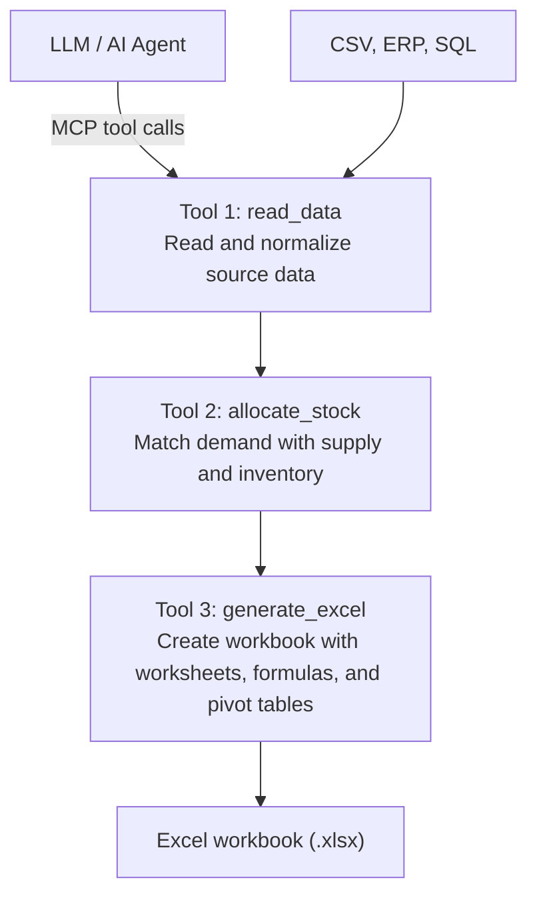

# **Logistics MCP Tool Implementation Plan**

[https://gemini.google.com/app/35fe407cba5ec134](https://gemini.google.com/app/35fe407cba5ec134)

## **Project Review and Stack Decision**

The recommendations in this section are based on the current repository and are the source of truth for implementation. The rest of this document contains earlier exploratory examples; some of those examples do not match the project.

### **What the Project Uses Today**

* The Gradle build exposes `stock-service` and `stock-client` projects, targeting Java 21. They map to the `stockio-service/` and `api/` directories.
* Spring Boot is configured at version 3.5.10, and the Spring AI BOM is 1.1.2.
* Both projects use Kotlin 2.2.20. The server uses `spring-ai-starter-mcp-server`, Spring AI `@Tool` methods, MCP STDIO transport, and a local Spring MVC REST API.
* The server now implements logistics allocation, persisted allocation runs and backorders, PostgreSQL/Flyway storage, and Excel report generation. The client is a sample MCP client.
* The server exposes `calculate_allocation`, `fulfill_open_backorders`, `process_daily_stock`, and `generate_excel_report`.
* Configuration is consolidated into `application.yml` in each module. The server routes logs to stderr so STDIO MCP messages remain on stdout.

### **Chosen Stack for the Logistics MCP**

| Area | Decision | Reason |
| :---- | :---- | :---- |
| Language | Kotlin 2.2.20 on the Java 21 toolchain | The project has been converted to Kotlin while retaining Java 21 compatibility with the existing Spring Boot and Spring AI setup. |
| Framework and MCP | Keep Spring Boot 3.5.10 and Spring AI 1.1.2; use the existing MCP server starter and `@Tool` pattern | These are already configured and working in the server module. Keep Spring AI versions managed by the existing BOM. |
| Build and modules | Keep the Gradle Groovy multi-project build; implement logistics tools in `stock-service` and retain `stock-client` only as a sample/integration client | The application code is Kotlin; retaining Groovy build scripts avoids an unrelated build DSL migration. Copilot itself is the production MCP client. |
| Transport | Use STDIO for the local Copilot MCP server | This matches the current non-web server configuration. Do not switch to the old SSE example below unless a remote HTTP deployment is actually required. |
| Database and migrations | PostgreSQL with Spring Data JPA and Flyway | Persist allocation runs, source details, open backorders, lot-level live stock, order reservations, daily snapshots, and stock-ledger transaction IDs. |
| Excel | Apache POI (`poi-ooxml`) | Generate the `.xlsx` report from deterministic allocation results. |
| Validation and tests | Spring Boot validation, Spring Boot Test, and Testcontainers for PostgreSQL integration tests | Validate tool inputs and test application behavior and real database migrations without depending on a developer's local database. |

The dependencies for this stack are already configured in the root Gradle build and `stock-service` project. Keep Spring AI version management on the existing BOM.

The allocation service applies the selected rules: lower numeric priority first, then FIFO by order placed date; ties preserve payload order. Inventory lots are consumed FIFO by received date and lot ID. Inbound shipments are consumed by expected arrival date and shipment ID, and only if they arrive on or before the order's required delivery date. Orders may be partially allocated; any remainder is stored as an open backorder and can be fulfilled by a later call. Backorder fulfillment uses only inbound shipments that have arrived by `asOfDate` and are eligible for that order's required delivery date.

Each allocation and fulfillment request requires a UUID `requestId`. Retrying the same request ID with the same payload returns its existing run; reusing it with a different payload or operation is rejected. An order ID already processed by an earlier allocation cannot be submitted as new demand again; use the backorder fulfillment tool for outstanding quantities.

`calculate_allocation` and `fulfill_open_backorders` use persisted, lot-level live stock and reserve inventory quantities transactionally in FIFO order. Inbound shipments are persisted, so unreceived, unreserved quantities remain available to later allocation calls. Each allocation run rebuilds aggregate and per-lot daily snapshots from today forward. Allocated quantities reduce physical stock on `requiredDeliveryDate`; backorders contribute to shortage without reducing physical stock. `process_daily_stock` accepts today's `snapshotDate` and synchronizes the saved lot-level closing balances to live stock. It also removes due stock reservations and converts arrived inbound reservations to stock reservations.

The REST endpoint `POST /api/logistics/allocate-and-sync` accepts an `AllocationRequest`, runs allocation followed by today's stock synchronization in one transaction, and returns both results. The API listens on `127.0.0.1:8080` by default; `SERVER_ADDRESS` and `SERVER_PORT` override the bind address and port.

`generate_excel_report` creates an `.xlsx` workbook under `~/itzitzo-mcp/reports` by default, with allocation details, source allocations, native Excel pivot tables, and a `Formula Summary` worksheet. The formula summary groups by SKU and allocation status and uses `SUMIFS` worksheet formulas for requested quantity, inventory allocation, inbound allocation, and backordered quantity. Set `REPORT_DIR` to override the output directory. Reports are generated from persisted allocation runs.

**Alignment note:** The Kotlin examples later in this document are historical proposals, not authoritative implementation code: they use older Spring Boot/Spring AI versions and dependency/API names (including `spring-ai-mcp-server-boot-starter` and `@McpTool`) that do not match the current build. Follow the Kotlin 2.2.20 / Java 21 / Spring AI 1.1.2 decisions and the current tool contracts above.

*User prompt: The goal of the logistics assignment is to link demand, supply, and inventory. I want to use an agentic MCP tool that ultimately generates an Excel file with pivot tables, etc. What is the implementation plan?*

**Response:** To have an AI agent (via **Model Context Protocol / MCP**) automatically link demand, supply, and inventory and process them into a complete Excel file with pivot tables, you need a structured **implementation plan**.

The idea behind the MCP architecture is that the agent does not "guess" the complex logic itself, but calls **MCP tools** that read source data, perform the logistics allocation (e.g., using Python), and then generate a dynamic Excel workbook (.xlsx) with advanced formatting and pivot tables.

## **Architecture & Conceptual Model**

## **Step-by-Step Implementation Plan**

**1. Phase 1: Architecture & MCP Server Setup**

Establish the foundation for the toolset.

Set up a dedicated MCP server (for example, using the Python MCP SDK or Node.js/TypeScript) that exposes logistics functions as tools for the agent.

* **Set up the environment:** Create a Python environment with libraries such as mcp, pandas, openpyxl, and win32com (if you want to enforce native Excel pivot tables on Windows), or use advanced Python Excel-generation scripts.  
* **Define MCP interfaces:** Create clear tool definitions with structured schemas (JSON Schema), so the LLM knows exactly how data should be submitted and requested.

**2. Phase 2: Normalize and Read Data Sources**

MCP Tool 1: read_supply_demand_data

Build an MCP tool that accepts source data (CSV, Excel sheets, ERP exports, or database dumps) and converts it to a standard data structure.

* **Demand:** Orders/customers, item number (SKU), required quantities, desired delivery date, and priority.  
* **Supply/Inbound:** Incoming shipments/purchase orders, SKU, expected receipt date, and supplier.  
* **Inventory (Stock):** Current available inventory per SKU, location, and any shelf-life or batch/lot restrictions.

**3. Phase 3: Logistics Matching & Allocation Engine**

MCP Tool 2: execute_inventory_matching

Develop the core logic in a Python script that the MCP agent calls to perform the allocation calculation.

* **Implement allocation rules:**  
  1. *Direct inventory allocation:* Match immediate demand to available inventory (FIFO/FEFO or priority).  
  2. *Supply/inbound matching:* Match remaining demand to incoming orders based on their expected delivery dates.  
  3. *Shortages and backorders:* Identify shortages and assign a status (*Allocated*, *In Transit*, *Shortage/Backorder*).  
* **DataFrame transformation:** Generate a consolidated table in which each demand line is linked to the specific inventory or supply source.

**4. Phase 4: Excel Generation & Pivot Tables**

MCP Tool 3: generate_excel_dashboard

Develop an MCP tool that converts the resulting data model into a polished .xlsx file with multiple worksheets and pivot tables.

* **Worksheet 1 - Overview / KPI Dashboard:** Key statistics (allocation %, total shortage, service level).  
* **Worksheet 2 - Matched Data Details:** The complete linked master data (demand + supply + inventory + status).  
* **Worksheet 3 - Pivot Tables:**  
  * *Pivot 1:* Inventory coverage per SKU (demand vs. current inventory vs. inbound supply).  
  * *Pivot 2:* Shortage analysis by customer/region or date.  
  * *Pivot 3:* Timeline/run rate of inventory movement over time.

**5. Phase 5: Validation, Agent Prompting & Workflow Automation**

Final checks and agent orchestration.

Connect the MCP server to your AI agent interface (such as Claude Desktop, Cursor, or a custom UI) and refine the instructions.

* **System prompt for the agent:** Instruct the agent to perform the steps automatically: Read sources -> Run allocation -> Generate Excel -> Report a summary.  
* **Error handling:** Add validation for missing SKUs, inconsistent date formats, and invalid quantities.

## **Technical Details of the MCP Tools**

An overview of how the MCP server's three core tools work together:

| MCP Tool Name | Input | Functionality / Logic | Output |
| :---- | :---- | :---- | :---- |
| parse_logistics_inputs | Paths to CSV/Excel files | Validates columns and aligns SKUs and dates. | Parsed and standardized JSON/DataFrames. |
| run_allocation_algorithm | Demand, supply, and inventory data | Calculates surpluses and shortages and applies matching rules. | Consolidated allocation table. |
| generate_pivoted_excel | Allocation table + output path | Builds worksheets, styles, formulas, and pivot tables using openpyxl/win32com. | .xlsx file with pivot tables saved to disk. |

## **Considerations for Excel Pivot Tables via Python/MCP**

> 1. **Native pivot tables with Python:**  
   * The openpyxl library can create basic pivot tables, but Excel must refresh the cache when the file is opened.  
   * If you run the MCP server on a Windows machine/VM, you can use Python win32com (Excel Application Automation) to generate fully featured, immediately usable Excel pivot tables and charts (Pivot Charts).  
> 2. **Dynamic formulas:**  
   * Add calculated columns to the master data (such as =DEMAND - SUPPLY) so that the Excel pivot tables automatically adapt when the user changes the data.

---

*User prompt: Is this also feasible with Kotlin and Spring Boot AI?*

**Response:** Yes, this is **very feasible** with **Kotlin** and **Spring AI** (or Spring Boot combined with the official MCP Java SDK).

This fits very naturally into the Spring ecosystem. While Python is often used for quick data science scripts, the JVM stack with Kotlin offers many benefits in type safety, maintainability, strong concurrency (with coroutines or virtual threads), and seamless integration with enterprise systems.

## **What Does the Architecture Look Like with Kotlin & Spring AI?**

Spring AI provides built-in support for the **Model Context Protocol (MCP)**. You can use it to easily set up a Spring Boot application as an **MCP server** that exposes *tools* to an LLM client (such as Claude Desktop, Continue, VS Code/Cursor, or your own Spring AI client).

+---------------------------------------------------------------------------------------+  
|                                    AI Agent Client                                    |  
|                   (Claude Desktop, Cursor / VS Code, or Spring AI Client)              |
+---------------------------------------------------------------------------------------+  
                                            |  
                                (MCP Protocol / SSE / Stdio)  
                                            v  
+---------------------------------------------------------------------------------------+  
|                        Spring Boot Application (MCP Server)                           |  
|                                                                                       |  
|  @McpTool                               @McpTool                  @McpTool            |  
|  parseLogisticsData()                   runAllocation()           generateExcel()     |  
+---------------------------------------------------------------------------------------+  
                                            |  
                         +------------------+------------------+  
                         |                                     |  
                         v                                     v  
         [ Kotlin Domain & Service Logic ]             [ Apache POI Engine ]  
         - Matching Algorithm (FIFO/FEFO)              - XLSX generation  
         - Stock Allocation Engine                     - Pivot tables & styling

## **Why Kotlin + Spring Boot AI Is a Strong Fit**

> 1. **Type safety and data classes:** Kotlin data classes let you define your domain models (such as DemandOrder, SupplyShipment, StockItem, and AllocationResult) concisely and reliably.  
> 2. **Spring AI @McpTool annotations:** A single annotation turns a Kotlin service function into an MCP tool. Spring AI automatically generates the required JSON Schema based on your Kotlin types and parameter documentation.  
> 3. **Robust Excel generation:** With **Apache POI** (or the Kotlin DSL wrappers kpoi/excel-kt), you have full control on the JVM over creating .xlsx files, including styles, formulas, multiple worksheets, and pivot tables.

## **Concrete Implementation: Step by Step**

### **1. Spring AI MCP Server Dependencies (build.gradle.kts)**

dependencies {  
    implementation("org.springframework.ai:spring-ai-mcp-server-boot-starter:1.0.0-M2") // Spring AI MCP Starter  
    implementation("org.apache.poi:poi-ooxml:5.2.5")                                    // Excel generation  
    implementation("com.fasterxml.jackson.module:jackson-module-kotlin")  
}

### **2. Kotlin Domain Models**

data class StockItem(  
    val sku: String,  
    val description: String,  
    val availableQuantity: Int,  
    val warehouseLocation: String  
)

data class DemandOrder(  
    val orderId: String,  
    val customer: String,  
    val sku: String,  
    val requestedQuantity: Int,  
    val priority: Int  
)

data class AllocationRecord(  
    val orderId: String,  
    val customer: String,  
    val sku: String,  
    val requested: Int,  
    val allocatedFromStock: Int,  
    val allocatedFromSupply: Int,  
    val shortage: Int,  
    val status: String  
)

### **3. Defining the MCP Tools**

With Spring AI, you create Spring @Service or @Component beans with methods annotated as MCP tools.

import org.springframework.ai.mcp.annotation.McpTool  
import org.springframework.stereotype.Service  
import java.io.File

@Service  
class LogisticsMcpService(  
    private val allocationEngine: AllocationEngine,  
    private val excelGenerator: ExcelReportGenerator  
) {

    @McpTool(description = "Performs logistics matching/allocation across demand, supply, and inventory")  
    fun runAllocation(  
        stockList: List<StockItem>,  
        demandList: List<DemandOrder>  
    ): List<AllocationRecord> {  
        return allocationEngine.match(stockList, demandList)  
    }

    @McpTool(description = "Generates an Excel workbook (.xlsx) with summary worksheets and pivot tables")  
    fun generateExcelReport(  
        allocations: List<AllocationRecord>,  
        outputPath: String  
    ): String {  
        val file = File(outputPath)  
        excelGenerator.writeToExcel(allocations, file)  
        return "Excel file successfully generated at: ${file.absolutePath}"  
    }  
}

### **4. Creating Excel Files and Pivot Tables with Apache POI (Kotlin)**

Apache POI makes it straightforward to build complex workbooks and add pivot tables:

import org.apache.poi.ss.SpreadsheetVersion  
import org.apache.poi.ss.util.AreaReference  
import org.apache.poi.ss.util.CellReference  
import org.apache.poi.xssf.usermodel.XSSFWorkbook  
import java.io.File  
import java.io.FileOutputStream

@Service  
class ExcelReportGenerator {

    fun writeToExcel(allocations: List<AllocationRecord>, outputFile: File) {  
        XSSFWorkbook().use { workbook ->  
            // 1. Data worksheet  
            val dataSheet = workbook.createSheet("Allocation Data")  
              
            // Write headers  
            val headerRow = dataSheet.createRow(0)  
            val headers = listOf("OrderId", "Customer", "SKU", "Requested", "AllocatedStock", "Shortage", "Status")  
            headers.forEachIndexed { i, h -> headerRow.createCell(i).setCellValue(h) }

            // Write rows  
            allocations.forEachIndexed { rowIndex, record ->  
                val row = dataSheet.createRow(rowIndex + 1)  
                row.createCell(0).setCellValue(record.orderId)  
                row.createCell(1).setCellValue(record.customer)  
                row.createCell(2).setCellValue(record.sku)  
                row.createCell(3).setCellValue(record.requested.toDouble())  
                row.createCell(4).setCellValue(record.allocatedFromStock.toDouble())  
                row.createCell(5).setCellValue(record.shortage.toDouble())  
                row.createCell(6).setCellValue(record.status)  
            }

            // 2. Create pivot table worksheet  
            val pivotSheet = workbook.createSheet("Pivot Analysis")  
            val sourceRange = AreaReference("A1:G${allocations.size + 1}", SpreadsheetVersion.EXCEL2007)  
            val position = CellReference("A3")

            // Anchor the pivot table to the master data  
            val pivotTable = pivotSheet.createPivotTable(sourceRange, position, dataSheet)

            // Configure row labels and values  
            pivotTable.addRowLabel(2) // SKU as row label  
            pivotTable.addRowLabel(6) // Status as secondary row label  
            pivotTable.addColumnLabel(org.apache.poi.ss.usermodel.DataConsolidateFunction.SUM, 3, "Total Requested")  
            pivotTable.addColumnLabel(org.apache.poi.ss.usermodel.DataConsolidateFunction.SUM, 5, "Total Shortage")

            // Save  
            FileOutputStream(outputFile).use { out -> workbook.write(out) }  
        }  
    }  
}

## **Recommended Approach for the Kotlin Stack**

| Component | Kotlin / Spring Ecosystem Choice | Why? |
| :---- | :---- | :---- |
| **Framework** | Spring Boot 3.x + Kotlin | Excellent tooling, Spring AI support, and enterprise readiness. |
| **MCP Library** | spring-ai-mcp-server-boot-starter | Official Spring AI starter for protocol handling (stdio/SSE). |
| **Excel Generation** | Apache POI (poi-ooxml) | The de facto JVM standard for native pivot tables and formatting. |
| **Data Normalization** | Kotlin Serialization / Jackson | Type-safe processing of source JSON/CSV data. |

The advantage of this approach over Python is that you can deploy it directly as a robust, production-ready microservice within an existing Spring Cloud or Kubernetes environment, while your AI agent (such as Claude Desktop or a Spring AI orchestrator) calls the MCP tools.

---

*User prompt: Provide a complete Spring Boot Kotlin Gradle configuration and project structure for the MCP server.*

**Response:** Here is a complete, production-ready **Spring Boot 3.x + Kotlin** project setup for the **Logistics Allocation MCP Server**.

This project uses Kotlin, Gradle (KTS), **Spring AI MCP Server**, and **Apache POI** to read logistics data (demand, supply, inventory) via the Model Context Protocol (STDIO or SSE), perform allocation/matching, and generate a formatted Excel file with pivot tables.

### **📂 Project Structure**

logistics-mcp-server/  
├── build.gradle.kts  
├── settings.gradle.kts  
├── gradle.properties  
└── src/  
    └── main/  
        ├── kotlin/  
        │   └── com/  
        │       example/  
        │       └── logisticsmcp/  
        │           ├── LogisticsMcpApplication.kt  
        │           ├── domain/  
        │           │   └── Models.kt  
        │           ├── service/  
        │           │   ├── AllocationEngineService.kt  
        │           │   └── ExcelReportGeneratorService.kt  
        │           └── mcp/  
        │               └── LogisticsMcpTools.kt  
        └── resources/  
            └── application.yml

### **📄 build.gradle.kts**

plugins {  
    id("org.springframework.boot") version "3.3.4"  
    id("io.spring.dependency-management") version "1.1.6"  
    kotlin("jvm") version "1.9.25"  
    kotlin("plugin.spring") version "1.9.25"  
}

group = "com.example"  
version = "0.0.1-SNAPSHOT"  
java.sourceCompatibility = JavaVersion.VERSION_21

repositories {  
    mavenCentral()  
    maven { url = uri("https://repo.spring.io/milestone") }  
}

extra["springAiVersion"] = "1.0.0-M2"

dependencies {  
    // Kotlin Extensions & Standard Library  
    implementation("org.jetbrains.kotlin:kotlin-reflect")  
    implementation("org.jetbrains.kotlin:kotlin-stdlib-jdk8")  
    implementation("com.fasterxml.jackson.module:jackson-module-kotlin")

    // Spring AI MCP Server Starter  
    implementation("org.springframework.ai:spring-ai-mcp-server-boot-starter")

    // Apache POI for Excel (.xlsx) & Pivot Tables  
    implementation("org.apache.poi:poi-ooxml:5.2.5")

    // Logging & Utilities  
    implementation("org.slf4j:slf4j-api")  
    testImplementation("org.springframework.boot:spring-boot-starter-test")  
}

dependencyManagement {  
    imports {  
        mavenBom("org.springframework.ai:spring-ai-bom:${property("springAiVersion")}")  
    }  
}

tasks.withType<org.jetbrains.kotlin.gradle.tasks.KotlinCompile> {  
    kotlinOptions {  
        freeCompilerArgs = listOf("-Xjsr305=strict")  
        jvmTarget = "21"  
    }  
}

tasks.withType<Test> {  
    useJUnitPlatform()  
}

### **📄 settings.gradle.kts & application.yml**

**settings.gradle.kts**

rootProject.name = "logistics-mcp-server"

**src/main/resources/application.yml**

spring:  
  application:  
    name: logistics-mcp-server  
  ai:  
    mcp:  
      server:  
        name: logistics-allocation-server  
        version: 1.0.0  
        # Transport choice: STDIO (for CLI tools/Claude Desktop) or ASYNC_STDIO / SSE  
        transport: STDIO

logging:  
  level:  
    root: INFO  
    org.springframework.ai.mcp: DEBUG

### **📄 LogisticsMcpApplication.kt**

package com.example.logisticsmcp

import org.springframework.boot.autoconfigure.SpringBootApplication  
import org.springframework.boot.runApplication

@SpringBootApplication  
class LogisticsMcpApplication

fun main(args: Array<String>) {  
    runApplication<LogisticsMcpApplication>(*args)  
}

### **📄 domain/Models.kt**

package com.example.logisticsmcp.domain

import java.time.LocalDate

data class StockItem(  
    val sku: String,  
    val description: String,  
    val availableQuantity: Int,  
    val warehouseLocation: String  
)

data class DemandOrder(  
    val orderId: String,  
    val customer: String,  
    val sku: String,  
    val requestedQuantity: Int,  
    val dueDate: LocalDate = LocalDate.now(),  
    val priority: Int = 1  
)

data class SupplyShipment(  
    val shipmentId: String,  
    val sku: String,  
    val expectedQuantity: Int,  
    val arrivalDate: LocalDate  
)

enum class AllocationStatus {  
    ALLOCATED_FROM_STOCK,  
    ALLOCATED_FROM_SUPPLY,  
    PARTIALLY_ALLOCATED,  
    SHORTAGE  
}

data class AllocationRecord(  
    val orderId: String,  
    val customer: String,  
    val sku: String,  
    val requestedQuantity: Int,  
    val allocatedFromStock: Int,  
    val allocatedFromSupply: Int,  
    val shortageQuantity: Int,  
    val status: AllocationStatus  
)

data class AllocationRequest(  
    val stockItems: List<StockItem>,  
    val demandOrders: List<DemandOrder>,  
    val supplyShipments: List<SupplyShipment> = emptyList()  
)

### **📄 service/AllocationEngineService.kt**

package com.example.logisticsmcp.service

import com.example.logisticsmcp.domain.*  
import org.springframework.stereotype.Service  
import kotlin.math.min

@Service  
class AllocationEngineService {

    /**  
     * Runs the allocation logic: first match against current inventory,  
     * then match the remaining demand against expected incoming shipments.  
     */  
    fun processAllocation(request: AllocationRequest): List<AllocationRecord> {  
        val stockMap = request.stockItems.groupBy { it.sku }  
            .mapValues { (_, items) -> items.sumOf { it.availableQuantity } }  
            .toMutableMap()

        val supplyMap = request.supplyShipments.groupBy { it.sku }  
            .mapValues { (_, items) -> items.sumOf { it.expectedQuantity } }  
            .toMutableMap()

        // Sort orders by priority (lower number = higher priority), then by due date  
        val sortedOrders = request.demandOrders.sortedWith(  
            compareBy<DemandOrder> { it.priority }.thenBy { it.dueDate }  
        )

        return sortedOrders.map { order ->  
            val sku = order.sku  
            var remaining = order.requestedQuantity

            // 1. Match against available inventory  
            val stockAvail = stockMap.getOrDefault(sku, 0)  
            val fromStock = min(remaining, stockAvail)  
            stockMap[sku] = stockAvail - fromStock  
            remaining -= fromStock

            // 2. Match against inbound supply (shipments)  
            val supplyAvail = supplyMap.getOrDefault(sku, 0)  
            val fromSupply = min(remaining, supplyAvail)  
            supplyMap[sku] = supplyAvail - fromSupply  
            remaining -= fromSupply

            // 3. Determine the status  
            val status = when {  
                remaining == 0 && fromSupply == 0 -> AllocationStatus.ALLOCATED_FROM_STOCK  
                remaining == 0 -> AllocationStatus.ALLOCATED_FROM_SUPPLY  
                fromStock > 0 || fromSupply > 0 -> AllocationStatus.PARTIALLY_ALLOCATED  
                else -> AllocationStatus.SHORTAGE  
            }

            AllocationRecord(  
                orderId = order.orderId,  
                customer = order.customer,  
                sku = order.sku,  
                requestedQuantity = order.requestedQuantity,  
                allocatedFromStock = fromStock,  
                allocatedFromSupply = fromSupply,  
                shortageQuantity = remaining,  
                status = status  
            )  
        }  
    }  
}

### **📄 service/ExcelReportGeneratorService.kt**

package com.example.logisticsmcp.service

import com.example.logisticsmcp.domain.AllocationRecord  
import org.apache.poi.ss.SpreadsheetVersion  
import org.apache.poi.ss.usermodel.DataConsolidateFunction  
import org.apache.poi.ss.util.AreaReference  
import org.apache.poi.ss.util.CellReference  
import org.apache.poi.xssf.usermodel.XSSFWorkbook  
import org.springframework.stereotype.Service  
import java.io.File  
import java.io.FileOutputStream

@Service  
class ExcelReportGeneratorService {

    fun generateWorkbook(allocations: List<AllocationRecord>, outputPath: String): String {  
        val outputFile = File(outputPath)  
        outputFile.parentFile?.mkdirs()

        XSSFWorkbook().use { workbook ->  
            // 1. Data Sheet  
            val dataSheet = workbook.createSheet("Allocation Data")  
            val headers = listOf("OrderId", "Customer", "SKU", "Requested", "FromStock", "FromSupply", "Shortage", "Status")  
              
            val headerRow = dataSheet.createRow(0)  
            headers.forEachIndexed { col, text ->  
                headerRow.createCell(col).setCellValue(text)  
            }

            allocations.forEachIndexed { rowIdx, record ->  
                val row = dataSheet.createRow(rowIdx + 1)  
                row.createCell(0).setCellValue(record.orderId)  
                row.createCell(1).setCellValue(record.customer)  
                row.createCell(2).setCellValue(record.sku)  
                row.createCell(3).setCellValue(record.requestedQuantity.toDouble())  
                row.createCell(4).setCellValue(record.allocatedFromStock.toDouble())  
                row.createCell(5).setCellValue(record.allocatedFromSupply.toDouble())  
                row.createCell(6).setCellValue(record.shortageQuantity.toDouble())  
                row.createCell(7).setCellValue(record.status.name)  
            }

            // Auto-size columns  
            headers.indices.forEach { dataSheet.autoSizeColumn(it) }

            // 2. Pivot table worksheet  
            if (allocations.isNotEmpty()) {  
                val pivotSheet = workbook.createSheet("Pivot Analysis")  
                val lastRow = allocations.size + 1  
                val sourceRange = AreaReference("A1:H$lastRow", SpreadsheetVersion.EXCEL2007)  
                val pivotPosition = CellReference("A3")

                val pivotTable = pivotSheet.createPivotTable(sourceRange, pivotPosition, dataSheet)

                // Pivot table layout:  
                // Row 1: SKU  
                // Row 2: Status  
                pivotTable.addRowLabel(2) // SKU  
                pivotTable.addRowLabel(7) // Status  
                  
                // Values: Sum of Requested and Sum of Shortage  
                pivotTable.addColumnLabel(DataConsolidateFunction.SUM, 3, "Total Requested")  
                pivotTable.addColumnLabel(DataConsolidateFunction.SUM, 6, "Total Shortage")  
            }

            FileOutputStream(outputFile).use { out -> workbook.write(out) }  
        }

        return outputFile.absolutePath  
    }  
}

### **📄 mcp/LogisticsMcpTools.kt**

package com.example.logisticsmcp.mcp

import com.example.logisticsmcp.domain.AllocationRecord  
import com.example.logisticsmcp.domain.AllocationRequest  
import com.example.logisticsmcp.service.AllocationEngineService  
import com.example.logisticsmcp.service.ExcelReportGeneratorService  
import org.springframework.ai.mcp.annotation.McpTool  
import org.springframework.stereotype.Component

@Component  
class LogisticsMcpTools(  
    private val allocationEngine: AllocationEngineService,  
    private val excelGenerator: ExcelReportGeneratorService  
) {

    @McpTool(  
        description = "Calculates the allocation and matching of demand (orders), supply (shipments), and current inventory."  
    )  
    fun calculateAllocation(request: AllocationRequest): List<AllocationRecord> {  
        return allocationEngine.processAllocation(request)  
    }

    @McpTool(  
        description = "Generates a formatted Excel (.xlsx) file with allocation data and automated pivot tables."  
    )  
    fun generateExcelReport(  
        allocations: List<AllocationRecord>,  
        destinationFilePath: String  
    ): String {  
        val createdPath = excelGenerator.generateWorkbook(allocations, destinationFilePath)  
        return "Excel report successfully generated and saved at: $createdPath"  
    }  
}

### **⚙️ Integration with AI Clients (e.g., Claude Desktop)**

After building the Spring Boot application with ./gradlew bootJar, you can add the MCP server to your claude_desktop_config.json, for example:

{  
  "mcpServers": {  
    "logistics-mcp": {  
      "command": "java",  
      "args": [  
        "-jar",  
        "/path/to/project/build/libs/logistics-mcp-server-0.0.1-SNAPSHOT.jar"  
      ]  
    }  
  }  
}

---

*User prompt: And what if I want to add it to my GitHub Copilot config?*

**Response:** To add your Spring Boot Kotlin MCP server to **GitHub Copilot**, the exact configuration depends on where you use Copilot (for example, **VS Code**, **Cursor**, or the **GitHub Copilot CLI / Claude extension** via copilot-instructions.md or the new MCP integration settings).

Below are configurations for the most commonly used Copilot environments.

### **Option 1: VS Code (with the GitHub Copilot Extension)**

GitHub Copilot supports MCP servers directly through the Copilot Chat settings in VS Code (or through the mcp.json configuration file).

#### **Via mcp.json (Recommended)**

Create or open .vscode/mcp.json in your workspace (or globally in your VS Code user settings):

{  
  "mcpServers": {  
    "logistics-mcp": {  
      "command": "java",  
      "args": [  
        "-jar",  
        "${workspaceFolder}/build/libs/logistics-mcp-server-0.0.1-SNAPSHOT.jar"  
      ],  
      "env": {  
        "SPRING_PROFILES_ACTIVE": "prod"  
      }  
    }  
  }  
}

#### **Via VS Code settings.json**

To add it through the global settings:

{  
  "github.copilot.chat.mcp.servers": {  
    "logistics-mcp": {  
      "command": "java",  
      "args": [  
        "-jar",  
        "/absolute/path/to/project/build/libs/logistics-mcp-server-0.0.1-SNAPSHOT.jar"  
      ]  
    }  
  }  
}

### **Option 2: Cursor / Windsurf (with the Copilot Extension or built-in agent)**

Create or edit \~/.cursor/mcp.json (or .cursor/mcp.json in the project):

{  
  "mcpServers": {  
    "logistics-mcp": {  
      "command": "java",  
      "args": [  
        "-jar",  
        "/absolute/path/to/logistics-mcp-server/build/libs/logistics-mcp-server-0.0.1-SNAPSHOT.jar"  
      ]  
    }  
  }  
}

### **Option 3: GitHub Copilot CLI / Custom Agent Workflow**

If you use the Copilot CLI and want to run the MCP server via **SSE (Server-Sent Events)** instead of STDIO, a hybrid HTTP/SSE setup is a better fit.

#### **1. Update application.yml for SSE transport:**

spring:  
  ai:  
    mcp:  
      server:  
        name: logistics-allocation-server  
        version: 1.0.0  
        transport: SSE  
        sse:  
          port: 8080  
          path: /mcp/sse

#### **2. Start the Spring Boot application:**

./gradlew bootRun

#### **3. Add the SSE endpoint to the Copilot CLI config (\~/.github-copilot/mcp.json):**

{  
  "mcpServers": {  
    "logistics-mcp-sse": {  
      "url": "http://localhost:8080/mcp/sse"  
    }  
  }  
}

### **⚠️ Important when running Spring Boot as an STDIO MCP tool**

> 1. **Avoid unnecessary logging to stdout:** STDIO communicates through the standard input/output streams. If Spring Boot writes its ASCII banner or arbitrary System.out.println output to stdout, it will confuse the MCP JSON-RPC parser.  
>    Therefore, add the following to application.yml:  
>    spring:  
>      main:  
>        banner-mode: "off"

> 2. **Build the JAR first:** Make sure the latest JAR has been built before Copilot starts:  
>    ./gradlew bootJar

---

*User prompt: And what kind of prompt should I use?*

**Response:** To help the agent make the best use of your Kotlin MCP tools and generate a well-allocated Excel file with pivot tables, use a **structured prompt**.

In the prompt, give the agent clear instructions about the **sequence of actions**, the **business logic**, and the desired **end result**.

Below are a few examples, depending on how you provide the data.

### **Option 1: Detailed System / Context Prompt (for Copilot Chat or your agent system prompt)**

If you want Copilot to understand exactly how to call the logistics-mcp tools for logistics-related requests, use this role instruction:

You are a Logistics & Supply Chain Agent. You have access to the `logistics-mcp` tools.

Whenever the user asks you to link demand, supply, and inventory or create an allocation report, always follow these steps:

1. **Collect and validate data:**  
   - Analyze the provided demand (orders), supply (incoming shipments), and current inventory.  
   - Check that all required fields are present (SKU, quantities, priority/dates).

2. **Run the allocation:**  
   - Call the `calculateAllocation` tool to perform logistics matching based on FIFO/priority.  
   - Check the results for shortages or backorders.

3. **Generate the Excel report:**  
   - Call the `generateExcelReport` tool with the allocation results.  
   - Save the workbook to the specified file path (e.g., `./output/Logistics_Allocation_Report.xlsx`).

4. **Report back to the user:**  
   - Provide a concise, clear text summary of the key KPIs:  
     * Total requested volume  
     * Percentage fulfilled directly from available inventory  
     * Percentage allocated from inbound supply  
     * Total shortage per SKU  
   - Confirm the exact location of the generated Excel file with pivot tables.

### **Option 2: Concrete Task Prompt (when you paste data directly into the chat)**

This is an example of a prompt you can paste directly into **GitHub Copilot Chat** (or Cursor/Claude) along with some raw data:

Use the logistics-mcp tools to link the following logistics data and process it into an Excel file.

---  
### 1. Available Inventory (Stock)  
- SKU: ELEC-001, Description: USB-C Hub, Quantity: 150, Location: A-01-02  
- SKU: ELEC-002, Description: Wireless Mouse, Quantity: 40, Location: B-03-01  
- SKU: ELEC-003, Description: Mechanical Keyboard, Quantity: 10, Location: C-02-05

### 2. Inbound Supply (Supply Shipments)  
- ShipmentId: SHIP-901, SKU: ELEC-002, Quantity: 100, Expected: 2026-10-15  
- ShipmentId: SHIP-902, SKU: ELEC-003, Quantity: 50, Expected: 2026-10-20

### 3. Demand / Orders  
- OrderId: ORD-101, Customer: TechCorp, SKU: ELEC-001, Quantity: 100, Priority: 1  
- OrderId: ORD-102, Customer: Innovate B.V., SKU: ELEC-002, Quantity: 80, Priority: 1  
- OrderId: ORD-103, Customer: RetailGroup, SKU: ELEC-002, Quantity: 50, Priority: 2  
- OrderId: ORD-104, Customer: TechCorp, SKU: ELEC-003, Quantity: 30, Priority: 1  
---

Task:  
1. Calculate the allocation using `calculateAllocation`.  
2. Generate an Excel report using `generateExcelReport` at `./reports/allocation_overview.xlsx`.  
3. Give me a brief summary in the chat of the largest shortages.

### **Option 3: Prompt Based on Files (CSV / JSON in your project)**

If your source data is already in files in your project directory:

@workspace Read the files `orders.json`, `stock.csv`, and `inbound.json` from the `./data/` directory.

Use the `logistics-mcp` tools to:  
1. Convert the data into an allocation request and call `calculateAllocation`.  
2. Generate a complete Excel dashboard with pivot tables at `./output/Demand_Supply_Matching.xlsx`.  
3. List all orders with the `SHORTAGE` status and suggest which purchase orders may need to be increased.

---
