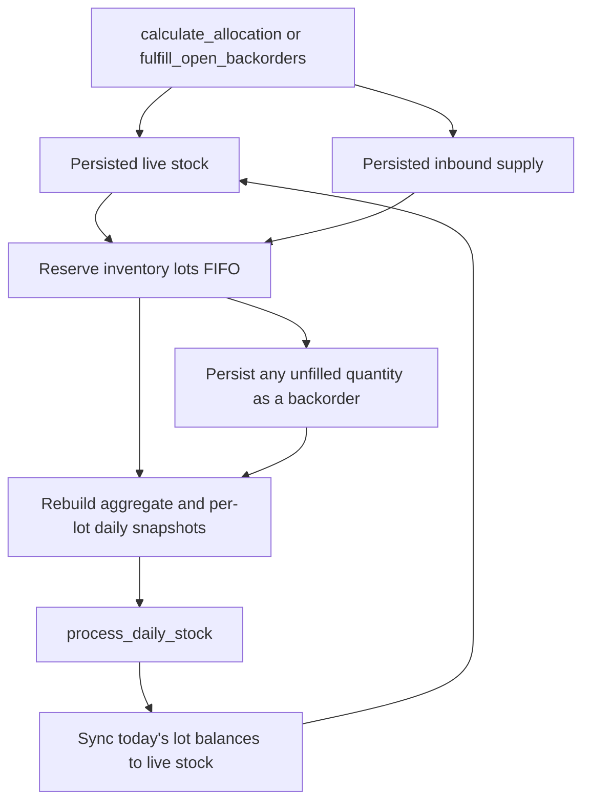

# Stock Interaction and Daily Projections

## Allocation and stock flow



Allocation persists reservations against inventory or inbound shipments and rebuilds snapshots from today forward. Previously registered, unreceived shipments are reusable by later allocation calls; their reserved quantities are excluded from available inbound supply.

## Per-order quantity flow

For live inventory, `quantity_on_hand` is the physical quantity and includes units reserved for orders. The quantity another order can use is:

```text
quantity_available = quantity_on_hand - quantity_reserved
```

Before a shipment is received, it is tracked separately as inbound supply:

```text
inbound_quantity_available = expected_quantity - quantity_reserved
```

The allocator processes orders by priority, then placed date, then request order. For each order it reserves available live inventory first and then eligible inbound supply. It does not first turn a new shipment into live stock and then allocate from it in that same run. As a result, an order fulfilled from a new shipment is reported as `allocatedFromInbound`, even if the shipment arrives that day. Any unallocated shipment balance remains available as stock after receipt.

### Worked example

Assume the request is processed on day **D**:

- Existing stock lot `LOT-A`: 5 on hand, 0 reserved, 5 available.
- New shipment `SHIP-B`: 4 units, expected to arrive on D.
- Order `ORDER-1`: 3 units due D+1.
- Order `ORDER-2`: 4 units due D+1.

The two orders are in the same allocation request, in the order shown, with equal priority and placed date.

| Order | Requested | From existing inventory | From inbound | Backordered | Remaining inventory available | Remaining inbound available |
| --- | ---: | ---: | ---: | ---: | ---: | ---: |
| `ORDER-1` | 3 | 3 | 0 | 0 | 2 | 4 |
| `ORDER-2` | 4 | 2 | 2 | 0 | 0 | 2 |

After allocation, before the shipment is received:

| Source | On hand / expected | Reserved | Available |
| --- | ---: | ---: | ---: |
| Existing stock lot `LOT-A` | 5 | 5 | 0 |
| Inbound shipment `SHIP-B` | 4 | 2 | 2 |

The existing stock is still physically 5 units; its 5 reservations are for the two orders due on D+1. The shipment has 2 units committed to `ORDER-2` and 2 units not yet committed.

When `process_daily_stock` runs on D, the arrived shipment becomes a stock lot. The live stock balances are then:

| Stock lot | On hand | Reserved for future delivery | Available |
| --- | ---: | ---: | ---: |
| `LOT-A` | 5 | 5 | 0 |
| `SHIP-B` | 4 | 2 | 2 |
| **Total** | **9** | **7** | **2** |

On D+1, when the saved snapshot for that day is synchronized, the 7 units allocated to these orders leave physical stock. The remaining live stock is 2 units on `SHIP-B`, with 0 reserved and 2 available. A later order can allocate those 2 units from inventory. It needs a new order ID; a previously processed order is not allocated a second time.

If there was no opening stock and a shipment of 5 units arrived on D for an order of 3 due on D, the allocation result would be `allocatedFromInventory = 0` and `allocatedFromInbound = 3`. After the D sync, the shipment lot would have 2 on hand, 0 reserved, and 2 available. A later new order can then consume those 2 units as inventory.

## Daily snapshot semantics

The aggregate `stock_daily_snapshots` row is keyed by date, SKU, and warehouse. Lot-level detail is stored in `stock_daily_lot_snapshots` so syncing does not lose FIFO lots or reservation information.

For each day:

```text
closing_stock = opening_stock + inbound_qty - allocated_qty
demand_qty = allocated_qty + shortage_qty
```

Successful inventory and inbound allocations reduce physical stock on their `requiredDeliveryDate`. A backordered quantity contributes to `shortage_qty` on its required delivery date, but does not reduce physical stock. The closing balance carries forward as the next day's opening balance.

The projection uses current live stock as its baseline and rebuilds today's and future snapshots when allocation changes. Existing earlier snapshots are retained; the service does not infer historical physical inventory from today's baseline.

## Synchronizing today's snapshot

`process_daily_stock` accepts only `snapshotDate`, which must be today. It does not accept stock movements or recalculate allocations. It reads the saved aggregate and lot-level snapshots, verifies that lot closing balances equal the aggregate balance, and synchronizes each lot's closing quantity and future reserved quantity to live stock.

On sync, reservations whose required delivery date is today or earlier are removed because their units have left physical stock. Inbound shipments with an expected arrival date on or before today are marked received. Their lot balances are created from the snapshot using the shipment's expected arrival date, and any remaining future inbound reservations are converted to live stock reservations. Repeating the sync is safe.

## Data responsibilities

| Table | Responsibility |
| --- | --- |
| `stock` | Current physical balance by SKU, warehouse, and lot, including quantity reserved for future delivery. |
| `stock_reservation` | Inventory quantity reserved for an order and its required delivery date. |
| `inbound_supply` | Persisted expected shipment, arrival date, and quantity already committed to orders. |
| `inbound_reservation` | Order quantities reserved against inbound shipments until receipt. |
| `stock_daily_snapshots` | Aggregate daily opening, inbound, allocated, closing, demand, and shortage quantities. |
| `stock_daily_lot_snapshots` | Per-lot daily balances and reservations required to sync live stock without losing lot identity. |

Flyway migration `V8__allocation_stock_projections.sql` adds the delivery dates, persisted inbound supply and reservations, allocated quantity, and per-lot snapshots.
